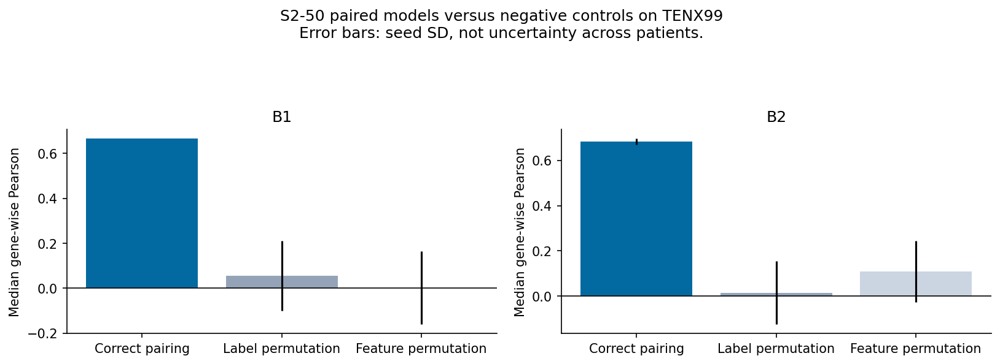
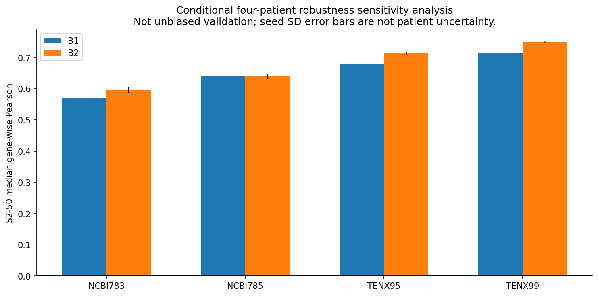
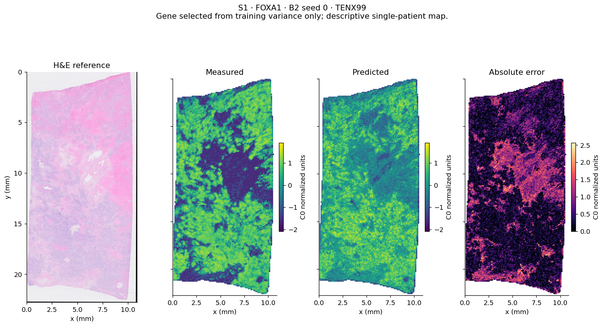

# C1 report: morphology-only spatial expression prediction

**Status: PASS_DEVELOPMENT.** The frozen generic ResNet18 features contain measurable local morphology-expression signal in this four-patient development cohort. This is not external validation or a publication-level conclusion.

C1 v2 was executed with the frozen C0 primary split: NCBI783 and NCBI785 for training (7,015 locations), TENX95 for validation (7,760), and TENX99 for final evaluation (20,761). The full cohort has 35,536 paired locations and 280 shared biological targets. The S1 target is **FOXA1**. S2-280 is the **full shared assay panel**, not the whole transcriptome.

## Primary results

All correlation summaries describe locations within the single primary test patient, TENX99. B2 values are mean ± sample standard deviation over seeds 0, 1, 2; this is training-seed variability, not patient-level uncertainty. B0 predictions are constant, so its correlations and coexpression statistic are mathematically undefined.

| Model | S1 Pearson | S2-50 median Pearson | S2-250 median Pearson | S2-280 median Pearson | S2-50 coexpression | S2-250 coexpression | S2-280 coexpression | Training time | Peak RSS |
| --- | --- | --- | --- | --- | --- | --- | --- | --- | --- |
| B0 | undefined | undefined | undefined | undefined | undefined | undefined | undefined | 0.0021 s | 704.0 MiB |
| B1 | 0.693 | 0.667 | 0.449 | 0.409 | 0.758 | 0.579 | 0.586 | 0.1176 s | 715.2 MiB |
| B2 | 0.736 ± 0.024 | 0.684 ± 0.014 | 0.511 ± 0.009 | 0.459 ± 0.022 | 0.741 ± 0.006 | 0.521 ± 0.017 | 0.513 ± 0.011 | 1.7336 ± 0.2301 s | 720.6 ± 14.6 MiB |

Training time is the sum over the four primary settings for each seed; it excludes tuning, controls, validation, inference and artifact writing. Peak RSS is the maximum sampled process RSS across those four fits, including resident data; it is not isolated model memory. CPU: Intel Core i7-14700, four computation threads. Timing can be very short because all image embeddings were already cached in C0. Per-run training/validation/inference times, parameter counts and dimensions are in [C1_RESOURCE_PROFILE.csv](C1_RESOURCE_PROFILE.csv).

### Prediction error

MSE is measured after inverting C1 target scaling, in the original frozen C0 normalized target units.

| Setting | B0 MSE | B1 MSE | B2 MSE | B2 relative MSE reduction vs B0 |
| --- | --- | --- | --- | --- |
| S1 | 0.964 | 0.528 | 0.515 ± 0.052 | 46.6% |
| S2-50 | 1.267 | 0.912 | 0.911 ± 0.010 | 28.1% |
| S2-250 | 1.188 | 0.879 | 0.859 ± 0.001 | 27.7% |
| S2-280 | 1.278 | 0.995 | 0.972 ± 0.008 | 24.0% |

Every primary B1/B2 setting and all primary B2 seeds improve mean MSE over B0. The gene-level CSV also contains Spearman, MSE, MAE, target variance and prediction variance. Summary CSVs include means, medians and every required Pearson-threshold fraction.

## Negative controls

NC1 permutes whole expression rows among training locations. NC2 permutes whole embedding rows. Both preserve validation/test data and retain within-row gene structure. Each uses seeds 0, 1, 2 with primary-selected hyperparameters; B2 early stopping still uses the unchanged validation patient. No hyperparameter grid was expanded after test access.

| Model | Condition | S2-50 median Pearson | MSE | Coexpression preservation |
| --- | --- | --- | --- | --- |
| B1 | primary | 0.667 | 0.912 | 0.758 |
| B1 | NC1 | 0.057 ± 0.156 | 1.321 ± 0.017 | 0.806 ± 0.003 |
| B1 | NC2 | 0.003 ± 0.163 | 1.391 ± 0.052 | 0.810 ± 0.002 |
| B2 | primary | 0.684 ± 0.014 | 0.911 ± 0.010 | 0.741 ± 0.006 |
| B2 | NC1 | 0.015 ± 0.140 | 1.343 ± 0.113 | 0.557 ± 0.390 |
| B2 | NC2 | 0.109 ± 0.136 | 1.266 ± 0.026 | 0.393 ± 0.336 |

The correctly paired model exceeds every individual negative-control run in median gene Pearson for both B1 and B2. Negative-control correlations are variable across three seeds and do not equal zero exactly. This is descriptive evidence, not a permutation p-value.

**Coexpression preservation alone is not evidence of spatial prediction.** Permuted Ridge models reach approximately 0.81 coexpression correlation, exceeding the paired Ridge value, while location-wise gene prediction largely collapses. Row permutation preserves target-vector covariance, which a multivariate fitted model can retain without faithful spatial prediction. The coexpression requirement is met as a descriptive structural result, but it cannot establish biological fidelity.

## Conditional four-patient robustness sensitivity analysis — not unbiased validation

Each fold trains on the other three patients, fits and saves its own feature and target scalers, and uses the already selected primary hyperparameters. B2 trains for a fixed epoch count from the primary runs, never early-stopping on the held-out fold patient. The frozen gene panels and primary-selected configuration make these estimates conditional. They are kept separate from the primary result.

| Held-out sample | B1 median Pearson | B2 median Pearson | B0 MSE | B1 MSE | B2 MSE |
| --- | --- | --- | --- | --- | --- |
| NCBI783 | 0.571 | 0.596 ± 0.010 | 1.451 | 1.218 | 1.108 ± 0.033 |
| NCBI785 | 0.641 | 0.640 ± 0.008 | 1.275 | 0.995 | 1.031 ± 0.028 |
| TENX95 | 0.680 | 0.714 ± 0.005 | 1.106 | 0.708 | 0.705 ± 0.006 |
| TENX99 | 0.713 | 0.750 ± 0.002 | 1.223 | 0.829 | 0.817 ± 0.013 |

This table shows S2-50. [C1_ROBUSTNESS_LOPO.csv](C1_ROBUSTNESS_LOPO.csv) contains all four settings and every seed/fold. Positive multi-gene signal is not confined to one patient. However, correlation and calibration differ: for S1/FOXA1 on NCBI785, both model families have positive correlation but worse mean MSE than B0; Ridge also slightly worsens S1 MSE on NCBI783. C1 therefore does not establish uniform benefit for every patient/gene.

## Gene-level predictability

Counts and fractions below use all genes in each panel as the denominator. B2 shows mean ± SD of seed-specific counts/fractions. Undefined B0 correlations are not treated as measured zero correlations.

| Panel | Model | Pearson > 0: count / fraction | > 0.1 | > 0.2 | > 0.3 |
| --- | --- | --- | --- | --- | --- |
| S2-50 | B1 | 50.0 / 100.0% | 46.0 / 92.0% | 43.0 / 86.0% | 36.0 / 72.0% |
| S2-50 | B2 | 49.0 ± 0.0 / 98.0 ± 0.0% | 47.0 ± 0.0 / 94.0 ± 0.0% | 42.3 ± 1.2 / 84.7 ± 2.3% | 37.7 ± 0.6 / 75.3 ± 1.2% |
| S2-250 | B1 | 246.0 / 98.4% | 231.0 / 92.4% | 201.0 / 80.4% | 163.0 / 65.2% |
| S2-250 | B2 | 248.3 ± 1.2 / 99.3 ± 0.5% | 238.3 ± 1.5 / 95.3 ± 0.6% | 212.0 ± 2.6 / 84.8 ± 1.1% | 179.7 ± 3.1 / 71.9 ± 1.2% |
| S2-280 | B1 | 275.0 / 98.2% | 252.0 / 90.0% | 213.0 / 76.1% | 172.0 / 61.4% |
| S2-280 | B2 | 275.3 ± 2.9 / 98.3 ± 1.0% | 260.3 ± 3.5 / 93.0 ± 1.3% | 220.7 ± 4.2 / 78.8 ± 1.5% | 185.3 ± 8.3 / 66.2 ± 3.0% |

The following rankings use mean Pearson across B2 seeds on the primary test patient and are **descriptive only**. They were not used to select models, panels or map genes. Equivalent B1 lists and seed SDs are in [C1_GENE_RANKINGS.csv](C1_GENE_RANKINGS.csv).

- **S2-50, B2 top10:** CD9 (0.826), NARS (0.818), KRT8 (0.808), TPD52 (0.800), TRAF4 (0.793), JUP (0.781), MYO5B (0.780), TFAP2A (0.780), DSP (0.778), TACSTD2 (0.764).
- **S2-50, B2 bottom10:** SFRP1 (-0.004), PDK4 (0.044), KRT5 (0.070), MYH11 (0.143), SFRP4 (0.164), PTGDS (0.165), ANKRD30A (0.169), IL7R (0.197), KRT14 (0.222), TRAC (0.237).
- **S2-250, B2 top10:** CCDC6 (0.822), LARS (0.819), OCIAD2 (0.819), FLNB (0.816), NARS (0.815), TRAPPC3 (0.811), CD9 (0.810), SEC24A (0.809), SMS (0.806), KARS (0.805).
- **S2-250, B2 bottom10:** ADH1B (-0.135), TAC1 (0.001), SFRP1 (0.015), ADIPOQ (0.027), KRT6B (0.057), OPRPN (0.060), CCL8 (0.061), PDK4 (0.074), KRT5 (0.079), IL2RA (0.084).
- **S2-280, B2 top10:** OCIAD2 (0.820), CD9 (0.819), CCDC6 (0.819), NARS (0.814), FLNB (0.811), ZNF562 (0.811), TRAPPC3 (0.809), KRT8 (0.808), LARS (0.806), SEC24A (0.806).
- **S2-280, B2 bottom10:** ADH1B (-0.168), ADIPOQ (-0.102), TAC1 (-0.008), CCL8 (0.001), SFRP1 (0.012), CXCL5 (0.034), OPRPN (0.044), KRT6B (0.058), PDK4 (0.066), KRT5 (0.067).

Histograms and target-variance/Pearson scatterplots are in `figures/*_gene_predictability.png`. Predictability is heterogeneous and some genes have near-zero or negative correlations. No pathway or biological explanation claims are made.

## Spatial-map audit

Map genes were frozen before primary test access using training log-count variance within each panel: S1 FOXA1; S2-50 FOXA1/LUM/CCDC80; S2-250 FOXA1/MRC1/KLRF1; S2-280 FOXA1/IGSF6/UCP1. Seed 0 is the predetermined visualization seed. Every map uses identical coordinate limits and extent for H&E, measured, predicted and absolute-error panels; measured/predicted expression share color limits.

The inspected FOXA1 and LUM maps show nonconstant spatial variation, including broad correspondence, but understate some regional expression contrasts. The low-variance UCP1 example shows that weak sparse signals are not recovered well. Error maps expose regional failures rather than hiding them. Thumbnail H&E does not validate cell-level registration. Coexpression heatmaps use the same frozen ordering for measured, predicted and difference matrices.

## Frozen model choices and preprocessing

| Setting | Ridge alpha | MLP hidden width | Dropout | Fixed LOPO epochs |
| --- | --- | --- | --- | --- |
| S1 | 100 | 128 | 0.0 | 14 |
| S2-50 | 100 | 128 | 0.1 | 14 |
| S2-250 | 100 | 256 | 0.0 | 7 |
| S2-280 | 100 | 256 | 0.1 | 8 |

Ridge selected alpha 100, the upper boundary of the predefined grid, in all settings. The grid was not extended after test evaluation. MLP tuning comprised only the four specified width/dropout combinations with seed 0, chosen by validation MSE. AdamW learning rate 0.001, weight decay 0.0001, batch size 512, maximum 80 epochs, patience 10 and minimum improvement 0.0001 were fixed beforehand. Primary early stopping selects the best improving validation checkpoint.

C1 scales features and targets using training-only means/standard deviations and inverts target scaling for reporting. LOPO restandardizes the unchanged C0 values using each fold-training pool. This cancels the original affine C0 shift/scale in model input targets apart from stored floating-point precision, but reporting units and frozen panel selection remain tied to C0. No C0 file, graph edge, neighbor expression, sparse mask or encoder weight was changed or used as a new C1 model input.

## Integrity and reproducibility

- 156 completed fits: 44 tuning candidates, 20 primary fits, 12 negative-control fits and 80 LOPO fits.
- 112 evaluated models; 15,125 gene-level metric rows; 268 append-only registry fit/evaluation events.
- All 20 scaler pairs recomputed from their declared training populations and verified.
- All 112 stored prediction arrays reproduced exactly by reloading model checkpoints (maximum absolute difference 0).
- All 261 frozen C0 file hashes still match. Primary test access occurred after the selection lock was written.
- Eight C1 unit tests and the 28 C0 tests pass. An initial single-target Ridge shape error was fixed before any successful candidate fit; its failure log and regression test are retained.

See [logs/INTEGRITY_AUDIT.json](logs/INTEGRITY_AUDIT.json), [C1_SPEC_LOCK.json](C1_SPEC_LOCK.json), and `C1_SPEC_LOCK.sha256`. Fitting source commit: `6c1520be27cf79e9466fb33d7da8a282f764339d`. Reporting source and all source/artifact hashes are recorded in the final lock. Large model/prediction files remain locally in this repository with recorded hashes; source, metrics, figures, scalers, logs and report are Git-versioned.

## Acceptance decision and limitations

`PASS_DEVELOPMENT` is supported by primary error improvements, substantially better paired-versus-permuted gene prediction, a nontrivial predictable gene subset, signal across all conditional LOPO patients, nonzero measured/predicted coexpression association, nonconstant spatial maps, and successful integrity/replay audits. These are checkpoint judgments; no new significance test or universal PCC cutoff is asserted.

Important limitations:

- Only four patients, with one primary test patient; locations are correlated observations, not independent biological replicates. No spot-level significance tests or population confidence intervals are reported.
- Conditional LOPO reuses frozen panels and primary-selected configurations. It is not unbiased cross-validation, independent validation, or external validation.
- The primary split also separates source studies, and assay/preparation/stain differences can confound transfer. Metadata patient grouping is inherited from HEST.
- Frozen generic ImageNet ResNet18 embeddings and simple CPU baselines were used. Encoder optimality, cell/nuclear interpretation and pathology-specific representations remain untested.
- The targeted assay supports 280 shared biological genes only; no 1,000/3,000-gene or whole-transcriptome result exists.
- C0 log-count normalization retains sequencing-depth and composition effects; correlations do not establish a mechanistic morphology-expression relation.
- Gene–gene structure can remain high under permutation controls. It is not a standalone success criterion for spatial reconstruction.
- Predictability varies across genes/patients; maps smooth or attenuate some regions, and positive correlation does not guarantee calibrated error improvement.
- Three seeds and a small fixed validation search give limited sensitivity information. Alpha selection at the grid boundary is documented, not retrospectively retuned.
- H&E thumbnail review cannot certify cell-level alignment. No biological discovery, faithful explanation, clinical utility or publication-level generalization is claimed.

## Exact recommendation for C2

**Proceed, after review, to a separately frozen C2 single-scale context comparison.** Keep the C0 embeddings, primary splits, target panels, normalization and C1 baselines unchanged. Compare local-neighborhood mean pooling plus MLP against compact single-scale GCN/GraphSAGE baselines, with graph geometry and hyperparameters chosen on validation patients only. Evaluate both correlation and error, report gene-specific contextual gains and patient dependence, and distinguish graph benefit from simple spatial averaging. Treat the results as development evidence; do not introduce S3, multiresolution fusion or biological explanations at this step.

C2 has **not** been executed. Stop at this checkpoint.
