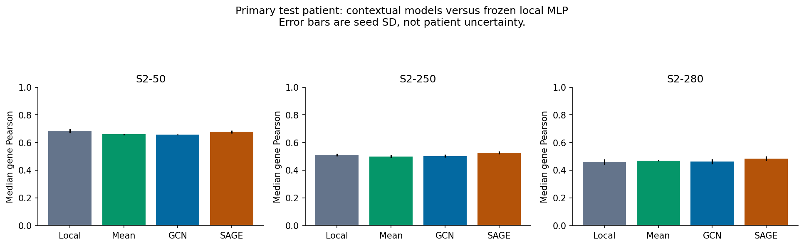
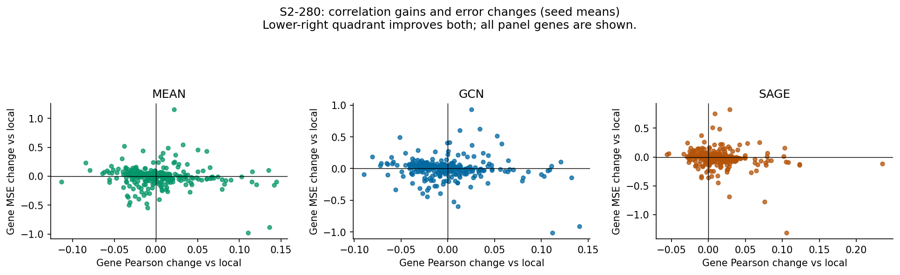
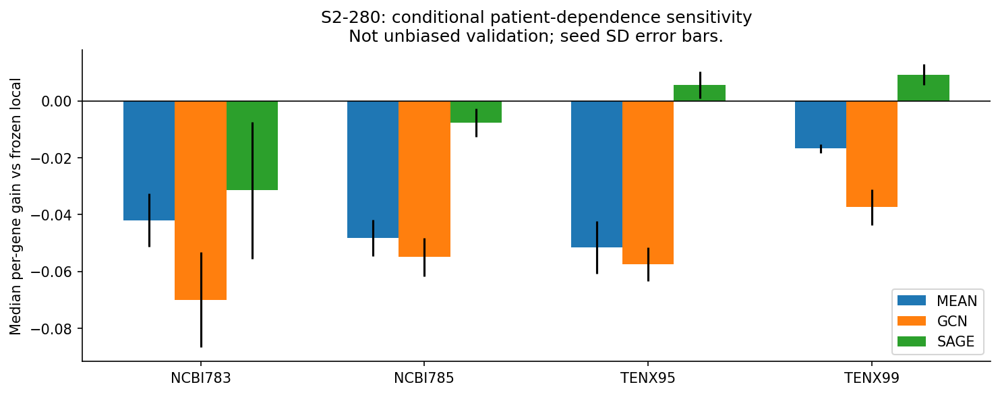
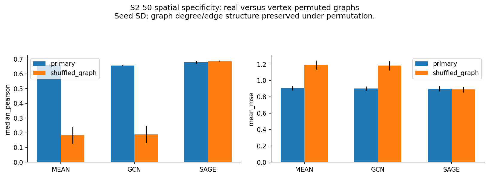
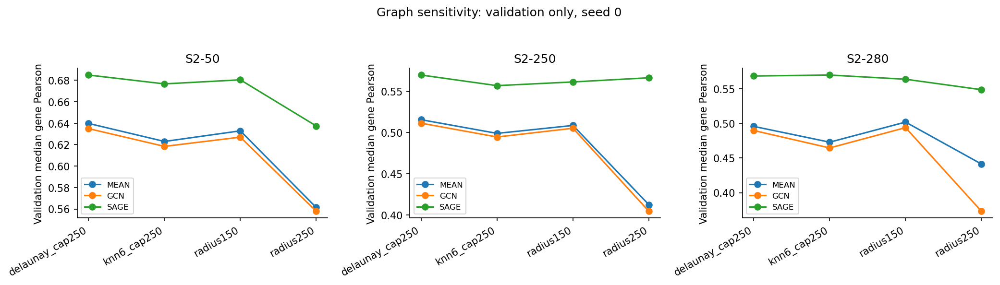
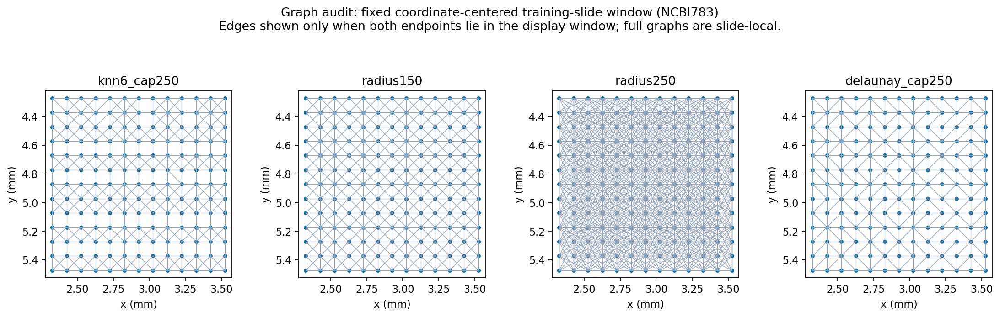

# C2 report: does single-scale spatial context add information?

**Scientific outcome: MIXED_CONTEXT_SIGNAL. Technical audit: PASS.** C2 is complete. C0 and accepted C1 remain unchanged; no C1 model was retrained, replayed or retuned. C3 has not been executed.

GraphSAGE gives modest primary-test median-correlation gains on the 250- and 280-gene settings, but not on S2-50. Per-gene gains are heterogeneous and patient-dependent. The frozen descriptive shortlist/support rule identifies **7 gene-panel results covering 6 distinct genes** (CCDC80, FBLN1, LRRC15, LUM, MMP2, SELL). These are candidates for further context-specificity checks, not established biological findings. Error disagreement and the shuffled-GraphSAGE control prevent a blanket claim that GNNs add reliable spatial information beyond local morphology and neighborhood averaging.

## Controlled design

The frozen C0 cohort, ResNet18 embeddings, split, panels and target normalization are unchanged. The primary split remains NCBI783/NCBI785 training, TENX95 validation, TENX99 test. All four settings were run: S1/FOXA1, S2-50, S2-250 and S2-280 (full shared assay panel).

The comparison is frozen local C1 B2 -> spatial MEAN + MLP -> one-layer GCN / mean-GraphSAGE. MEAN and GCN retain the corresponding C1 hidden width, dropout, direct output head, optimizer and training settings. GraphSAGE concatenates self and neighbor-mean features and reduces hidden width to match parameter count; the largest mismatch is 0.282%. Thus parameter budgets are controlled, but GraphSAGE's local/self pathway and width still differ architecturally from the frozen local baseline.

- MEAN: row-normalize A+I, aggregate image embeddings, then the C1-selected MLP.
- GCN: symmetric degree normalization of A+I, a learned linear graph convolution, GELU, frozen dropout, direct readout.
- SAGE: concatenate the local embedding with neighbor-only mean, learned linear map, GELU, frozen dropout, direct readout; isolated nodes receive a zero neighbor vector.

Precomputing aggregation of frozen embeddings is exactly equivalent to a single linear message-passing layer before the activation; a numerical equivalence test verifies this. These are shallow one-layer models, not multi-hop or multiresolution networks. The normalization/root-feature conventions follow the standard [GCN operator](https://github.com/pyg-team/pytorch_geometric/blob/master/torch_geometric/nn/conv/gcn_conv.py) and [mean GraphSAGE operator](https://pytorch-geometric.readthedocs.io/en/2.8.0/generated/torch_geometric.nn.conv.SAGEConv.html); implementation uses SciPy sparse operations and PyTorch directly.

Four predefined, undirected, slide-local graphs were compared: capped kNN k=6 (250 µm edge limit), 150 µm radius, 250 µm radius, and Delaunay with edges longer than 250 µm removed. Graphs use coordinates only. They never contain targets or cross-slide edges. Each experiment uses one graph scale. C0 physical calibration is estimated, not a biological interaction radius.

For each panel/model, graph choice uses seed-0 validation median gene Pearson, with validation MSE and graph name as tie-breaks. The architecture is not retuned. Final primary models use seeds 0, 1, 2 and the unchanged C1 training/early-stopping settings. The model-selection lock and analysis-rule lock were written before C2 test access. Since C1's test result was already known, this is a sequential development checkpoint, not a fresh untouched confirmatory study.

## Primary results: correlation and error

Values are mean ± sample SD over three seeds on **one test patient**. They are not population confidence intervals. MSE/MAE are in frozen C0 normalized units after inverting the C1 target scaler.

| Setting | Model | Median gene Pearson | Median per-gene Δ vs local | Median gene Spearman | Mean MSE | Mean MAE |
| --- | --- | --- | --- | --- | --- | --- |
| S1 | Frozen local B2 | 0.736 ± 0.024 | 0 (reference) | 0.783 ± 0.028 | 0.515 ± 0.052 | 0.545 ± 0.025 |
| S1 | MEAN | 0.778 ± 0.008 | 0.042 ± 0.025 | 0.797 ± 0.008 | 0.430 ± 0.011 | 0.508 ± 0.006 |
| S1 | GCN | 0.767 ± 0.009 | 0.031 ± 0.029 | 0.789 ± 0.007 | 0.430 ± 0.012 | 0.514 ± 0.007 |
| S1 | SAGE | 0.769 ± 0.014 | 0.033 ± 0.030 | 0.796 ± 0.012 | 0.488 ± 0.056 | 0.529 ± 0.031 |
| S2-50 | Frozen local B2 | 0.684 ± 0.014 | 0 (reference) | 0.699 ± 0.004 | 0.911 ± 0.010 | 0.763 ± 0.004 |
| S2-50 | MEAN | 0.659 ± 0.004 | -0.002 ± 0.001 | 0.651 ± 0.004 | 0.905 ± 0.027 | 0.760 ± 0.013 |
| S2-50 | GCN | 0.657 ± 0.002 | -0.005 ± 0.003 | 0.650 ± 0.003 | 0.902 ± 0.024 | 0.759 ± 0.011 |
| S2-50 | SAGE | 0.678 ± 0.010 | 0.016 ± 0.010 | 0.682 ± 0.009 | 0.898 ± 0.031 | 0.762 ± 0.016 |
| S2-250 | Frozen local B2 | 0.511 ± 0.009 | 0 (reference) | 0.456 ± 0.012 | 0.859 ± 0.001 | 0.732 ± 0.002 |
| S2-250 | MEAN | 0.499 ± 0.010 | -0.015 ± 0.005 | 0.444 ± 0.012 | 0.861 ± 0.014 | 0.731 ± 0.008 |
| S2-250 | GCN | 0.503 ± 0.011 | -0.015 ± 0.008 | 0.455 ± 0.013 | 0.867 ± 0.016 | 0.734 ± 0.009 |
| S2-250 | SAGE | 0.526 ± 0.010 | 0.005 ± 0.009 | 0.465 ± 0.019 | 0.859 ± 0.014 | 0.730 ± 0.004 |
| S2-280 | Frozen local B2 | 0.459 ± 0.022 | 0 (reference) | 0.410 ± 0.015 | 0.972 ± 0.008 | 0.754 ± 0.004 |
| S2-280 | MEAN | 0.470 ± 0.006 | -0.004 ± 0.011 | 0.424 ± 0.007 | 0.966 ± 0.016 | 0.752 ± 0.005 |
| S2-280 | GCN | 0.462 ± 0.018 | -0.007 ± 0.007 | 0.422 ± 0.015 | 0.970 ± 0.005 | 0.755 ± 0.003 |
| S2-280 | SAGE | 0.485 ± 0.017 | 0.006 ± 0.013 | 0.439 ± 0.015 | 0.957 ± 0.022 | 0.749 ± 0.010 |

**The two correlation columns answer different questions.** The main scientific quantity is Δ_g = r_g(model) − r_g(frozen local), paired by gene/patient/seed. The median of these differences is not generally the difference of median correlations. For example, S2-50 GraphSAGE has a lower aggregate median Pearson than local B2, yet its median paired gene gain is positive; gene ordering changes between predictors. Both summaries are retained.

S1 benefits on the primary test slide, especially from simple averaging. For the broader settings, most incremental changes are small, with both positive and negative gene effects. GCN does not show a consistent advantage over MEAN.

| Panel | Model | Mean per-gene Δ vs local | Median per-gene Δ vs MEAN | Mean MSE change vs local | Genes with Δ > 0 | Genes with Δ ≥ 0.05 |
| --- | --- | --- | --- | --- | --- | --- |
| S2-50 | MEAN | 0.006 ± 0.004 | 0.000 ± 0.000 | -0.006 ± 0.021 | 48.7 ± 1.2% | 16.7 ± 3.1% |
| S2-50 | GCN | 0.005 ± 0.005 | -0.002 ± 0.001 | -0.009 ± 0.019 | 45.3 ± 4.6% | 16.0 ± 2.0% |
| S2-50 | SAGE | 0.022 ± 0.008 | 0.011 ± 0.010 | -0.013 ± 0.029 | 70.0 ± 10.0% | 16.7 ± 9.9% |
| S2-250 | MEAN | -0.013 ± 0.005 | 0.000 ± 0.000 | 0.002 ± 0.014 | 34.1 ± 8.0% | 6.1 ± 2.3% |
| S2-250 | GCN | -0.012 ± 0.008 | -0.001 ± 0.003 | 0.008 ± 0.015 | 32.4 ± 7.0% | 5.5 ± 2.2% |
| S2-250 | SAGE | 0.008 ± 0.008 | 0.019 ± 0.007 | -0.000 ± 0.015 | 57.1 ± 11.1% | 11.3 ± 3.3% |
| S2-280 | MEAN | 0.002 ± 0.013 | 0.000 ± 0.000 | -0.005 ± 0.009 | 45.7 ± 13.6% | 10.6 ± 4.3% |
| S2-280 | GCN | -0.002 ± 0.008 | -0.004 ± 0.014 | -0.001 ± 0.007 | 41.0 ± 10.4% | 8.7 ± 2.6% |
| S2-280 | SAGE | 0.012 ± 0.017 | 0.011 ± 0.005 | -0.014 ± 0.016 | 59.0 ± 17.7% | 12.6 ± 8.6% |

All per-gene Pearson, Spearman, MSE, MAE and changes are available in [C2_GENE_CONTEXTUAL_GAINS.csv](C2_GENE_CONTEXTUAL_GAINS.csv). Fractions are calculated per seed over the full panel before aggregation; no negative-gain genes were excluded.

## Gene-specific candidate audit

C1 did not retain validation per-gene predictions. To honor the instruction not to rerun C1, the pre-test validation shortlist compares graph models with MEAN only. It requires mean validation gain ≥0.05 over MEAN, a positive gain in every seed, and non-increasing validation MSE. That creates 11 S2-50, 140 S2-250 and 139 S2-280 SAGE gene-panel candidates; no GCN gene meets this shortlist rule.

A candidate is then flagged as supported by the **descriptive** rule frozen before test access if: primary mean gain over local is ≥0.05; each primary seed improves over local; primary mean gain over MEAN is positive; primary mean MSE does not increase; and at least three of four conditional LOPO patients have positive mean gains over both local and MEAN. This rule is not a significance test. The large validation shortlist is not itself evidence of gain beyond local morphology.

| Panel | Gene | Primary Δ vs local | Primary Δ vs MEAN | Primary MSE change | LOPO positive vs both | LOPO mean Δ vs local | LOPO mean MSE change |
| --- | --- | --- | --- | --- | --- | --- | --- |
| S2-250 | FBLN1 | +0.088 | +0.078 | -0.092 | 3/4 | +0.026 | +0.102 |
| S2-250 | LRRC15 | +0.066 | +0.124 | -0.152 | 3/4 | +0.022 | +0.132 |
| S2-250 | LUM | +0.089 | +0.043 | -0.092 | 3/4 | +0.055 | +0.181 |
| S2-250 | SELL | +0.051 | +0.082 | -0.044 | 4/4 | +0.023 | +0.029 |
| S2-280 | CCDC80 | +0.078 | +0.061 | -0.143 | 3/4 | +0.043 | -0.019 |
| S2-280 | LRRC15 | +0.058 | +0.114 | -0.269 | 3/4 | +0.018 | -0.023 |
| S2-280 | MMP2 | +0.105 | +0.021 | -0.081 | 3/4 | +0.028 | +0.056 |

These 7 rows represent only 6 unique genes because LRRC15 occurs in two panels. **5 of the 7 rows worsen average LOPO MSE**, despite correlation support. In this audit, CCDC80 and LRRC15 in S2-280 also improve average LOPO MSE; this still does not prove spatial specificity on those panels. No pathway or biological interpretation is assigned to any gene.

The complete shortlist, rejected candidates, fold-level gains and error changes are in [C2_GENE_CANDIDATE_AUDIT.csv](C2_GENE_CANDIDATE_AUDIT.csv) and [C2_GENE_PATIENT_DEPENDENCE.csv](C2_GENE_PATIENT_DEPENDENCE.csv).

## Patient dependence

This is a **conditional four-patient robustness sensitivity analysis, not unbiased or external validation**. Each C2 fold reads the exact frozen C1 fold-specific scalers and compares with the exact frozen C1 LOPO baseline for the same patient, panel and seed. Models are fitted only on the other three patients. Graph/configuration choice stays fixed from primary validation, and epochs are fixed to the rounded median primary best epoch; evaluation patients do not drive early stopping.

The following table highlights GraphSAGE. Full MEAN/GCN/SAGE results, including S1 and per-seed values, are in [C2_ROBUSTNESS_LOPO.csv](C2_ROBUSTNESS_LOPO.csv) and [C2_CONTEXTUAL_GAIN_SUMMARY.csv](C2_CONTEXTUAL_GAIN_SUMMARY.csv).

| Panel | Evaluation sample | Median per-gene Δ vs local | Median per-gene Δ vs MEAN | Mean MSE change vs local |
| --- | --- | --- | --- | --- |
| S2-50 | NCBI783 | -0.094 ± 0.064 | 0.002 ± 0.060 | 0.228 ± 0.085 |
| S2-50 | NCBI785 | 0.005 ± 0.016 | 0.027 ± 0.005 | 0.085 ± 0.067 |
| S2-50 | TENX95 | 0.020 ± 0.002 | 0.044 ± 0.004 | -0.052 ± 0.006 |
| S2-50 | TENX99 | 0.019 ± 0.004 | 0.028 ± 0.003 | -0.070 ± 0.023 |
| S2-250 | NCBI783 | -0.030 ± 0.021 | 0.028 ± 0.029 | 0.032 ± 0.044 |
| S2-250 | NCBI785 | -0.008 ± 0.004 | 0.043 ± 0.013 | 0.237 ± 0.091 |
| S2-250 | TENX95 | 0.009 ± 0.002 | 0.053 ± 0.003 | -0.006 ± 0.018 |
| S2-250 | TENX99 | 0.018 ± 0.001 | 0.033 ± 0.004 | -0.060 ± 0.014 |
| S2-280 | NCBI783 | -0.031 ± 0.024 | 0.016 ± 0.029 | 0.070 ± 0.093 |
| S2-280 | NCBI785 | -0.008 ± 0.005 | 0.042 ± 0.001 | 0.060 ± 0.031 |
| S2-280 | TENX95 | 0.006 ± 0.005 | 0.057 ± 0.003 | -0.010 ± 0.006 |
| S2-280 | TENX99 | 0.009 ± 0.004 | 0.027 ± 0.006 | -0.070 ± 0.022 |

NCBI783 shows negative median contextual gains for all three model families across the multi-gene panels. GraphSAGE's broader-panel gains are more favorable on the TENX patients than the NCBI patients, and several folds worsen MSE. Four patients cannot separate patient effects from source/staining/preparation differences. Reused panels, hyperparameters and overlapping fold-training cohorts further limit independence.

## Spatial-specificity control

The S2-50 control permutes graph vertex labels independently by slide and seed. It preserves the graph's topology and degree distribution while breaking the link between edges and physical proximity. All features and expression targets remain correctly paired at their own nodes. These controls were specified before test access and use the selected graph geometry; no target values enter the permutation.

| Model | Graph condition | Median gene Pearson | Mean MSE | Mean MAE |
| --- | --- | --- | --- | --- |
| MEAN | Real spatial graph | 0.659 ± 0.004 | 0.905 ± 0.027 | 0.760 ± 0.013 |
| MEAN | Vertex-permuted graph | 0.184 ± 0.058 | 1.190 ± 0.054 | 0.918 ± 0.020 |
| GCN | Real spatial graph | 0.657 ± 0.002 | 0.902 ± 0.024 | 0.759 ± 0.011 |
| GCN | Vertex-permuted graph | 0.189 ± 0.059 | 1.181 ± 0.056 | 0.915 ± 0.021 |
| SAGE | Real spatial graph | 0.678 ± 0.010 | 0.898 ± 0.031 | 0.762 ± 0.016 |
| SAGE | Vertex-permuted graph | 0.688 ± 0.003 | 0.889 ± 0.033 | 0.762 ± 0.018 |

Mean pooling and GCN deteriorate markedly under permutation: they rely on real neighborhoods to retain predictive morphology. This does **not** by itself show that they outperform local prediction. GraphSAGE retains strong performance with shuffled neighbors, consistent with its ability to use the unaltered local-feature branch. Therefore its S2-50 performance cannot be attributed uniquely to physical neighbors. The shuffled control was not run on S2-250/S2-280, so broader-panel and shortlisted-gene specificity remains unresolved; results from the 50-gene control cannot establish it.

## Graph sensitivity and selected configurations

| Panel | Model | Selected graph | Hidden width | Dropout | Fixed LOPO epochs |
| --- | --- | --- | --- | --- | --- |
| S1 | MEAN | delaunay_cap250 | 128 | 0.0 | 11 |
| S1 | GCN | delaunay_cap250 | 128 | 0.0 | 11 |
| S1 | SAGE | delaunay_cap250 | 64 | 0.0 | 12 |
| S2-50 | MEAN | delaunay_cap250 | 128 | 0.1 | 14 |
| S2-50 | GCN | delaunay_cap250 | 128 | 0.1 | 14 |
| S2-50 | SAGE | delaunay_cap250 | 67 | 0.1 | 7 |
| S2-250 | MEAN | delaunay_cap250 | 256 | 0.0 | 17 |
| S2-250 | GCN | delaunay_cap250 | 256 | 0.0 | 17 |
| S2-250 | SAGE | delaunay_cap250 | 153 | 0.0 | 11 |
| S2-280 | MEAN | radius150 | 256 | 0.1 | 17 |
| S2-280 | GCN | radius150 | 256 | 0.1 | 18 |
| S2-280 | SAGE | knn6_cap250 | 156 | 0.1 | 13 |

Sensitivity across all four graph choices is recorded on **validation only** in [C2_GRAPH_SENSITIVITY.csv](C2_GRAPH_SENSITIVITY.csv). Test scores were not used to choose a graph or extend the search. Delaunay is selected for most comparisons; S2-280 selects radius150 for MEAN/GCN and capped kNN6 for SAGE. Thus on S2-280, the main comparison includes independently validation-selected geometry as well as model family; this is not a common-geometry architectural ablation.

Fifteen graph files were needed: all four choices on the primary training/validation slides, plus only selected choices on the primary test slide. No unused radius250 test graph was constructed. Graph statistics include edge lengths, degree distribution, isolated nodes and connected components. Pruning removes long edges but does not guarantee every edge avoids a small tissue gap. Delaunay choices on near-grid coordinates can also depend on triangulation tie-breaking; cached graph hashes fix the executed version.

## Resources and audit

CPU-only execution used four threads on an Intel Core i7-14700. The following summarizes primary fits across the four settings, per seed. Training time excludes graph/feature preparation, which is shown separately; training RSS includes prepared arrays and resident data. Inference time includes model loading and feature aggregation. No encoder extraction was repeated.

| Model | Training seconds | Preparation seconds | Peak training RSS MiB | Inference seconds |
| --- | --- | --- | --- | --- |
| MEAN | 2.767 ± 0.265 | 0.272 ± 0.007 | 807.5 ± 0.0 | 0.620 ± 0.181 |
| GCN | 2.524 ± 0.166 | 0.265 ± 0.007 | 807.5 ± 0.0 | 0.501 ± 0.005 |
| SAGE | 2.112 ± 0.190 | 0.308 ± 0.016 | 850.2 ± 0.0 | 0.666 ± 0.209 |

[C2_RESOURCE_PROFILE.csv](C2_RESOURCE_PROFILE.csv) records every fit and inference, including parameter counts and graph-preparation time. [C2_GRAPH_STATISTICS.csv](C2_GRAPH_STATISTICS.csv) records one-time graph-construction costs.

- 237 fits: 48 graph-search candidates, 36 primary fits, 9 shuffled-graph controls and 144 conditional LOPO fits.
- 189 evaluations and 26,595 gene-metric rows; 426 C2 fit/evaluation events appended without changing the C1 registry prefix.
- All 15 graph files reconstructed exactly from the frozen coordinates and configurations.
- All 189 C2 saved predictions replayed within the frozen numerical tolerance; maximum absolute replay error: 0.
- Ten C2 unit tests pass, including one-layer GCN equivalence, physical bounds, graph symmetry, determinism, disconnected-region locality and parameter matching.
- C0 and all frozen C1 artifacts pass their hash audit. No C1 training or inference was invoked.
- The first audit script expected an unused sixteenth graph. Its expectation was corrected to the actual validation/selected-test schedule; no data, graph, model or result was regenerated. The initial audit log is retained.

`C2_SPEC_LOCK.json` records source, inputs, selected graphs/configurations, scaler references, library versions, result/model/graph hashes and the append-only registry prefix. Model checkpoints/prediction arrays remain locally under C2 with hashes; source, metrics, graphs, figures, logs and reports are Git-versioned.

## Decision and recommendation before C3

**C2 is technically complete, with mixed and subset-specific evidence. Do not claim a general graph advantage.** The modest broader-panel improvements and six candidate genes warrant focused follow-up, but patient-dependent losses, correlation/error disagreement, and the GraphSAGE shuffled-neighbor result leave spatial attribution unresolved.

Before committing to a C3 multiresolution claim, review this C2 freeze. The most informative next authorized experiment would be a separately versioned control study on S2-250/S2-280 and the fixed candidate list: compare true neighbors with shuffled neighbors and a self-only GraphSAGE control that retains the same width/parameterization and training protocol. Keep graph search and all tuning on validation. Advance candidate-driven multiresolution experiments only if their benefits survive those controls and the error tradeoffs are acceptable.

Important limits remain: four patients; one primary test patient; correlated locations; conditional overlapping LOPO folds; generic ImageNet embeddings; 280 targeted assay genes; estimated spatial calibration; no cell-level alignment certification; one-layer graph models; training-seed variability rather than patient confidence intervals; primary-test knowledge inherited from C1; and no external, biological, mechanistic or clinical validation. No pathology encoder, S3, GAT, multiresolution fusion, explanation or biological interpretation was introduced.

**STOP: C3 has not started. Await review.**
