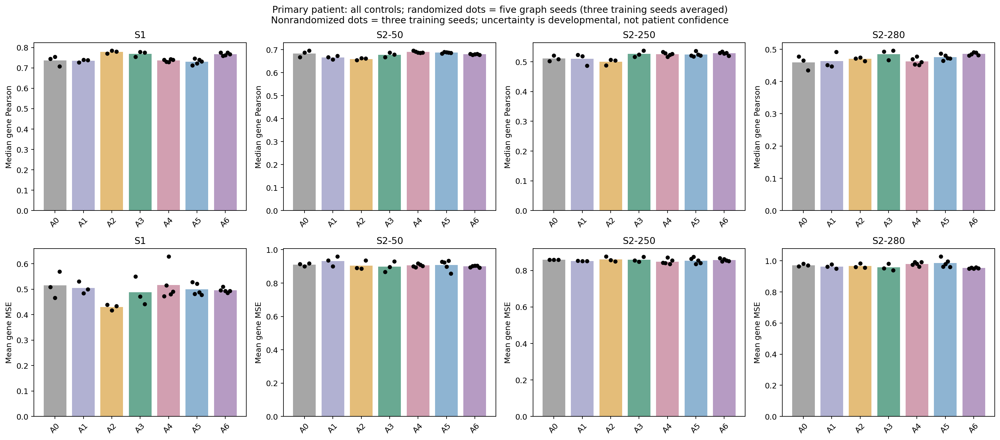
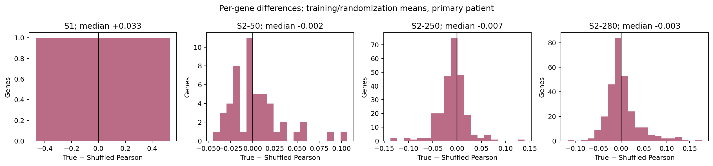
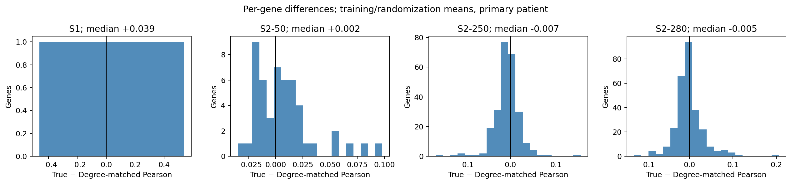
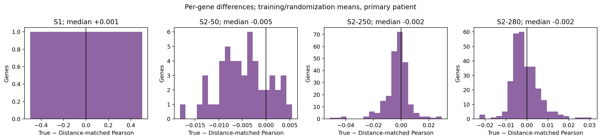
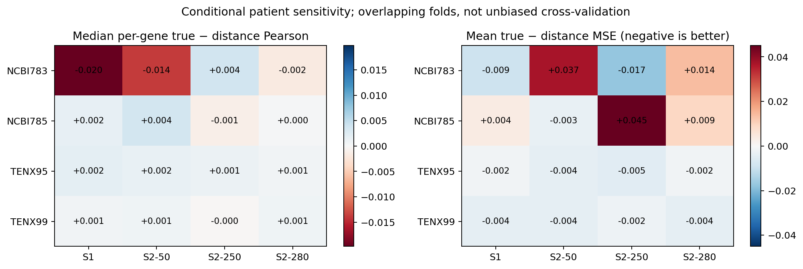
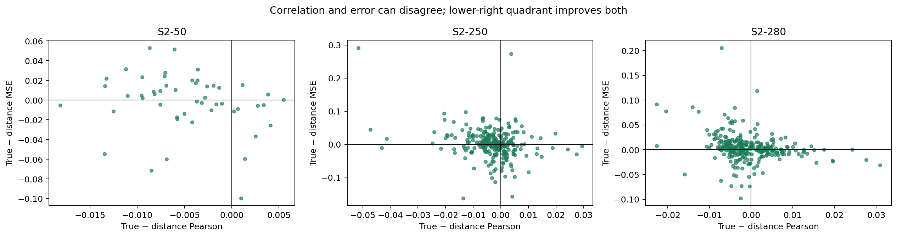
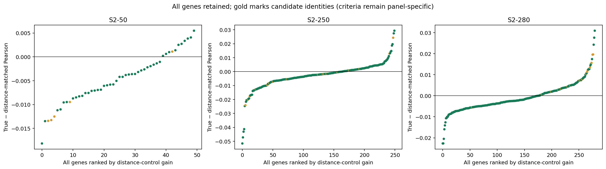
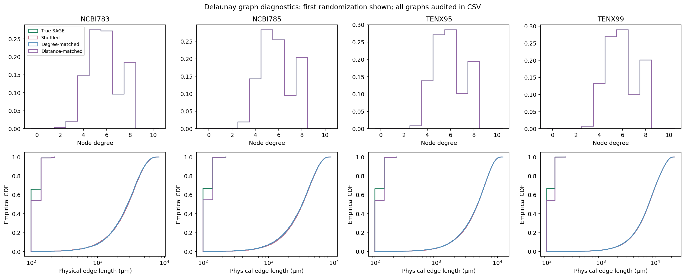
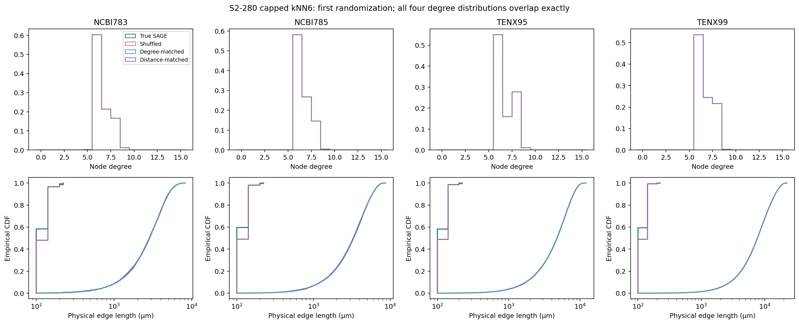

C3A status: MIXED_SPATIAL_SPECIFICITY
C3B status: NOT_RUN
Overall C3 status: MIXED_SPATIAL_SPECIFICITY

# C3A — Spatial specificity

The predefined spatial-specificity gate did not pass. Stop here: C3B was not created or executed. No multiresolution model is justified by this checkpoint.

Technical audit: **PASS**. All frozen C0/C1/C2 hashes are unchanged. No C1/C2 model was refitted, retuned or replayed. Their saved predictions and exact metrics were imported as immutable references.

## Question 1 — Does true tissue topology outperform matched randomized topology?

**A reproducible spatial-specificity advantage was not established under the predeclared gate. Positive individual-gene differences must be read alongside the matched-control distributions, error changes and patient sensitivity below.**

The table below reports the primary-patient results for all controls. A0 is frozen local MLP; A1 is self-only SAGE; A2 is frozen mean pooling + MLP; A3 is frozen true-spatial SAGE; A4 permutes vertex labels; A5 rewires edges with exact node degrees; A6 rewires edges with exact node degrees and physical-length-bin counts. Every random control uses **five graph seeds crossed with three training seeds**.

| Panel | Control | Median gene Pearson | Median Spearman | Mean MSE | Mean MAE |
| --- | --- | --- | --- | --- | --- |
| S1 | A0 | 0.736 ± 0.024 | 0.783 ± 0.028 | 0.515 ± 0.052 | 0.545 ± 0.025 |
| S1 | A1 | 0.734 ± 0.007 | 0.786 ± 0.010 | 0.505 ± 0.023 | 0.542 ± 0.010 |
| S1 | A2 | 0.778 ± 0.008 | 0.797 ± 0.008 | 0.430 ± 0.011 | 0.508 ± 0.006 |
| S1 | A3 | 0.769 ± 0.014 | 0.796 ± 0.012 | 0.488 ± 0.056 | 0.529 ± 0.031 |
| S1 | A4 | 0.736 ± 0.007 | 0.770 ± 0.007 | 0.517 ± 0.064 | 0.567 ± 0.021 |
| S1 | A5 | 0.730 ± 0.013 | 0.764 ± 0.015 | 0.500 ± 0.023 | 0.571 ± 0.013 |
| S1 | A6 | 0.768 ± 0.007 | 0.792 ± 0.004 | 0.496 ± 0.009 | 0.534 ± 0.004 |
| S2-50 | A0 | 0.684 ± 0.014 | 0.699 ± 0.004 | 0.911 ± 0.010 | 0.763 ± 0.004 |
| S2-50 | A1 | 0.666 ± 0.008 | 0.681 ± 0.006 | 0.932 ± 0.030 | 0.776 ± 0.013 |
| S2-50 | A2 | 0.659 ± 0.004 | 0.651 ± 0.004 | 0.905 ± 0.027 | 0.760 ± 0.013 |
| S2-50 | A3 | 0.678 ± 0.010 | 0.682 ± 0.009 | 0.898 ± 0.031 | 0.762 ± 0.016 |
| S2-50 | A4 | 0.690 ± 0.004 | 0.690 ± 0.004 | 0.905 ± 0.009 | 0.765 ± 0.004 |
| S2-50 | A5 | 0.687 ± 0.003 | 0.686 ± 0.002 | 0.908 ± 0.032 | 0.769 ± 0.013 |
| S2-50 | A6 | 0.680 ± 0.002 | 0.682 ± 0.002 | 0.900 ± 0.006 | 0.760 ± 0.003 |
| S2-250 | A0 | 0.511 ± 0.009 | 0.456 ± 0.012 | 0.859 ± 0.001 | 0.732 ± 0.002 |
| S2-250 | A1 | 0.509 ± 0.020 | 0.448 ± 0.009 | 0.852 ± 0.001 | 0.727 ± 0.003 |
| S2-250 | A2 | 0.499 ± 0.010 | 0.444 ± 0.012 | 0.861 ± 0.014 | 0.731 ± 0.008 |
| S2-250 | A3 | 0.526 ± 0.010 | 0.465 ± 0.019 | 0.859 ± 0.014 | 0.730 ± 0.004 |
| S2-250 | A4 | 0.525 ± 0.006 | 0.484 ± 0.008 | 0.849 ± 0.014 | 0.729 ± 0.007 |
| S2-250 | A5 | 0.524 ± 0.008 | 0.476 ± 0.005 | 0.854 ± 0.016 | 0.733 ± 0.008 |
| S2-250 | A6 | 0.528 ± 0.005 | 0.475 ± 0.007 | 0.857 ± 0.007 | 0.728 ± 0.003 |
| S2-280 | A0 | 0.459 ± 0.022 | 0.410 ± 0.015 | 0.972 ± 0.008 | 0.754 ± 0.004 |
| S2-280 | A1 | 0.463 ± 0.025 | 0.416 ± 0.018 | 0.963 ± 0.013 | 0.750 ± 0.010 |
| S2-280 | A2 | 0.470 ± 0.006 | 0.424 ± 0.007 | 0.966 ± 0.016 | 0.752 ± 0.005 |
| S2-280 | A3 | 0.485 ± 0.017 | 0.439 ± 0.015 | 0.957 ± 0.022 | 0.749 ± 0.010 |
| S2-280 | A4 | 0.462 ± 0.011 | 0.428 ± 0.011 | 0.980 ± 0.013 | 0.762 ± 0.006 |
| S2-280 | A5 | 0.475 ± 0.009 | 0.432 ± 0.011 | 0.985 ± 0.028 | 0.766 ± 0.014 |
| S2-280 | A6 | 0.485 ± 0.004 | 0.434 ± 0.005 | 0.953 ± 0.004 | 0.748 ± 0.002 |

For A0–A3, ± is sample SD across three training seeds. For A4–A6, each graph seed first averages the three training seeds, then ± is sample SD over five graph seeds. These SDs describe different sources of development variability; neither is a patient confidence interval. [C3A_PANEL_METRICS.csv](C3A/C3A_PANEL_METRICS.csv) retains all 15 outcomes for each randomized primary comparison, including mean/median Pearson, Spearman, MSE, MAE, threshold fractions, and secondary coexpression. The 280-gene setting is the **full shared assay panel**, not whole-transcriptome prediction.

The central endpoint is the paired per-gene difference, not subtraction of panel medians. The following medians average training seeds and, for controls, graph seeds within each gene before summarizing genes:

| Panel | Δ vs local A0 | Δ vs self A1 | Δ vs mean A2 | Δ vs shuffle A4 | Δ vs degree A5 | Δ vs distance A6 | Mean MSE change vs A6 |
| --- | --- | --- | --- | --- | --- | --- | --- |
| S1 | +0.0333 | +0.0347 | -0.0088 | +0.0330 | +0.0391 | +0.0012 | -0.0081 |
| S2-50 | +0.0159 | +0.0219 | +0.0151 | -0.0019 | +0.0016 | -0.0046 | -0.0018 |
| S2-250 | +0.0047 | +0.0091 | +0.0203 | -0.0071 | -0.0066 | -0.0022 | +0.0018 |
| S2-280 | +0.0059 | +0.0013 | +0.0117 | -0.0034 | -0.0053 | -0.0022 | +0.0043 |

All signed gains and error changes remain in [C3A_GENE_SPATIAL_GAINS.csv](C3A/C3A_GENE_SPATIAL_GAINS.csv); negative effects are retained. [C3A_RANDOMIZATION_METRICS.csv](C3A/C3A_RANDOMIZATION_METRICS.csv) contains every graph-seed/gene result, and [C3A_RANDOMIZATION_UNCERTAINTY.csv](C3A/C3A_RANDOMIZATION_UNCERTAINTY.csv) reports the corresponding mean and sample SD. Per-training-seed contrasts are separate in [C3A_SEED_CONTRASTS.csv](C3A/C3A_SEED_CONTRASTS.csv).

### Patient dependence and calibration

The same four conditional held-out patients were evaluated for A1 and A6 on **all four panels**, with all five A6 graph seeds and three training seeds. A0/A2/A3 retain the exact frozen C1/C2 conditional-fold results. A4/A5 are primary-only; they were not expanded to the folds. The strongest spatially matched control, A6, was specified before outcomes rather than chosen post hoc from test performance.

| Panel | Held-out sample | Median gene Δ vs A6 | Mean MSE change vs A6 | Genes with positive Δ vs A6 |
| --- | --- | --- | --- | --- |
| S1 | NCBI783 | -0.0198 | -0.0093 | 0.0% |
| S1 | NCBI785 | +0.0016 | +0.0037 | 100.0% |
| S1 | TENX95 | +0.0020 | -0.0017 | 100.0% |
| S1 | TENX99 | +0.0007 | -0.0040 | 100.0% |
| S2-50 | NCBI783 | -0.0139 | +0.0373 | 24.0% |
| S2-50 | NCBI785 | +0.0037 | -0.0032 | 84.0% |
| S2-50 | TENX95 | +0.0015 | -0.0040 | 92.0% |
| S2-50 | TENX99 | +0.0009 | -0.0041 | 70.0% |
| S2-250 | NCBI783 | +0.0037 | -0.0173 | 68.0% |
| S2-250 | NCBI785 | -0.0011 | +0.0450 | 41.6% |
| S2-250 | TENX95 | +0.0011 | -0.0051 | 66.8% |
| S2-250 | TENX99 | -0.0002 | -0.0022 | 43.2% |
| S2-280 | NCBI783 | -0.0018 | +0.0140 | 36.4% |
| S2-280 | NCBI785 | +0.0002 | +0.0092 | 52.1% |
| S2-280 | TENX95 | +0.0006 | -0.0015 | 64.3% |
| S2-280 | TENX99 | +0.0008 | -0.0041 | 63.9% |

These are **conditional patient-sensitivity analyses, not unbiased cross-validation**. Fold feature/target scalers are the frozen C1 objects and were checked numerically against the training patients only. Every new fold model uses the frozen C2 SAGE fixed epoch count, architecture and optimizer; it never early-stops on its held-out patient. Primary-selected panels/configurations and overlapping fold training cohorts limit independence. The primary patient is already part of the prior development history.

## Question 2 — Is any benefit more than simple averaging or self-only prediction?

**Not reproducibly under the frozen rule: no gene-panel result clears the full control, uncertainty, error and patient-consistency requirements.**

A pass requires a meaningful subset that exceeds **each** of self-only SAGE, frozen mean pooling, fully shuffled, degree-preserving and distance-matched controls, not just frozen local MLP. There are **0 robust gene-panel rows covering 0 unique genes** under that rule. Inspect the A1/A2 gains above alongside the graph-null gains; gains relative to A0 alone do not demonstrate spatial specificity.

A1 feeds `[x_i, x_i]` into the exact C2 SAGE dimensions/hidden width/dropout. Both branches have trainable weights and only local information; nominal and active parameter counts match A3 exactly. The duplicated branches remain functionally redundant, so identical parameter count does not imply identical function-space dimension or regularization. A2 uses the exact frozen C2 self-inclusive mean formulation and selected geometry. In S2-280 its radius150 graph differs from A3's capped kNN6, so that comparison includes validation-selected graph geometry. SAGE itself is one linear neighbor aggregation before GELU and readout; it is also expressible as an MLP on local-plus-neighbor features, not evidence that a deep message-passing network is necessary.

## Question 3 — Which genes have the strongest descriptive true-spatial benefit?

The frozen candidate criteria identify **17 gene-panel rows and 17 distinct genes**: CAV1, CCDC80, CXCL12, FBLN1, FOXA1, GLIPR1, LDHB, LRRC15, LUM, MYLK, MZB1, PDGFRB, PDK4, S100A4, SFRP4, TCF4, ZEB1. These are descriptive development candidates, not population-significant or biological findings. Their primary distance-control gains range from +0.0006 to +0.0196. Counts by panel are S1: 1, S2-50: 1, S2-250: 0, S2-280: 15. These small effects are sensitive to the predeclared development tolerances; the 0.02 threshold is not a biological boundary.

The table ranks the strongest primary mean A6 correlation gains, whether or not they qualify, to expose rejection by error or patient criteria:

| Panel | Gene | Δ local | Δ degree | Δ distance | MSE change vs distance | Positive patient directions | Candidate | Robust |
| --- | --- | --- | --- | --- | --- | --- | --- | --- |
| S2-280 | IL7R | +0.013 | +0.010 | +0.031 | -0.031 | 1/4 | False | False |
| S2-250 | LILRA4 | -0.025 | -0.034 | +0.029 | -0.006 | 4/4 | False | False |
| S2-280 | ADH1B | +0.235 | +0.205 | +0.028 | -0.020 | 2/4 | False | False |
| S2-250 | MRC1 | -0.064 | -0.061 | +0.027 | -0.031 | 3/4 | False | False |
| S2-250 | SFRP4 | +0.062 | +0.053 | +0.024 | -0.016 | 4/4 | False | False |
| S2-280 | NCAM1 | +0.013 | +0.031 | +0.024 | -0.000 | 2/4 | False | False |
| S2-250 | CCR7 | -0.008 | -0.087 | +0.020 | +0.033 | 2/4 | False | False |
| S2-280 | FBLN1 | +0.123 | +0.119 | +0.020 | -0.024 | 3/4 | True | False |
| S2-280 | CCDC80 | +0.078 | +0.104 | +0.020 | -0.022 | 3/4 | True | False |
| S2-250 | MMP1 | +0.000 | +0.009 | +0.019 | -0.012 | 0/4 | False | False |
| S2-280 | DPT | +0.080 | +0.023 | +0.017 | -0.000 | 1/4 | False | False |
| S2-280 | LRRC15 | +0.058 | +0.067 | +0.016 | -0.026 | 3/4 | True | False |

[C3A_CANDIDATE_AUDIT.csv](C3A/C3A_CANDIDATE_AUDIT.csv) records every gene, each criterion, every rejection and both candidate/robust flags. The six C2 candidate identities were retained in the specification for traceability, but C3A does not assume they are spatially specific. Candidate spatial maps, when candidates exist, are saved as `figures/map_<panel>_<gene>.png`; maps share a color scale between measured, local, true-graph and distance-control predictions and carry no mechanistic interpretation. Prediction maps average the available training/graph seeds; these diagnostic ensemble maps are not used to recompute the reported per-run metrics.

### Exact frozen decision rule

[C3A_SPEC_LOCK.json](C3A/C3A_SPEC_LOCK.json) was written and hashed before new C3 test evaluation; the analysis implementation was separately hashed before test access. Candidate: positive true Pearson; positive mean gain over A0/A5/A6; primary MSE no more than 2% worse than A0; positive A6 correlation direction in at least 3/4 conditional patients; no patient A6 gain below −0.05; and no patient MSE more than 25% worse than local. These are explicit pragmatic development tolerances, not universal biological cutoffs.

Robust: candidate plus primary mean gain ≥0.02 over **each A1/A2/A4/A5/A6**; positive A6 gain in all three training seeds; mean A6 gain greater than one graph-randomization SD; no primary MSE increase versus A0 or A6; and no mean conditional-fold MSE increase versus A6. PASS requires at least three distinct robust genes and one multi-gene panel with at least `max(3, ceil(2% of panel size))` robust genes. If no pass, MIXED requires at least one candidate or at least three distinct genes with primary A6 gain ≥0.02 and non-increasing A6 MSE. Otherwise FAIL. Any failed technical/control audit overrides these with FAIL_TECHNICAL. The thresholds were not revised after inspecting C3 predictions.

## Graph controls audit and limits

| Control | Graphs | Edges changed | Degree histogram exact | Per-node degree exact | Length-bin counts exact | Max length KS |
| --- | --- | --- | --- | --- | --- | --- |
| A4 | 40 | 99.7%–100.0% | True | False | False | 0.999 |
| A5 | 40 | 99.7%–100.0% | True | True | False | 0.999 |
| A6 | 40 | 12.2%–15.7% | True | True | True | 0.128 |

All 120 random graphs use fixed seeds derived from sample, geometry, control and randomization seed. Undirected graphs have no self/duplicate edges and never cross slides. A4 preserves graph topology under vertex relabeling and the degree histogram. A5 performs double-edge swaps while preserving every node degree. A6 additionally preserves counts in `[0,175)`, `[175,250)`, `[250,∞)` µm. Each proposal is label-free; no target expression enters graph construction or prediction inputs.

The frozen C0 spatial calibration is estimated. Coordinates form an approximately 100 µm lattice, with immediate cardinal/diagonal distances of 100/141 µm. A coordinate-only pilot found that bins separating those distances allowed less than 2% edge turnover under exact degree constraints; the broader immediate-neighborhood bin was chosen before C3 test evaluation. **A6 preserves binned lengths, not every exact length**. Within-bin empirical length KS (rounded to 0.001 µm to suppress floating-point lattice artifacts) and mean-length shifts are audited against predeclared limits of 0.20 and 10%; edge turnover must exceed 10%. A4/A5 must replace at least 90% of edges.

A6 changes only 12.2%–15.7% of true edges. This is an intentionally constrained null and still retains most true adjacency. It tests whether exact adjacency matters beyond nearby connections of similar lengths; it cannot establish absence of all spatial information. Swap chains are reproducible but are not claimed to sample uniformly from every admissible graph or prove full mixing. Fixed maximum attempts are reported even when the target accepted-swap count is not reached. Stronger randomization would relax the matching constraints and answer a different question.

[C3A_GRAPH_AUDIT.csv](C3A/C3A_GRAPH_AUDIT.csv) includes every graph's nodes, edges, degree summaries, components, physical-distance distribution, overlap, algorithm, attempts, accepted swaps, seed, source and content hash. Per-graph JSON files retain detailed provenance. A7, the optional feature-nearest graph, was omitted to focus on the required matched controls.

The degree histograms overlap exactly because their distributions are preserved.

## Reproducibility and execution

- 480 new fits and saved-checkpoint prediction replays; maximum absolute replay difference 0.
- 660 evaluated/reused model outcomes: 192 new primary fits, 288 new conditional fits, and 180 immutable reference outcomes.
- All 136 stored graph variants reconstructed exactly; 120 are randomized controls.
- 40 scaler mean/scale checks against the correct training patients; no refitting used for prediction.
- A test/audit module initially resolved the frozen C2 runner because both runner files share a name. Its import was made explicit; the retained initial test log documents this harness error. The training runner, predictions, and pre-test scientific specification did not change.
- Eight unit tests cover randomization constraints/determinism, label-free graph inputs, self-only locality, capacity matching and the balanced seed schedule.
- Frozen C0/C1/C2 hash audits pass; zero C1/C2 model runs. New preprocessing, encoder extraction, S3 inputs, explainability, enrichment and biological interpretation were not introduced.
- 1276 events are appended to the global registry. Its original header/prefix remains byte-identical because prior checkpoint hashes cover it. [C3A_REGISTRY_EXTENSIONS.csv](C3A/C3A_REGISTRY_EXTENSIONS.csv) supplies the new schema fields keyed by `(event, run_id)`; multi-slide fit events also retain their per-slide graph references.
- The pre-test specification is immutable. The separate final manifest hashes sources, outputs, graph files, local model/prediction artifacts and the registry prefix without rewriting the pre-test lock.

Models and prediction arrays remain under C3A locally with hashes and are excluded from Git because of size. Code, graph files, configs, logs, metrics, figures, and reports are versioned. Scripts reference the frozen C1/C2 implementations read-only. Primary controls use unchanged C1 optimizer/early-stopping settings; no C3 hyperparameter search was performed.

## Question 4 — Do genes show reproducible physical-scale preferences?

C3B is **NOT_RUN** at this stage. No physical-scale preferences are claimed and no C3B directory is created unless the C3A gate passes.

## Question 5 — Is a gene-adaptive multiresolution model justified?

**NOT YET.** The predefined spatial-specificity gate did not pass. Stop here: C3B was not created or executed. No multiresolution model is justified by this checkpoint. A C3A pass would authorize only the C3B scale-identification experiment; a later gene-adaptive architecture also requires a C3B pass. This checkpoint supports no causal, pathway, external-generalization, clinical or whole-transcriptome claim.
