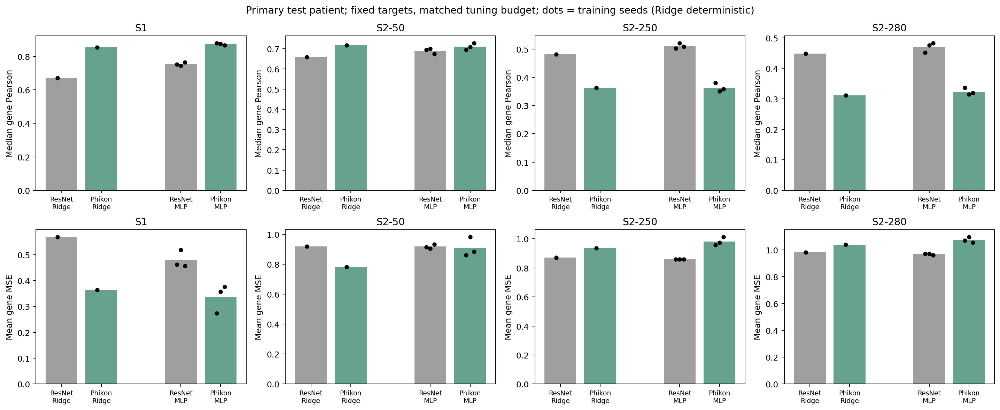
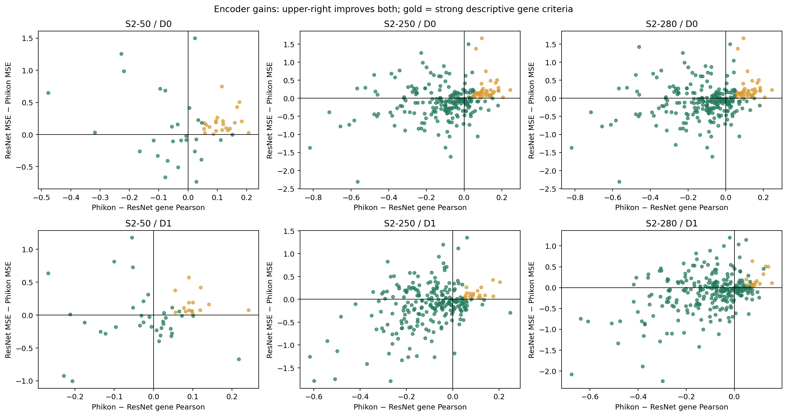
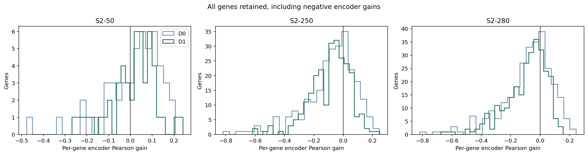
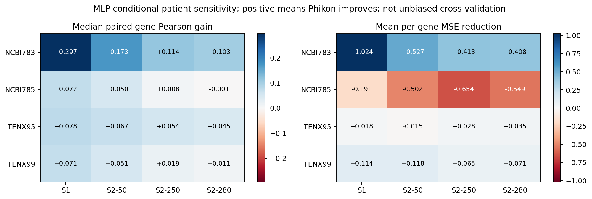
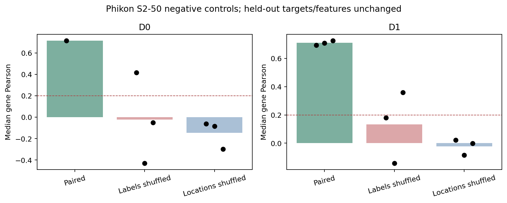

C4A status: PASS_PATHOLOGY_REPRESENTATION
C4B status: NOT_RUN
Overall C4 status: PASS_PATHOLOGY_REPRESENTATION

# C4A — Frozen pathology representation benchmark

## 1. Does a pathology-specific encoder materially improve prediction?

**The predeclared representation gate passes on this development cohort; a minimal C4B spatial recheck is authorized.** This compares the specific frozen Phikon release with the exact C0 ResNet18 embeddings. It is not a conclusion about all pathology foundation models, and it is not external validation.

| Panel | Model | Encoder | Median gene Pearson | Median Spearman | Mean MSE | Mean MAE |
| --- | --- | --- | --- | --- | --- | --- |
| S1 | D0 | ResNet18 | 0.671 (deterministic) | 0.718 (deterministic) | 0.568 (deterministic) | 0.646 (deterministic) |
| S1 | D0 | Phikon | 0.854 (deterministic) | 0.843 (deterministic) | 0.364 (deterministic) | 0.503 (deterministic) |
| S1 | D1 | ResNet18 | 0.754 ± 0.011 | 0.800 ± 0.014 | 0.479 ± 0.034 | 0.530 ± 0.015 |
| S1 | D1 | Phikon | 0.874 ± 0.006 | 0.873 ± 0.009 | 0.336 ± 0.054 | 0.461 ± 0.040 |
| S2-50 | D0 | ResNet18 | 0.659 (deterministic) | 0.681 (deterministic) | 0.920 (deterministic) | 0.776 (deterministic) |
| S2-50 | D0 | Phikon | 0.716 (deterministic) | 0.724 (deterministic) | 0.784 (deterministic) | 0.711 (deterministic) |
| S2-50 | D1 | ResNet18 | 0.690 ± 0.014 | 0.707 ± 0.007 | 0.919 ± 0.014 | 0.764 ± 0.006 |
| S2-50 | D1 | Phikon | 0.710 ± 0.016 | 0.712 ± 0.025 | 0.910 ± 0.064 | 0.771 ± 0.030 |
| S2-250 | D0 | ResNet18 | 0.482 (deterministic) | 0.426 (deterministic) | 0.871 (deterministic) | 0.743 (deterministic) |
| S2-250 | D0 | Phikon | 0.363 (deterministic) | 0.297 (deterministic) | 0.936 (deterministic) | 0.771 (deterministic) |
| S2-250 | D1 | ResNet18 | 0.511 ± 0.009 | 0.456 ± 0.012 | 0.859 ± 0.001 | 0.732 ± 0.002 |
| S2-250 | D1 | Phikon | 0.363 ± 0.015 | 0.321 ± 0.019 | 0.981 ± 0.028 | 0.788 ± 0.006 |
| S2-280 | D0 | ResNet18 | 0.448 (deterministic) | 0.389 (deterministic) | 0.982 (deterministic) | 0.764 (deterministic) |
| S2-280 | D0 | Phikon | 0.311 (deterministic) | 0.260 (deterministic) | 1.039 (deterministic) | 0.789 (deterministic) |
| S2-280 | D1 | ResNet18 | 0.470 ± 0.016 | 0.419 ± 0.013 | 0.969 ± 0.007 | 0.754 ± 0.005 |
| S2-280 | D1 | Phikon | 0.323 ± 0.011 | 0.276 ± 0.011 | 1.075 ± 0.020 | 0.796 ± 0.006 |

D0 is Ridge; D1 is a one-hidden-layer MLP. MLP values are mean ± sample SD across three training seeds on one primary test patient. Ridge is deterministic and is not padded with duplicate-seed outcomes. The complete tables also include mean/median Pearson, Spearman, MSE and MAE; fractions above 0/0.1/0.2/0.3 Pearson; per-gene target/prediction variance; and secondary coexpression diagnostics. The 280-gene setting is the **full shared assay panel**, not whole-transcriptome prediction. Errors use the unchanged C0 normalized target units.

### Matched downstream design

Both encoders use the same five Ridge alphas `[0.1, 1, 10, 100, 1000]` and the same four MLP candidates: hidden width 128/256 crossed with dropout 0/0.1. Seed-0 validation median Pearson chooses the configuration, with validation MSE and a canonical config tie-break. The unchanged C1 AdamW, learning-rate, weight-decay, batch-size, patience and maximum-epoch settings apply to both representations. Three MLP primary seeds follow selection. This C4 ResNet18 probe is a new matched-budget benchmark; it does not replace or change frozen C1 results.

| Encoder | Panel | Selected Ridge alpha | MLP width | MLP dropout | Fixed sensitivity epochs |
| --- | --- | --- | --- | --- | --- |
| ResNet18 | S1 | 1000 | 256 | 0.0 | 10 |
| ResNet18 | S2-50 | 1000 | 256 | 0.1 | 12 |
| ResNet18 | S2-250 | 1000 | 256 | 0.0 | 7 |
| ResNet18 | S2-280 | 1000 | 128 | 0.1 | 13 |
| Phikon | S1 | 1000 | 256 | 0.1 | 2 |
| Phikon | S2-50 | 1000 | 256 | 0.1 | 1 |
| Phikon | S2-250 | 1000 | 256 | 0.1 | 1 |
| Phikon | S2-280 | 1000 | 256 | 0.0 | 1 |

All Ridge selections reached the upper boundary of the small predeclared alpha grid. Phikon MLP validation often selected an early epoch (one epoch for the multi-gene sensitivity configurations). These are limitations of this compact probe and its cross-patient transfer; the grid and optimization schedule were not expanded after selection.

Feature and target scalers are fitted on the C4 training patients only. Gene lists/order, C0 target normalization and patient split remain unchanged. Model families, hidden widths and tuning budgets match; **absolute parameter counts differ because inputs are 512 versus 768 dimensions**. Ridge is an additional check across model families. [C4A_RESOURCE_PROFILE.csv](C4A_RESOURCE_PROFILE.csv) records the actual counts and training resources.

The specification and gate were hashed before new test evaluation. Only training/validation images were extracted initially; selected downstream configs were locked before extracting the test image cache. The test target cache was then used for final evaluation only. C0–C3 test results were already known, so this is sequential development rather than fresh confirmation.

## 2. Which panels and genes benefit most?

The primary scientific quantities are gene-paired encoder Pearson gain and MSE reduction. Positive values mean Phikon improves. Median paired gene gains need not equal the difference of panel median correlations.

| Panel | Model | Mean gene gain | Median gene gain | Pearson improved | Both endpoints improved |
| --- | --- | --- | --- | --- | --- |
| S1 | D0 | +0.183 | +0.183 | 100.0% | 100.0% |
| S1 | D1 | +0.120 | +0.120 | 100.0% | 100.0% |
| S2-250 | D0 | -0.085 | -0.053 | 34.8% | 21.6% |
| S2-250 | D1 | -0.091 | -0.069 | 27.6% | 12.4% |
| S2-280 | D0 | -0.084 | -0.053 | 34.3% | 20.7% |
| S2-280 | D1 | -0.094 | -0.062 | 27.9% | 15.0% |
| S2-50 | D0 | +0.018 | +0.046 | 64.0% | 52.0% |
| S2-50 | D1 | +0.010 | +0.026 | 62.0% | 36.0% |

The complete phase/patient/model summaries are in [C4A_ENCODER_GAIN_SUMMARY.csv](C4A_ENCODER_GAIN_SUMMARY.csv). The following table applies the locked MLP representation gate to the three multi-gene panels:

| Panel (MLP) | Median gene gain | Mean gene gain | Pearson improved | Both endpoints improved | Strong genes | Folds improved in both | Panel gate pass |
| --- | --- | --- | --- | --- | --- | --- | --- |
| S2-50 | +0.026 | +0.010 | 62.0% | 36.0% | 15 | 2 | True |
| S2-250 | -0.069 | -0.091 | 27.6% | 12.4% | 18 | 3 | False |
| S2-280 | -0.062 | -0.094 | 27.9% | 15.0% | 16 | 3 | False |

A strong descriptive gene requires mean primary Pearson gain ≥0.05, positive gain in every MLP seed and non-increasing mean MSE. This is a development threshold, not biological significance. The following top gains are shown irrespective of whether every rule passes; all genes remain in [C4A_ENCODER_GAIN.csv](C4A_ENCODER_GAIN.csv) and [C4A_GENE_SUPPORT.csv](C4A_GENE_SUPPORT.csv).

| Panel | Gene | Mean Pearson gain | Mean MSE reduction | Strong descriptive gene | Folds with positive Pearson gain / 4 | Folds improving both / 4 |
| --- | --- | --- | --- | --- | --- | --- |
| S2-250 | CEACAM6 | +0.248 | -0.296 | False | 4 | 2 |
| S2-50 | KRT14 | +0.242 | +0.074 | True | 4 | 3 |
| S2-50 | CEACAM6 | +0.217 | -0.673 | False | 4 | 2 |
| S2-250 | MRC1 | +0.204 | +0.375 | True | 4 | 3 |
| S2-250 | KRT14 | +0.175 | +0.066 | True | 4 | 4 |
| S2-250 | ERBB2 | +0.174 | +0.424 | True | 4 | 3 |
| S2-280 | FOXA1 | +0.156 | +0.106 | True | 4 | 3 |
| S2-280 | CEACAM6 | +0.142 | +0.499 | True | 3 | 1 |
| S2-50 | KRT5 | +0.141 | +0.160 | True | 4 | 4 |
| S2-250 | CDH1 | +0.139 | +0.086 | True | 4 | 3 |
| S2-250 | EPCAM | +0.135 | -0.014 | False | 4 | 2 |
| S2-280 | KRT23 | +0.131 | +0.507 | True | 4 | 2 |
| S2-250 | MLPH | +0.128 | -0.117 | False | 4 | 1 |
| S2-250 | S100A14 | +0.123 | +0.260 | True | 4 | 3 |
| S2-280 | MRC1 | +0.122 | +0.450 | False | 4 | 3 |

No pathways, mechanisms or clinical conclusions are assigned to these gene identities.

## 3. Are gains reproducible across conditional held-out patients?

All four patients and all four panels were evaluated with both models and both encoders. Configurations remain primary-selected. MLP epochs are fixed per encoder/panel to the rounded median primary best epoch; the held-out fold never early-stops a model. Fold feature/target scaling uses only the other three patients. These folds overlap in training data and inherit primary-selected panels/hyperparameters; they are **conditional sensitivity analyses, not unbiased cross-validation**.

| Panel (MLP) | Held-out sample | Median paired Pearson gain | Mean MSE reduction | Relative MSE increase |
| --- | --- | --- | --- | --- |
| S1 | NCBI783 | +0.297 | +1.024 | -72.3% |
| S1 | NCBI785 | +0.072 | -0.191 | +27.2% |
| S1 | TENX95 | +0.078 | +0.018 | -6.7% |
| S1 | TENX99 | +0.071 | +0.114 | -35.6% |
| S2-50 | NCBI783 | +0.173 | +0.527 | -48.1% |
| S2-50 | NCBI785 | +0.050 | -0.502 | +47.4% |
| S2-50 | TENX95 | +0.067 | -0.015 | +2.2% |
| S2-50 | TENX99 | +0.051 | +0.118 | -14.4% |
| S2-250 | NCBI783 | +0.114 | +0.413 | -39.6% |
| S2-250 | NCBI785 | +0.008 | -0.654 | +59.9% |
| S2-250 | TENX95 | +0.054 | +0.028 | -3.5% |
| S2-250 | TENX99 | +0.019 | +0.065 | -8.2% |
| S2-280 | NCBI783 | +0.103 | +0.408 | -38.0% |
| S2-280 | NCBI785 | -0.001 | -0.549 | +45.6% |
| S2-280 | TENX95 | +0.045 | +0.035 | -3.9% |
| S2-280 | TENX99 | +0.011 | +0.071 | -8.3% |

### Pairing negative controls

Only training image/expression pairings are permuted; validation/test stay intact. NC1 permutes training labels, NC2 permutes training feature locations. Each uses three seeds for both D0 and D1 on Phikon S2-50.

| Model | Control | Median Pearson by seed (0,1,2) | Mean median Pearson | Drop from paired | Pass |
| --- | --- | --- | --- | --- | --- |
| D0 | NC1 | 0.417, -0.431, -0.050 | -0.021 | 0.738 | True |
| D0 | NC2 | -0.082, -0.297, -0.061 | -0.147 | 0.863 | True |
| D1 | NC1 | 0.360, -0.143, 0.180 | 0.132 | 0.578 | True |
| D1 | NC2 | -0.002, -0.085, 0.021 | -0.022 | 0.732 | True |

Each control must have mean median Pearson ≤0.20 and lose at least 0.15 versus the corresponding unpermuted model. Failing this integrity gate overrides the scientific status with FAIL_TECHNICAL.

## Encoder, patch compatibility and resources

UNI2-h and UNI returned HTTP 401 gated-weight responses with no configured access. Under the plan's fallback order, one public CPU-practical pathology model was used: [Phikon](https://huggingface.co/owkin/phikon/tree/057cc0295895c2df3dd7681a89680da6015cbefe), revision `057cc0295895c2df3dd7681a89680da6015cbefe`. No second encoder or outcome-driven encoder sweep was run. The published feature interface is a 768-dimensional CLS representation from a frozen ViT-B/16; C4 follows the official extraction convention without the unused pooler. [Official extraction instructions](https://github.com/owkin/HistoSSLscaling#update--phikon-release-on-hugging-face-).

The exact 224×224 RGB C0 pixel arrays are reused with the official image processor: scaling by 1/255 and ImageNet channel means/standard deviations; no stain normalization, color augmentation or recropping. Approximate physical calibration supports the usual 20× interpretation, but scanner-level calibration is not independently certified. Source patch fields of view and alignment errors are:

| Sample | Patient | Locations | Source FOV µm | Resized µm/pixel | Max alignment error px | Phikon extraction seconds |
| --- | --- | --- | --- | --- | --- | --- |
| NCBI783 | patient 5 | 3005 | 112.05 | 0.5002 | 0.994 | 240.1 |
| TENX95 | patient 2 | 7760 | 111.99 | 0.4999 | 0.989 | 591.1 |
| NCBI785 | patient 4 | 4010 | 112.08 | 0.5004 | 0.993 | 306.0 |
| TENX99 | patient 1 | 20761 | 111.99 | 0.4999 | 0.997 | 1420.4 |

**Preprocessing is part of the compared encoder pipeline.** Phikon consumes the whole 224-pixel source tile. The frozen ResNet18 official transform had resized it to 256 pixels then center-cropped 224, retaining about 87.5% of the source width (approximately 98 µm rather than 112 µm). Thus this benchmark does not isolate pretraining from architecture, feature dimension or effective crop field of view. No C0 patch/cache was altered to conceal that difference. Public-pretraining overlap has not been independently excluded at individual-slide level.

Extraction used CPU float32, batch size 16, eight PyTorch threads, on Intel Core i7-14700; no functioning NVIDIA driver was available. Actual extraction time sums to 2557.6 seconds. Downstream training uses four CPU threads. The isolated `C4/deps` environment adds pinned Transformers/Hugging Face libraries without changing the C0–C3 environment. Model weight, processor/config, patch, cache, barcode-order, scaler and checkpoint hashes are retained. [C4A_ENCODER_MANIFEST.csv](C4A_ENCODER_MANIFEST.csv) records cache dimensions, bytes and extraction resources.

E0 reference cache files are wrappers containing bit-identical C0 embeddings plus the new provenance fields; ResNet18 was not extracted again. E1 embeddings were extracted once per location and reused. Every location retains sample, patient, barcode, coordinates, source HDF5 row, source RGB hash and encoder/preprocessing hash. Both cache directories are under `C4/embeddings/` and referenced from C4A manifests. Large caches, weights, models and predictions remain local with hashes and are excluded from Git.

## Frozen gate and technical audit

A multi-gene MLP panel passes only if its panel median correlation improves ≥0.02, median paired gene gain improves ≥0.02, mean MSE worsens no more than 2%, at least 20% of genes improve both endpoints, and at least `max(3, ceil(5% of panel size))` genes meet the strong-gene rule. At least two conditional patients must improve median gene correlation with MSE worsening no more than 2%; mean fold-relative MSE worsening must be ≤5%. The same-panel Ridge median gene gain must be nonnegative. Negative controls and technical integrity must pass. MIXED/FAIL fallbacks are specified in [C4A_SPEC_LOCK.json](C4A_SPEC_LOCK.json); thresholds were not changed after test outcomes.

Technical status: **PASS**. 244 stored downstream models were replayed, including 72 validation candidates and 172 held-out outcomes; maximum prediction difference 0. 35536 source RGB patch hashes, 8 caches and 80 training-only scaler checks passed. A sampled replay of 64 encoder rows had maximum difference 0. This sampled encoder replay is not a claim of re-extracting the full cohort twice. All frozen C0–C3 hashes are unchanged.

All extraction/fitting/evaluation events were appended to the existing registry. Its frozen header/prefix remains unchanged; additional encoder fields are in `C4A_REGISTRY_EXTENSIONS.csv`. Source/config locks precede test access; the final artifact manifest is separate and does not rewrite that history.

## 4. Does true topology become more informative?

C4B is **NOT_RUN** in this C4A report. Only a clear PASS_PATHOLOGY_REPRESENTATION authorizes the minimal spatial recheck. No new radius, multiresolution model, adaptive scale fusion, explanation or sparse-ST input was introduced.

## 5. What should happen next?

Current recommendation: **NEED_REPRESENTATION_REVIEW**. A clear representation pass authorizes C4B before assigning the final C4 recommendation.

A faithful CMRCNet auxiliary benchmark is deferred for the concrete compatibility reasons in [CROSS_MODAL_COMPATIBILITY.md](../CROSS_MODAL_COMPATIBILITY.md). No approximate CMRCNet result is reported. This checkpoint supports no causal, clinical, external-validation or publication-level claims.
