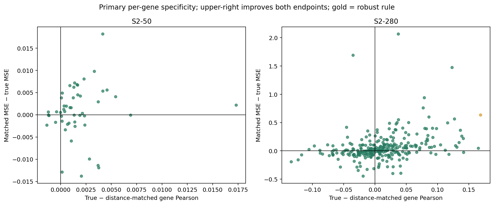
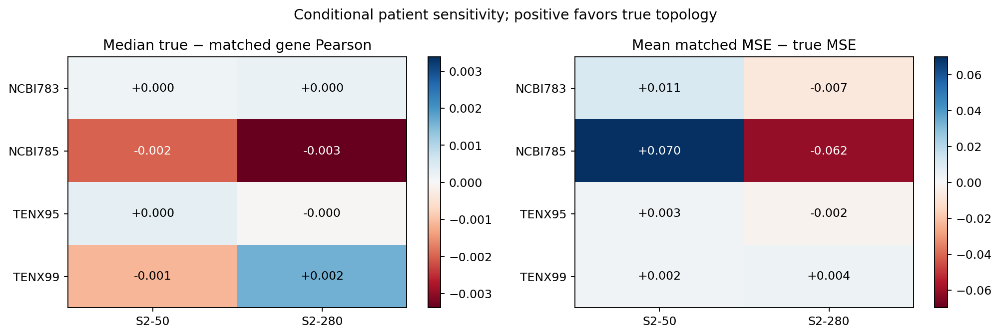

C4B status: MIXED_SPATIAL_RECHECK

# Minimal spatial-specificity recheck

Some primary genes meet the candidate rule, but the full reproducible spatial-specificity criterion does not pass. Stop for review.

C4A authorized this stage through **S2-50 only**: +0.026 median paired gene Pearson gain, 15 strong genes, approximately 0.9% lower primary mean MSE, and two conditional patients improving both endpoints. The 250/280-gene primary results worsened; this is not a broad representation improvement. S2-280 remains the prespecified stress test here.

## Matched spatial experiment

The node features are the exact C4A Phikon caches. LOCAL reuses the 30 saved C4A MLP outcomes for these two panels. MEAN uses the exact C2 self-inclusive neighbor-mean operator. TRUE uses the frozen C2 one-hop mean GraphSAGE operator, concatenating local and neighbor means before the learned MLP. MATCHED uses the identical architecture/configuration and exact C3 A6 adjacency matrices. All nonlocal models use three training seeds; MATCHED crosses those with all five frozen graph seeds. No encoder, radius, graph, architecture or hyperparameter search was added.

Frozen geometry: S2-50 uses capped Delaunay for both MEAN and SAGE. S2-280 uses the frozen radius-150 mean baseline and kNN-6 capped-at-250 SAGE geometry. No new graph construction is introduced. SAGE hidden widths/dropout remain 67/0.1 and 156/0.1 for 50/280 genes; MEAN widths/dropout remain 128/0.1 and 256/0.1. Fixed sensitivity epochs remain C2's 7/13 for SAGE and 14/17 for MEAN. Primary validation-MSE early stopping remains the original C1 protocol.

Spatial hyperparameters and schedules match C3, but input dimension changes parameter count. The local comparator is C4A's newly selected matched-budget MLP, which can differ from C3's frozen C1 local configuration. Thus the direct C3 contrast is informative development evidence, not a claim that every downstream parameter or local optimization setting was identical. Feature and target scalers are reused from the audited C4A training-only fits. Measured neighboring expression never enters the inputs.

The C4B source and decision rules were locked before 42 primary fits, and all 42 model records were locked before B test prediction. C4A and older test results were already known. This remains a sequential development experiment. Four-patient results use primary-frozen choices and fold-training scalers without held-out early stopping; they are conditional sensitivity, not unbiased cross-validation.

## Primary correlation and error

| Panel | Model | Median gene Pearson | Median Spearman | Mean MSE | Mean MAE |
| --- | --- | --- | --- | --- | --- |
| S2-50 | LOCAL | 0.710 ± 0.016 | 0.712 ± 0.025 | 0.910 ± 0.064 | 0.771 ± 0.030 |
| S2-50 | MEAN | 0.686 ± 0.026 | 0.688 ± 0.023 | 1.007 ± 0.078 | 0.823 ± 0.034 |
| S2-50 | TRUE | 0.686 ± 0.065 | 0.693 ± 0.068 | 0.951 ± 0.048 | 0.790 ± 0.020 |
| S2-50 | MATCHED | 0.684 ± 0.001 | 0.693 ± 0.001 | 0.952 ± 0.001 | 0.790 ± 0.001 |
| S2-280 | LOCAL | 0.323 ± 0.011 | 0.276 ± 0.011 | 1.075 ± 0.020 | 0.796 ± 0.006 |
| S2-280 | MEAN | 0.338 ± 0.011 | 0.288 ± 0.004 | 1.084 ± 0.017 | 0.804 ± 0.004 |
| S2-280 | TRUE | 0.298 ± 0.027 | 0.259 ± 0.028 | 1.088 ± 0.037 | 0.799 ± 0.007 |
| S2-280 | MATCHED | 0.278 ± 0.028 | 0.251 ± 0.024 | 1.151 ± 0.017 | 0.818 ± 0.003 |

For LOCAL/MEAN/TRUE, values are mean ± sample SD over three training seeds. For MATCHED, average the three training seeds within each graph first, then report mean ± sample SD over five graph realizations. All 15 individual matched outcomes remain in the metric tables. No population significance or independent-patient uncertainty is implied. Errors remain in frozen C0 normalized units.

## Gene-specific gains and frozen decision

| Panel | Robust genes | Required | Primary candidates | Median spatial gain | Median matched gain | Mean spatial MSE reduction | Mean matched MSE reduction |
| --- | --- | --- | --- | --- | --- | --- | --- |
| S2-280 | 1 | 6 | 29 | -0.011 | +0.008 | -0.014 | +0.063 |
| S2-50 | 0 | 3 | 0 | -0.022 | +0.001 | -0.041 | +0.001 |

A robust gene must gain at least 0.02 mean primary Pearson over LOCAL, MEAN and MATCHED, improve against LOCAL and MATCHED in every training seed, exceed one matched-graph SD, and have non-increasing primary MSE versus LOCAL/MATCHED. At least two conditional patients must have positive LOCAL/MATCHED correlation gain with MSE worsening at most 2% against both; mean fold-relative MSE worsening versus MATCHED must be at most 5%. A panel needs `max(3, ceil(2% of panel size))` robust genes. The MIXED fallback requires at least three primary genes with matched gain ≥0.02, positive local gain and no MSE worsening versus either. These descriptive criteria were frozen before B outcomes.

The largest primary matched gains below are shown regardless of final robustness. All genes, including negative gains, are retained in [C4B_GENE_GAIN.csv](C4B_GENE_GAIN.csv) and [C4B_GENE_SUPPORT.csv](C4B_GENE_SUPPORT.csv).

| Panel | Gene | Gain vs local | Gain vs mean | Gain vs matched | Matched MSE reduction | Supporting patients / 4 | Robust |
| --- | --- | --- | --- | --- | --- | --- | --- |
| S2-280 | MYLK | +0.097 | +0.040 | +0.169 | +0.633 | 2 | True |
| S2-280 | AQP1 | -0.024 | -0.066 | +0.165 | +0.045 | 2 | False |
| S2-280 | DUSP2 | +0.085 | +0.059 | +0.142 | -0.028 | 2 | False |
| S2-280 | CAV1 | +0.019 | +0.035 | +0.141 | +0.218 | 1 | False |
| S2-280 | FCGR3A | +0.020 | -0.039 | +0.139 | +0.259 | 1 | False |
| S2-280 | CD93 | +0.084 | +0.084 | +0.137 | +0.363 | 1 | False |
| S2-280 | VWF | +0.024 | +0.065 | +0.135 | +0.146 | 0 | False |
| S2-280 | TCF7 | +0.009 | -0.017 | +0.131 | +0.064 | 0 | False |
| S2-280 | MMP1 | +0.027 | +0.032 | +0.129 | +0.091 | 1 | False |
| S2-280 | TCF4 | +0.082 | +0.113 | +0.127 | +0.563 | 2 | False |
| S2-280 | GJB2 | +0.021 | -0.001 | +0.123 | +1.472 | 3 | False |
| S2-280 | S100A8 | +0.006 | -0.012 | +0.118 | -0.062 | 1 | False |
| S2-280 | TPD52 | -0.027 | -0.014 | +0.116 | +0.494 | 1 | False |
| S2-280 | CLEC14A | +0.177 | +0.179 | +0.113 | +0.011 | 0 | False |
| S2-280 | SERPINB9 | +0.056 | -0.034 | +0.105 | +0.105 | 2 | False |

## Patient dependence

| Panel | Held-out sample | Median local gain | Median matched gain | Mean local MSE reduction | Mean matched MSE reduction | Relative MSE increase vs local | Relative MSE increase vs matched |
| --- | --- | --- | --- | --- | --- | --- | --- |
| S2-280 | NCBI783 | -0.000 | +0.000 | -0.098 | -0.007 | +14.8% | +1.0% |
| S2-280 | NCBI785 | +0.012 | -0.003 | -0.066 | -0.062 | +3.8% | +3.5% |
| S2-280 | TENX95 | +0.024 | -0.000 | +0.027 | -0.002 | -3.1% | +0.3% |
| S2-280 | TENX99 | +0.013 | +0.002 | +0.036 | +0.004 | -4.5% | -0.5% |
| S2-50 | NCBI783 | +0.007 | +0.000 | -0.087 | +0.011 | +15.2% | -1.6% |
| S2-50 | NCBI785 | -0.010 | -0.002 | +0.025 | +0.070 | -1.6% | -4.4% |
| S2-50 | TENX95 | +0.015 | +0.000 | +0.023 | +0.003 | -3.2% | -0.4% |
| S2-50 | TENX99 | -0.009 | -0.001 | +0.002 | +0.002 | -0.3% | -0.3% |

## Graph sensitivity

All 56 referenced graph files were copied exactly from frozen C2/C3 artifacts; 40 are matched graphs (two SAGE geometries × four slides × five seeds). Their per-node degrees and global physical-distance-bin counts remain exact. Each matched graph has at least 10% edge turnover, length-distribution KS ≤0.2, and absolute relative mean edge-length change ≤10%, using the frozen C3 audit. This constrained randomization is not claimed uniform.

Each row below averages training seeds before calculating the gene-paired primary contrast against one graph realization. Detailed graph statistics/hashes are under `graphs/`.

| Panel | Frozen graph seed | Median true-minus-matched gene Pearson | Mean matched-minus-true MSE |
| --- | --- | --- | --- |
| S2-50 | 0 | +0.0009 | -0.0008 |
| S2-50 | 1 | +0.0014 | +0.0003 |
| S2-50 | 2 | +0.0006 | +0.0018 |
| S2-50 | 3 | +0.0011 | -0.0001 |
| S2-50 | 4 | +0.0023 | +0.0023 |
| S2-280 | 0 | -0.0094 | +0.0849 |
| S2-280 | 1 | +0.0160 | +0.0590 |
| S2-280 | 2 | +0.0073 | +0.0746 |
| S2-280 | 3 | +0.0168 | +0.0405 |
| S2-280 | 4 | +0.0202 | +0.0561 |

## Direct comparison with frozen C3 ResNet18 results

| Phase | Panel | C3 median spatial gain | C4B median spatial gain | C3 median matched gain | C4B median matched gain |
| --- | --- | --- | --- | --- | --- |
| lopo | S2-280 | -0.008 | +0.012 | -0.000 | -0.000 |
| lopo | S2-50 | -0.015 | +0.001 | -0.002 | -0.001 |
| primary | S2-280 | +0.006 | -0.011 | -0.002 | +0.008 |
| primary | S2-50 | +0.016 | -0.022 | -0.005 | +0.001 |

Sensitivity entries are equal-weight means of four patient-specific gene medians. Primary entries refer to TENX99. [C4B_VS_FROZEN_C3.csv](C4B_VS_FROZEN_C3.csv) preserves every gene/patient contrast and corresponding MSE changes. C3 results were read from frozen metrics only; no C0–C3 model was rerun or retuned.

## Integrity and recommendation

Audit: **PASS**. All 210 new models and held-out predictions replayed, plus 42 primary validation outputs; maximum prediction difference 0. Reused local prediction files are byte-identical; metric CSV round-tripping differs by at most 4.44e-16. All 30 reused local outcomes, 56 graph references, all frozen C4A artifacts and all C0–C3 hashes passed. The registry has 506 C4B events appended without changing its prior header/prefix. Per-fit parameter counts, timings and peak RAM are in [C4B_RESOURCE_PROFILE.csv](C4B_RESOURCE_PROFILE.csv).

A CSV parser correction was necessary: pandas inferred the per-run control label TRUE as Boolean. The typed reader adapter restores text labels before executing the unchanged locked analysis source. Saved metrics/predictions and scientific decision rules were not changed; the correction and regression test are logged.

Final recommendation: **NEED_REPRESENTATION_REVIEW**. Stop after C4 for user review. No multiresolution, partial-ST reconstruction, interpretation, explainability or clinical claims were executed.
