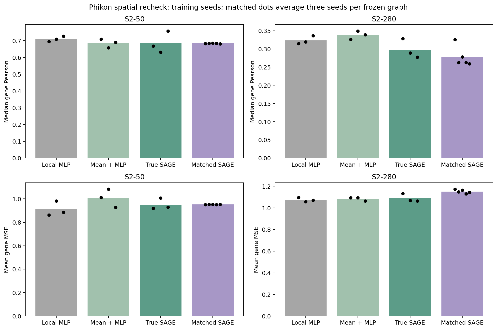

C4A status: PASS_PATHOLOGY_REPRESENTATION
C4B status: MIXED_SPATIAL_RECHECK
Overall C4 status: MIXED_SPATIAL_RECHECK

# C4 — Representation and minimal spatial recheck

## 1. Does a pathology-specific encoder materially improve H&E→expression prediction?

**A limited pass on S2-50, not a broad improvement across panels.** The single public frozen Phikon fallback improves the 50-gene MLP median correlation from 0.690 to 0.710, with approximately 0.9% lower MSE. Median gene-paired gain is +0.026; 15/50 genes satisfy the strong-gain rule, 62% improve Pearson and 36% improve both Pearson and MSE. The locked criterion passes on this panel and two conditional patients support it. S1 also improves, while the 250- and 280-gene primary outcomes worsen substantially.

| Panel | ResNet MLP median Pearson | Phikon MLP median Pearson | ResNet MLP mean MSE | Phikon MLP mean MSE |
| --- | --- | --- | --- | --- |
| S1 | 0.754 | 0.874 | 0.479 | 0.336 |
| S2-50 | 0.690 | 0.710 | 0.919 | 0.910 |
| S2-250 | 0.511 | 0.363 | 0.859 | 0.981 |
| S2-280 | 0.470 | 0.323 | 0.969 | 1.075 |

These are means over three training seeds on the primary patient. Full Ridge/MLP metrics, individual seeds, gene gains and controls are in [C4A_REPORT.md](C4A/C4A_REPORT.md). UNI2-h and UNI were gated without configured access, so Phikon was the single planned public fallback. The C4A report is the frozen snapshot written before B; the final B status is shown above. Both encoders received the same compact downstream grid; no extra encoder was added. The conclusion applies to this encoder pipeline and cohort, not all pathology foundation models.

## 2. Which panels and genes benefit most?

S1 and S2-50 benefit most on the primary test patient. Fifteen S2-50 genes meet the encoder strong-gain criterion. The largest primary Pearson gains among these are **KRT14 (+0.242), KRT5 (+0.141), S100A14 (+0.120), CDH1 (+0.119), ERBB2 (+0.101)**. Their identities, full per-gene correlation/error changes and fold support are in [C4A_GENE_SUPPORT.csv](C4A/C4A_GENE_SUPPORT.csv) and the detailed C4A report. Spatial gene-specific gains and failure cases are in [C4B_GENE_SUPPORT.csv](C4B/C4B_GENE_SUPPORT.csv). No biological significance, pathway or clinical interpretation is assigned to these identities.

| Panel | Spatial robust genes | Required | Primary candidates | Median spatial gain | Median matched gain | Mean spatial MSE reduction | Mean matched MSE reduction |
| --- | --- | --- | --- | --- | --- | --- | --- |
| S2-280 | 1 | 6 | 29 | -0.011 | +0.008 | -0.014 | +0.063 |
| S2-50 | 0 | 3 | 0 | -0.022 | +0.001 | -0.041 | +0.001 |

## 3. Are gains reproducible across conditional held-out patients?

C4A's S2-50 gain meets the joint correlation/error condition in two of four patients, with important error deterioration in NCBI785. It is patient dependent. All four sensitivity folds preserve frozen panels/normalization and primary-selected configurations, fit C4 scalers using fold-training patients only, and avoid held-out early stopping. These are conditional analyses, not external validation or unbiased cross-validation. Full stage-specific patient tables are retained. The following table reports **C4B spatial contrasts**, not encoder gains; positive reductions favor true topology.

| Panel | Held-out sample | Median local gain | Median matched gain | Mean local MSE reduction | Mean matched MSE reduction | Relative MSE increase vs local | Relative MSE increase vs matched |
| --- | --- | --- | --- | --- | --- | --- | --- |
| S2-280 | NCBI783 | -0.000 | +0.000 | -0.098 | -0.007 | +14.8% | +1.0% |
| S2-280 | NCBI785 | +0.012 | -0.003 | -0.066 | -0.062 | +3.8% | +3.5% |
| S2-280 | TENX95 | +0.024 | -0.000 | +0.027 | -0.002 | -3.1% | +0.3% |
| S2-280 | TENX99 | +0.013 | +0.002 | +0.036 | +0.004 | -4.5% | -0.5% |
| S2-50 | NCBI783 | +0.007 | +0.000 | -0.087 | +0.011 | +15.2% | -1.6% |
| S2-50 | NCBI785 | -0.010 | -0.002 | +0.025 | +0.070 | -1.6% | -4.4% |
| S2-50 | TENX95 | +0.015 | +0.000 | +0.023 | +0.003 | -3.2% | -0.4% |
| S2-50 | TENX99 | -0.009 | -0.001 | +0.002 | +0.002 | -0.3% | -0.3% |

## 4. Does true tissue topology become more informative?

**MIXED_SPATIAL_RECHECK.** Some primary genes meet the candidate rule, but the full reproducible spatial-specificity criterion does not pass. Stop for review. The recheck used only LOCAL, neighbor MEAN, true SAGE and the strongest frozen distance-matched C3 control on S2-50/S2-280. It used three training seeds and five matched-graph seeds, exact C2/C3 single-scale geometry, and no new graph search.

| Phase | Panel | C3 median spatial gain | C4B median spatial gain | C3 median matched gain | C4B median matched gain |
| --- | --- | --- | --- | --- | --- |
| lopo | S2-280 | -0.008 | +0.012 | -0.000 | -0.000 |
| lopo | S2-50 | -0.015 | +0.001 | -0.002 | -0.001 |
| primary | S2-280 | +0.006 | -0.011 | -0.002 | +0.008 |
| primary | S2-50 | +0.016 | -0.022 | -0.005 | +0.001 |

See [C4B_REPORT.md](C4B/C4B_REPORT.md) for graph sensitivity, gene-level criteria, correlation/error metrics and replay evidence. C3 rows are exact frozen metrics, not rerun models. Spatial model settings remain frozen C2/C3 choices; the local C4A probe can have different selected settings than the C3 local baseline, and input dimensions change parameter counts.

## 5. What should happen next?

**NEED_REPRESENTATION_REVIEW**

Stop here for review. No later checkpoint was executed. A full CMRCNet reproduction is deferred because the official preprocessing/panels/training and CUDA assumptions do not support a cheap faithful comparison in this frozen CPU setup; see [CROSS_MODAL_COMPATIBILITY.md](CROSS_MODAL_COMPATIBILITY.md). No approximate implementation is labeled CMRCNet.

## Limits and reproducibility

C0–C3 remain unchanged. C4A replayed 244 stored models with zero prediction discrepancy, checked all 35,536 RGB patch hashes, eight caches and 80 training-only scaler fits, and exactly replayed 64 sampled encoder rows. C4B replayed 210 new models with maximum prediction discrepancy 0, verified 30 reused local outcomes and 56 graph files, and preserved the complete frozen C4A artifact set. The registry contains 420 C4A plus 506 C4B events appended to the existing header/prefix. Code, configurations, reports, metrics and hashes are versioned; large weights/caches/checkpoints/predictions remain local and are hashed in the final manifest.

A logged CSV-reader correction preserved TRUE as a text control label; the locked analysis formulas and thresholds remained unchanged.

The compared encoder pipelines also differ in architecture, feature dimension and effective crop field of view: Phikon uses the full approximately 112 µm source tile; frozen ResNet18 retained approximately 98 µm after its official crop. Public-pretraining slide overlap has not been independently excluded. All Ridge selections reached the maximum predeclared alpha; Phikon MLPs often selected epoch 1. Negative controls pass their frozen average-over-seeds criterion, but some individual label-permutation seeds retain positive correlation (up to approximately 0.42); the individual results are disclosed and are not evidence of null signal in every run. Prior checkpoint/test outcomes were known, thresholds are descriptive, and no statistical, external-validation, causal or clinical claim follows.
