C5 status: PASS_SPARSE_ST_RECONSTRUCTION
Final recommendation: PROCEED_TO_SAMPLING_OPTIMIZATION

# C5 — Sparse spatial-transcriptomics reconstruction

The frozen sparse-reconstruction gate passes for **ResNet18 with S2-50 and S2-280** on this development cohort. Phikon does not meet the full cross-patient gate, and S2-250 has primary results but no conditional folds. Random-anchor fusion helps most at lower coverage; contiguous extrapolation remains harder. This does not establish unrestricted reconstruction of any unmeasured region or overturn the earlier H&E-only topology findings.

At nominal 20% random coverage on the primary patient, S2-50 ResNet18 H&E-only gives median Pearson 0.695 / MSE 0.911; selected sparse interpolation gives 0.792 / 0.268; simple fusion gives 0.822 / 0.279. These are three-mask means. Correlation and error must be read together, and this random-anchor result must not be generalized to contiguous missing regions.

The unit hidden from the predictor is an **entire tissue location and its full expression vector**. H&E/coordinates remain available everywhere; only observed anchors provide molecular inputs. S2-280 is the full shared assay panel, not whole-transcriptome reconstruction. All outcomes below score hidden locations only in frozen C0 normalized target units.

## 1. How much do sparse ST anchors improve over H&E alone?

The table compares H&E-only B1, validation-selected molecular interpolation B2, simple fusion B3, and compact learned propagation B4 at nominal 20% coverage. Values are equal-mask means of three mask-specific panel statistics on TENX99. The complete tables retain both B2 families, B0, every mask, realized coverage, encoder, patient and gene; no favorable interpolation family was chosen on test outcomes.

| Panel | Geometry | Encoder | B1 median r | B2 median r | B3 median r | B4 median r | B1 MSE | B2 MSE | B3 MSE | B4 MSE |
| --- | --- | --- | --- | --- | --- | --- | --- | --- | --- | --- |
| S2-50 | random | ResNet18 | 0.695 | 0.792 | 0.822 | 0.831 | 0.911 | 0.268 | 0.279 | 0.288 |
| S2-50 | random | Phikon | 0.761 | 0.792 | 0.822 | 0.842 | 0.860 | 0.268 | 0.280 | 0.324 |
| S2-50 | block | ResNet18 | 0.710 | -0.017 | 0.575 | 0.671 | 0.919 | 0.948 | 0.691 | 0.611 |
| S2-50 | block | Phikon | 0.774 | -0.017 | 0.550 | 0.715 | 0.869 | 0.948 | 0.701 | 0.671 |
| S2-50 | capture_window | ResNet18 | 0.674 | 0.121 | 0.528 | 0.631 | 0.900 | 1.506 | 0.745 | 0.692 |
| S2-50 | capture_window | Phikon | 0.746 | 0.121 | 0.486 | 0.644 | 0.841 | 1.506 | 0.791 | 0.751 |
| S2-250 | random | ResNet18 | 0.526 | 0.675 | 0.710 | 0.716 | 0.847 | 0.373 | 0.370 | 0.381 |
| S2-250 | random | Phikon | 0.408 | 0.675 | 0.697 | 0.711 | 0.921 | 0.373 | 0.386 | 0.458 |
| S2-250 | block | ResNet18 | 0.537 | 0.011 | 0.457 | 0.516 | 0.845 | 0.966 | 0.705 | 0.641 |
| S2-250 | block | Phikon | 0.415 | 0.011 | 0.303 | 0.379 | 0.907 | 0.966 | 0.749 | 0.758 |
| S2-250 | capture_window | ResNet18 | 0.500 | 0.080 | 0.380 | 0.444 | 0.845 | 1.511 | 0.844 | 0.819 |
| S2-250 | capture_window | Phikon | 0.387 | 0.080 | 0.257 | 0.305 | 0.932 | 1.511 | 0.979 | 1.065 |
| S2-280 | random | ResNet18 | 0.480 | 0.660 | 0.690 | 0.686 | 0.958 | 0.406 | 0.409 | 0.427 |
| S2-280 | random | Phikon | 0.367 | 0.660 | 0.660 | 0.682 | 1.013 | 0.406 | 0.406 | 0.461 |
| S2-280 | block | ResNet18 | 0.486 | 0.015 | 0.402 | 0.457 | 0.954 | 1.017 | 0.770 | 0.712 |
| S2-280 | block | Phikon | 0.377 | 0.015 | 0.154 | 0.291 | 0.998 | 1.017 | 0.859 | 0.810 |
| S2-280 | capture_window | ResNet18 | 0.452 | 0.078 | 0.339 | 0.392 | 0.968 | 1.537 | 0.933 | 0.917 |
| S2-280 | capture_window | Phikon | 0.344 | 0.078 | 0.248 | 0.289 | 1.034 | 1.537 | 1.039 | 1.107 |

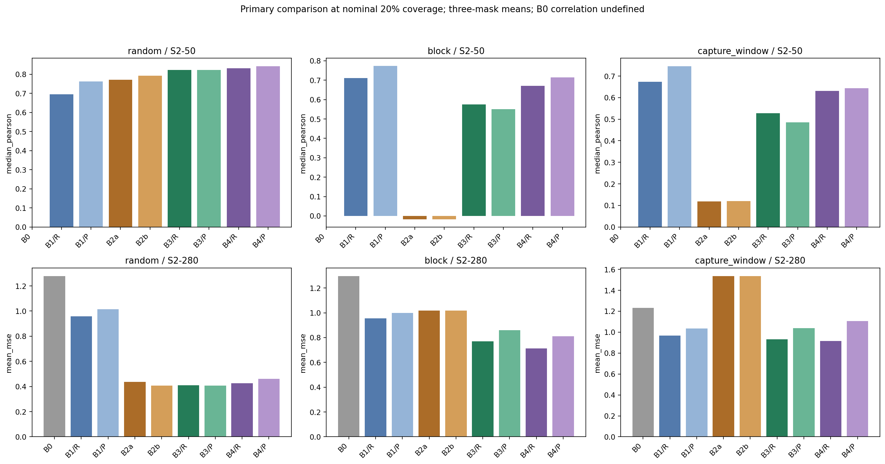

A sparse setting passes its descriptive comparison when at least two of three masks show B2 median-Pearson gain ≥0.02 and MSE reduction ≥2% over B1. Numbers of qualifying primary settings (coverage × geometry) appear below.

## 2. Does H&E improve over sparse-ST interpolation alone?

H&E contribution is B3 minus the **validation-selected stronger B2 family**, separately for each encoder. A fusion setting requires median gene-paired Pearson gain ≥0.01, non-increasing mean MSE, and at least `max(3, ceil(5% of panel size))` genes with mean Pearson gain ≥0.05, positive gain in two masks, and non-increasing MSE. The table reports this fixed rule; it is descriptive, not a statistical significance claim.

| Panel | Encoder | Primary sparse settings | Primary fusion settings | Supporting conditional patients in same geometry | Contiguous ability supported | Full gate pass |
| --- | --- | --- | --- | --- | --- | --- |
| S2-50 | ResNet18 | 5 | 14 | 4 | True | True |
| S2-50 | Phikon | 4 | 14 | 0 | True | False |
| S2-250 | ResNet18 | 6 | 14 | Not run | Not assessed | Not assessed across patients |
| S2-250 | Phikon | 6 | 13 | Not run | Not assessed | Not assessed across patients |
| S2-280 | ResNet18 | 6 | 14 | 4 | True | True |
| S2-280 | Phikon | 6 | 12 | 0 | True | False |

S2-250 conditional folds were not part of the predeclared sensitivity scope; their absence is not a negative patient result. For the passing ResNet18 panels, all four conditional patients have qualifying random-anchor sparse and fusion settings, although the successful coverage need not be identical. Primary random fusion qualifies at 5% and 10%; higher coverage can improve correlation while increasing error relative to interpolation.

[C5_SETTING_GAINS.csv](C5_SETTING_GAINS.csv) and [C5_GENE_GAINS.csv.gz](C5_GENE_GAINS.csv.gz) retain positive and negative morphology contributions. Both frozen representations were carried forward irrespective of their C4 test ranking. Their weighted blends may select lambda zero, correctly indicating no selected H&E contribution for that setting.

## 3. Does learned propagation beat simple fusion?

B4 is judged against B3, never justified merely by beating B1. A qualifying B4 setting requires median gene-paired Pearson gain ≥0.01, no mean-MSE increase, and positive median gain in at least two masks. The table shows how many conditional patients have at least one such setting, plus the number of qualifying primary settings at 10/20/40% that reproduce in at least two conditional patients at the **same geometry and coverage**.

| Panel | Encoder | Qualifying primary B4 settings | Conditional patients with any qualifying B4 setting | Matched primary/fold settings / 9 |
| --- | --- | --- | --- | --- |
| S2-250 | P | 3 | Not run | Not run |
| S2-250 | R | 13 | Not run | Not run |
| S2-280 | P | 5 | 3 | 4 |
| S2-280 | R | 13 | 3 | 6 |
| S2-50 | P | 10 | 3 | 6 |
| S2-50 | R | 14 | 3 | 7 |

B4 improves over B3 in several matched settings, but it has no qualifying setting on NCBI785 for either encoder/panel. At primary S2-50 random 20%, its higher correlation accompanies higher MSE, so that example does not qualify. Its value is conditional on patient and geometry.

B4 is a deliberately small **linear, per-gene, two-hop graph propagation model**, not an exhaustive test of GNN architectures. It learns a residual over B3 using image-only PCA messages, observed indicators, zero-filled observed expression and normalized observed-expression messages on the exact frozen kNN-6/cap-250 graph. No architectural escalation or multiresolution model followed these results.

## 4. How does performance change with measured-ST coverage?

All 216 frozen C0 masks were copied byte-for-byte and classified: three geometries × six coverages (5/10/20/40/60/80%) × three replicates × four patients. The existing 80% masks are retained as a high-coverage endpoint. Primary evaluation uses all 54 test masks and all three panels. Four-patient sensitivity uses 10/20/40%, all three geometries, all three replicates, and S2-50/S2-280. Plots use realized spot coverage; it is not an estimate of physical tissue-area coverage or experimental cost saving.

| Panel | Geometry | Lowest realized coverage | Highest realized coverage | Low-coverage median r | High-coverage median r | Low-coverage MSE | High-coverage MSE |
| --- | --- | --- | --- | --- | --- | --- | --- |
| S2-50 | random | 5.0% | 80.0% | 0.692 | 0.852 | 0.367 | 0.200 |
| S2-50 | block | 4.7% | 79.8% | -0.042 | 0.170 | 1.155 | 0.614 |
| S2-50 | capture_window | 5.0% | 80.0% | 0.029 | 0.119 | 1.047 | 0.836 |
| S2-250 | random | 5.0% | 80.0% | 0.579 | 0.750 | 0.470 | 0.300 |
| S2-250 | block | 4.7% | 79.8% | -0.028 | 0.129 | 1.132 | 0.670 |
| S2-250 | capture_window | 5.0% | 80.0% | 0.040 | 0.103 | 1.039 | 0.855 |
| S2-280 | random | 5.0% | 80.0% | 0.565 | 0.734 | 0.508 | 0.330 |
| S2-280 | block | 4.7% | 79.8% | -0.024 | 0.119 | 1.193 | 0.726 |
| S2-280 | capture_window | 5.0% | 80.0% | 0.039 | 0.095 | 1.101 | 0.908 |

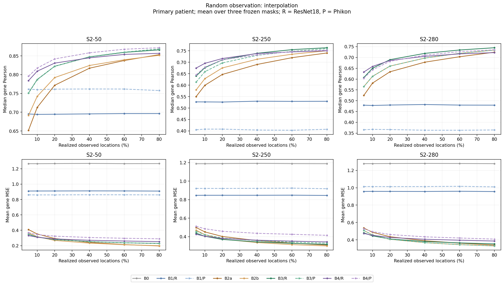

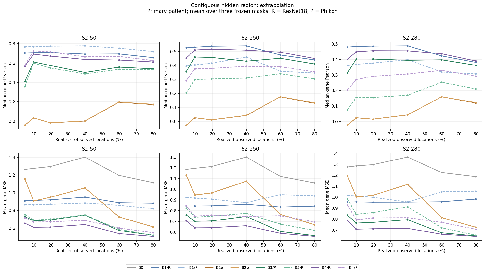

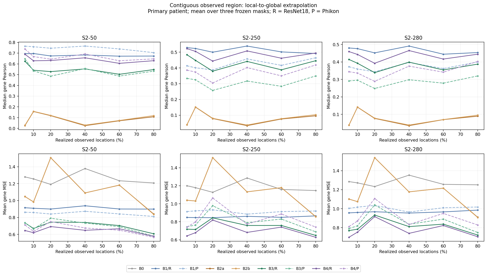

The curves are means over three simulated masks on one primary patient, not independent biological replicates or population confidence intervals. Constant B0 predictions have undefined correlation; they remain undefined in the saved metrics and are evaluated through error.

## 5. How does error change with distance to the nearest observed anchor?

Distances use the inherited estimated physical calibration in micrometers. Frozen bins are [0,150), [150,300), [300,600), [600,1200), [1200,2400), and ≥2400 µm. Every run reports bin count, MSE, MAE and median gene Pearson where at least 20 hidden locations are available. Empty bins are omitted, never assigned zero error. The broad final bin does not locate a precise extrapolation boundary.

The table is ResNet18 B3 at nominal 20%, with equal-mask means per available bin. Counts are summed prediction instances over three masks, not independent patients.

| Panel | Geometry | Distance bin µm | Hidden prediction instances | MSE | MAE | Median gene Pearson |
| --- | --- | --- | --- | --- | --- | --- |
| S2-250 | block | 0–150 | 305 | 0.466 | 0.537 | 0.516 |
| S2-250 | block | 150–300 | 307 | 0.515 | 0.563 | 0.495 |
| S2-250 | block | 300–600 | 921 | 0.519 | 0.565 | 0.390 |
| S2-250 | block | 600–1200 | 1842 | 0.535 | 0.570 | 0.352 |
| S2-250 | block | 1200–2400 | 3684 | 0.579 | 0.596 | 0.339 |
| S2-250 | block | ≥2400 | 43032 | 0.730 | 0.680 | 0.462 |
| S2-250 | capture_window | 0–150 | 764 | 0.447 | 0.532 | 0.699 |
| S2-250 | capture_window | 150–300 | 776 | 0.501 | 0.563 | 0.654 |
| S2-250 | capture_window | 300–600 | 1918 | 0.551 | 0.590 | 0.609 |
| S2-250 | capture_window | 600–1200 | 3802 | 0.620 | 0.625 | 0.506 |
| S2-250 | capture_window | 1200–2400 | 8050 | 0.694 | 0.660 | 0.409 |
| S2-250 | capture_window | ≥2400 | 34516 | 0.935 | 0.769 | 0.332 |
| S2-250 | random | 0–150 | 41144 | 0.360 | 0.467 | 0.717 |
| S2-250 | random | 150–300 | 8392 | 0.414 | 0.501 | 0.680 |
| S2-250 | random | 300–600 | 291 | 0.449 | 0.527 | 0.642 |
| S2-280 | block | 0–150 | 305 | 0.518 | 0.561 | 0.486 |
| S2-280 | block | 150–300 | 307 | 0.576 | 0.586 | 0.445 |
| S2-280 | block | 300–600 | 921 | 0.589 | 0.591 | 0.357 |
| S2-280 | block | 600–1200 | 1842 | 0.616 | 0.599 | 0.311 |
| S2-280 | block | 1200–2400 | 3684 | 0.665 | 0.624 | 0.305 |
| S2-280 | block | ≥2400 | 43032 | 0.792 | 0.697 | 0.409 |
| S2-280 | capture_window | 0–150 | 764 | 0.484 | 0.545 | 0.676 |
| S2-280 | capture_window | 150–300 | 776 | 0.537 | 0.574 | 0.619 |
| S2-280 | capture_window | 300–600 | 1918 | 0.596 | 0.601 | 0.573 |
| S2-280 | capture_window | 600–1200 | 3802 | 0.679 | 0.638 | 0.474 |
| S2-280 | capture_window | 1200–2400 | 8050 | 0.765 | 0.675 | 0.381 |
| S2-280 | capture_window | ≥2400 | 34516 | 1.036 | 0.786 | 0.297 |
| S2-280 | random | 0–150 | 41144 | 0.400 | 0.486 | 0.695 |
| S2-280 | random | 150–300 | 8392 | 0.454 | 0.519 | 0.653 |
| S2-280 | random | 300–600 | 291 | 0.481 | 0.540 | 0.616 |
| S2-50 | block | 0–150 | 305 | 0.427 | 0.524 | 0.665 |
| S2-50 | block | 150–300 | 307 | 0.471 | 0.547 | 0.616 |
| S2-50 | block | 300–600 | 921 | 0.468 | 0.543 | 0.543 |
| S2-50 | block | 600–1200 | 1842 | 0.458 | 0.537 | 0.618 |
| S2-50 | block | 1200–2400 | 3684 | 0.525 | 0.580 | 0.466 |
| S2-50 | block | ≥2400 | 43032 | 0.724 | 0.694 | 0.574 |
| S2-50 | capture_window | 0–150 | 764 | 0.401 | 0.515 | 0.807 |
| S2-50 | capture_window | 150–300 | 776 | 0.463 | 0.555 | 0.763 |
| S2-50 | capture_window | 300–600 | 1918 | 0.518 | 0.586 | 0.711 |
| S2-50 | capture_window | 600–1200 | 3802 | 0.558 | 0.609 | 0.683 |
| S2-50 | capture_window | 1200–2400 | 8050 | 0.614 | 0.639 | 0.608 |
| S2-50 | capture_window | ≥2400 | 34516 | 0.821 | 0.743 | 0.480 |
| S2-50 | random | 0–150 | 41144 | 0.269 | 0.409 | 0.830 |
| S2-50 | random | 150–300 | 8392 | 0.326 | 0.453 | 0.787 |
| S2-50 | random | 300–600 | 291 | 0.354 | 0.481 | 0.774 |

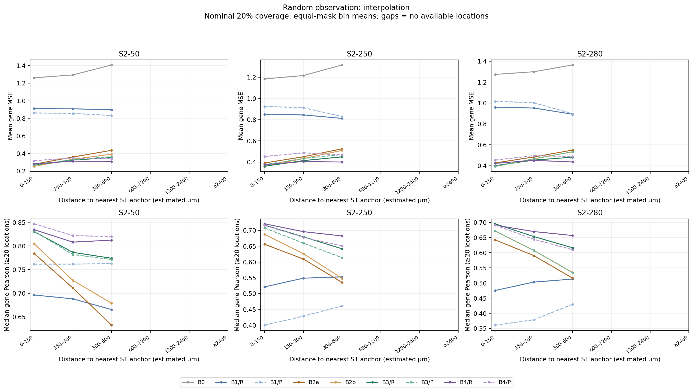

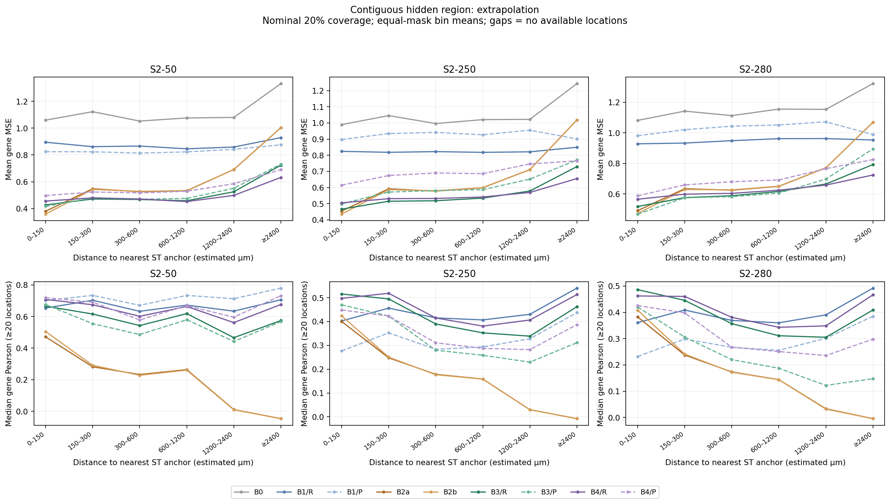

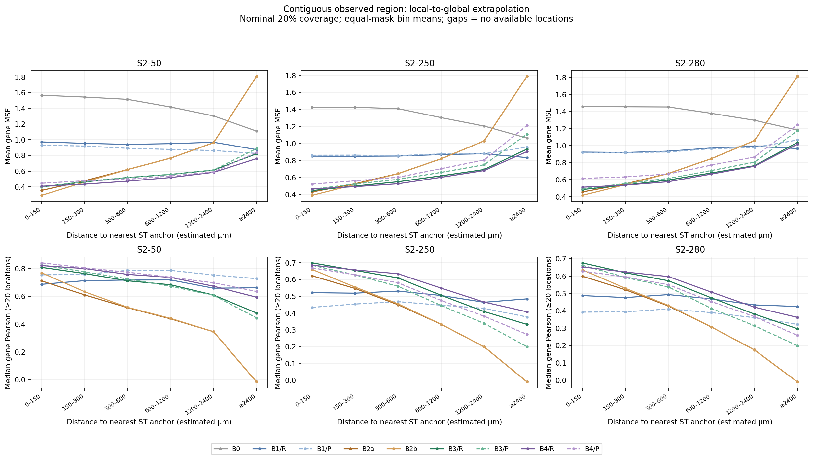

Error need not increase monotonically in every bin: tissue composition, target variance, anchor placement and available counts also change with distance. Full patient/mask/bin data are in [C5_DISTANCE_TO_ANCHOR.csv](C5_DISTANCE_TO_ANCHOR.csv). No robust biological fidelity cutoff was justified before testing, so no scalar effective horizon or biological diffusion length is claimed.

## 6. How different are interpolation and contiguous extrapolation?

Random anchors provide nearby measurements throughout tissue. M2 removes a compact square completely; M3 confines observed anchors to a compact circular window and reconstructs the remainder. These are separate evaluation tasks throughout the tables and figures. A favorable random-mask result is not evidence of general reconstruction into entirely unmeasured tissue.

The examples below were frozen before test evaluation: TENX99, the first frozen S2-50 gene **FOXA1**, nominal 20%, replicate 0, ResNet18 B3, all three geometries. They were not selected by visual quality or prediction scores. Prediction/error maps show only hidden sites; measured sites are not credited as reconstructions.

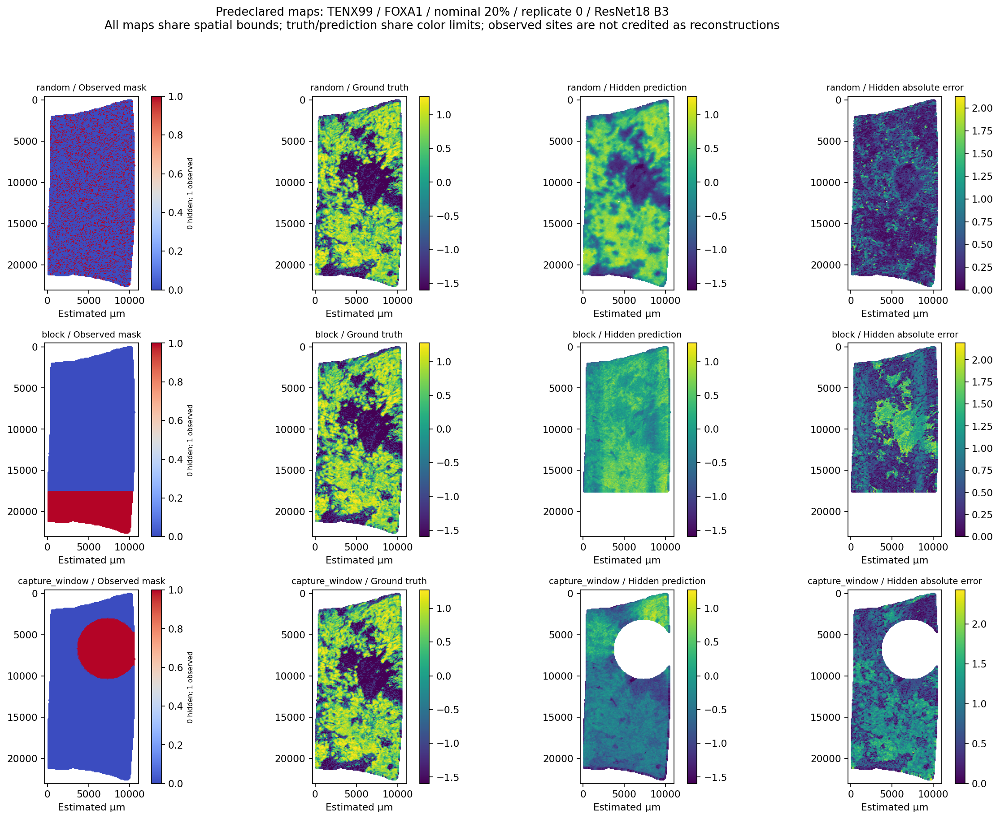

## 7. Which genes appear to need dense versus sparse measurements?

Every gene's complete coverage trajectory is provided in [C5_GENE_COVERAGE.csv.gz](C5_GENE_COVERAGE.csv.gz). Below are the five largest and five smallest primary S2-50 random-interpolation MSE reductions from 5% to 80%, as descriptive contrasts, not validated minimum-coverages or biological categories. Low improvement can mean an already well-predicted gene, an uninformative target, or persistent difficulty; it does not by itself prove low measurement need.

| Gene | Pearson at 5% | Pearson at 80% | MSE at 5% | MSE at 80% |
| --- | --- | --- | --- | --- |
| TOP2A | 0.624 | 0.822 | 0.813 | 0.427 |
| CENPF | 0.569 | 0.791 | 0.765 | 0.417 |
| S100A14 | 0.769 | 0.908 | 0.577 | 0.249 |
| JUP | 0.733 | 0.883 | 0.551 | 0.264 |
| CDH1 | 0.746 | 0.892 | 0.512 | 0.238 |
| ANKRD30A | 0.201 | 0.307 | 0.053 | 0.046 |
| TENT5C | 0.290 | 0.456 | 0.156 | 0.122 |
| SERHL2 | 0.559 | 0.731 | 0.146 | 0.098 |
| SFRP1 | 0.302 | 0.506 | 0.194 | 0.144 |
| KLF5 | 0.580 | 0.702 | 0.214 | 0.163 |

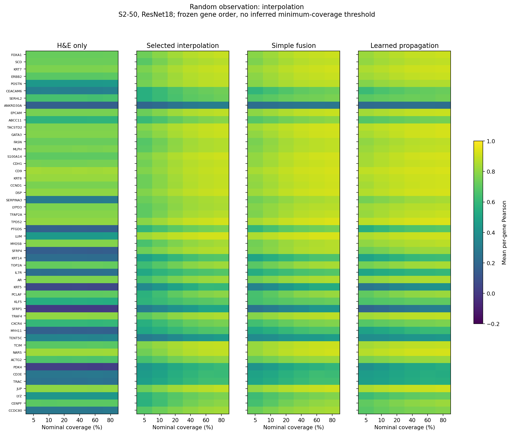

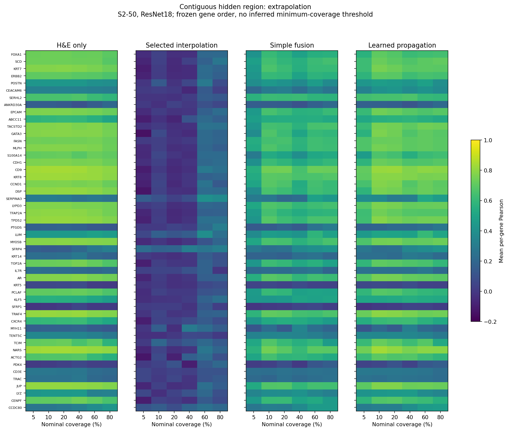

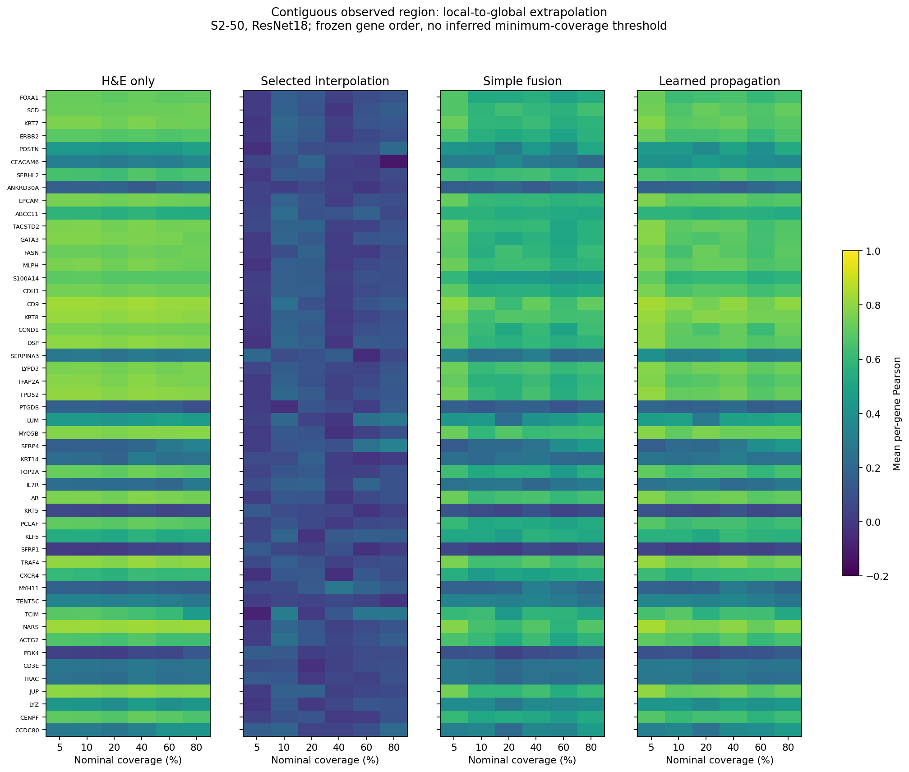

Heatmaps keep the complete frozen 50-gene order. No C*_g threshold is forced and no pathway enrichment or biological interpretation is performed.

## 8. Are results robust across patients and mask geometries?

The following table counts qualifying settings among 10/20/40% within each conditional patient/geometry. R/P denote ResNet18/Phikon. Fold means here average the three coverage settings, not pooled spots.

| Held-out patient sample | Panel | Geometry | Encoder | Sparse settings / 3 | Fusion settings / 3 | Propagation settings / 3 | Mean median fusion gain | Mean fusion MSE reduction |
| --- | --- | --- | --- | --- | --- | --- | --- | --- |
| NCBI783 | S2-280 | block | P | 0 | 3 | 3 | +0.237 | +0.332 |
| NCBI783 | S2-280 | block | R | 0 | 3 | 3 | +0.382 | +0.452 |
| NCBI783 | S2-280 | capture_window | P | 0 | 3 | 3 | +0.485 | +0.550 |
| NCBI783 | S2-280 | capture_window | R | 0 | 3 | 3 | +0.384 | +0.373 |
| NCBI783 | S2-280 | random | P | 0 | 0 | 3 | +0.000 | +0.000 |
| NCBI783 | S2-280 | random | R | 2 | 3 | 1 | +0.060 | +0.038 |
| NCBI783 | S2-50 | block | P | 0 | 3 | 3 | +0.477 | +0.542 |
| NCBI783 | S2-50 | block | R | 0 | 3 | 3 | +0.367 | +0.423 |
| NCBI783 | S2-50 | capture_window | P | 0 | 3 | 3 | +0.526 | +0.557 |
| NCBI783 | S2-50 | capture_window | R | 0 | 3 | 3 | +0.401 | +0.355 |
| NCBI783 | S2-50 | random | P | 0 | 3 | 3 | +0.075 | +0.068 |
| NCBI783 | S2-50 | random | R | 3 | 2 | 0 | +0.054 | +0.017 |
| NCBI785 | S2-280 | block | P | 0 | 3 | 0 | +0.159 | +0.131 |
| NCBI785 | S2-280 | block | R | 0 | 3 | 0 | +0.376 | +0.274 |
| NCBI785 | S2-280 | capture_window | P | 0 | 1 | 0 | +0.329 | +0.047 |
| NCBI785 | S2-280 | capture_window | R | 0 | 3 | 0 | +0.388 | +0.231 |
| NCBI785 | S2-280 | random | P | 3 | 0 | 0 | +0.000 | +0.000 |
| NCBI785 | S2-280 | random | R | 2 | 2 | 0 | +0.045 | +0.017 |
| NCBI785 | S2-50 | block | P | 0 | 3 | 0 | +0.441 | +0.195 |
| NCBI785 | S2-50 | block | R | 0 | 3 | 0 | +0.474 | +0.368 |
| NCBI785 | S2-50 | capture_window | P | 0 | 1 | 0 | +0.387 | +0.049 |
| NCBI785 | S2-50 | capture_window | R | 0 | 3 | 0 | +0.410 | +0.233 |
| NCBI785 | S2-50 | random | P | 2 | 0 | 0 | +0.041 | -0.035 |
| NCBI785 | S2-50 | random | R | 3 | 2 | 0 | +0.039 | +0.007 |
| TENX95 | S2-280 | block | P | 0 | 3 | 3 | +0.224 | +0.166 |
| TENX95 | S2-280 | block | R | 0 | 3 | 3 | +0.373 | +0.196 |
| TENX95 | S2-280 | capture_window | P | 0 | 3 | 3 | +0.492 | +0.318 |
| TENX95 | S2-280 | capture_window | R | 0 | 3 | 3 | +0.438 | +0.279 |
| TENX95 | S2-280 | random | P | 0 | 0 | 3 | +0.000 | +0.000 |
| TENX95 | S2-280 | random | R | 1 | 3 | 2 | +0.079 | +0.041 |
| TENX95 | S2-50 | block | P | 0 | 3 | 3 | +0.479 | +0.249 |
| TENX95 | S2-50 | block | R | 0 | 3 | 3 | +0.431 | +0.225 |
| TENX95 | S2-50 | capture_window | P | 0 | 3 | 3 | +0.587 | +0.357 |
| TENX95 | S2-50 | capture_window | R | 0 | 3 | 3 | +0.530 | +0.323 |
| TENX95 | S2-50 | random | P | 0 | 3 | 2 | +0.086 | +0.040 |
| TENX95 | S2-50 | random | R | 1 | 3 | 3 | +0.078 | +0.032 |
| TENX99 | S2-280 | block | P | 0 | 3 | 3 | +0.210 | +0.201 |
| TENX99 | S2-280 | block | R | 0 | 3 | 3 | +0.409 | +0.293 |
| TENX99 | S2-280 | capture_window | P | 0 | 3 | 3 | +0.339 | +0.524 |
| TENX99 | S2-280 | capture_window | R | 0 | 3 | 3 | +0.337 | +0.509 |
| TENX99 | S2-280 | random | P | 3 | 0 | 3 | +0.000 | +0.000 |
| TENX99 | S2-280 | random | R | 3 | 2 | 1 | +0.039 | +0.014 |
| TENX99 | S2-50 | block | P | 0 | 3 | 3 | +0.651 | +0.342 |
| TENX99 | S2-50 | block | R | 0 | 3 | 3 | +0.608 | +0.298 |
| TENX99 | S2-50 | capture_window | P | 0 | 3 | 3 | +0.512 | +0.564 |
| TENX99 | S2-50 | capture_window | R | 0 | 3 | 3 | +0.485 | +0.533 |
| TENX99 | S2-50 | random | P | 0 | 3 | 1 | +0.048 | +0.016 |
| TENX99 | S2-50 | random | R | 2 | 2 | 1 | +0.042 | +0.006 |

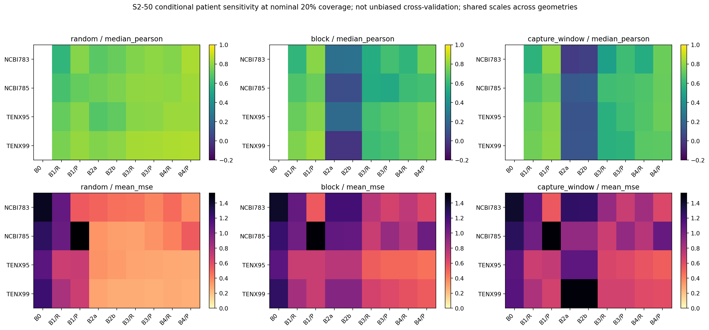

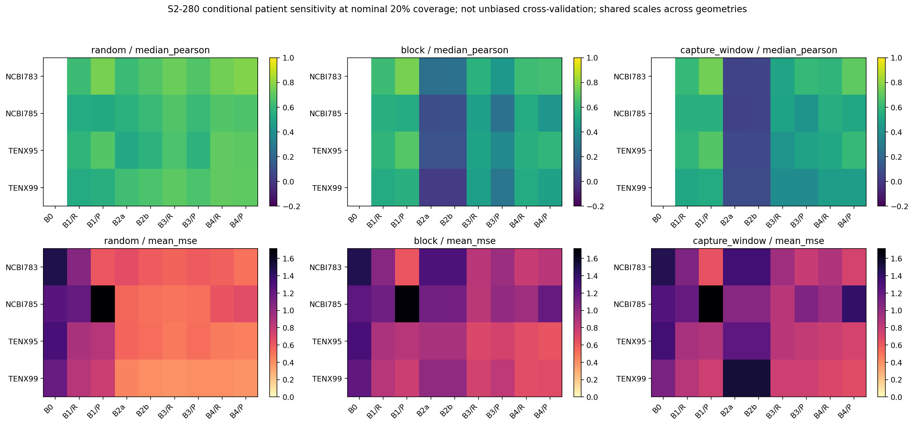

These folds train C5 parameters and image scalers on the other three patients. B1 uses the matching frozen C4 fold models. Interpolation/fusion/regularization choices remain primary-selected. Panels, C0 target units and previous checkpoint development decisions are inherited. This is **conditional patient sensitivity**, not unbiased cross-validation or external validation; the training cohorts overlap and prior test outcomes were known.

### Information-specific negative controls

NC1 permutes observed expression vectors; NC2 permutes their assigned observed positions; NC3 permutes images and corresponding frozen image predictions while molecular anchors stay fixed. NC1 and NC2 are equivalent families of association-breaking nulls, not independent biological mechanisms. Each uses three seeds at the fixed S2-50, random 20%, replicate-0 test mask. Models were not retuned. The table reports all control correlations and average changes from the same uncorrupted model; positive MSE change is worse.

| Model | Encoder | Control | Median Pearson by control seed | Mean Pearson change | Mean MSE change |
| --- | --- | --- | --- | --- | --- |
| B1 | pathology_encoder_1 | NC3 | 0.002, 0.007, -0.006 | -0.761 | +0.463 |
| B1 | resnet18_reference | NC3 | 0.005, 0.013, -0.005 | -0.691 | +0.552 |
| B2a | none | NC1 | -0.006, 0.007, 0.036 | -0.756 | +0.569 |
| B2a | none | NC2 | -0.005, -0.017, 0.025 | -0.768 | +0.577 |
| B2b | none | NC1 | -0.005, 0.004, 0.036 | -0.779 | +0.532 |
| B2b | none | NC2 | -0.004, -0.027, 0.030 | -0.791 | +0.539 |
| B3 | pathology_encoder_1 | NC1 | 0.265, 0.279, 0.299 | -0.539 | +0.397 |
| B3 | pathology_encoder_1 | NC2 | 0.262, 0.246, 0.295 | -0.553 | +0.401 |
| B3 | pathology_encoder_1 | NC3 | 0.763, 0.766, 0.763 | -0.056 | +0.058 |
| B3 | resnet18_reference | NC1 | 0.303, 0.315, 0.355 | -0.496 | +0.384 |
| B3 | resnet18_reference | NC2 | 0.305, 0.294, 0.351 | -0.504 | +0.388 |
| B3 | resnet18_reference | NC3 | 0.754, 0.756, 0.753 | -0.066 | +0.067 |
| B4 | pathology_encoder_1 | NC1 | 0.585, 0.579, 0.596 | -0.253 | +0.274 |
| B4 | pathology_encoder_1 | NC2 | 0.573, 0.577, 0.601 | -0.257 | +0.276 |
| B4 | pathology_encoder_1 | NC3 | 0.658, 0.661, 0.655 | -0.182 | +0.159 |
| B4 | resnet18_reference | NC1 | 0.561, 0.571, 0.583 | -0.258 | +0.270 |
| B4 | resnet18_reference | NC2 | 0.568, 0.567, 0.584 | -0.256 | +0.272 |
| B4 | resnet18_reference | NC3 | 0.619, 0.622, 0.615 | -0.210 | +0.163 |

The controls show the intended information dependence: anchor permutations reduce molecular-only median Pearson to approximately zero, and image permutation reduces B1 correlation to approximately zero. Fused models retain whichever information source is still intact.

When selected lambda is zero, an image permutation should have no effect on B3 because it has no H&E contribution. Conversely, a molecular permutation need not erase the remaining image signal in a fused model. These controls are reported as information-specific diagnostics; they are distinct from the mandatory hidden-label invariance test.

## 9. Is a later sampling-optimization checkpoint justified?

**PROCEED_TO_SAMPLING_OPTIMIZATION**

The predeclared decision requires primary sparse and H&E-fusion gains, support in more than one conditional patient, nontrivial contiguous reconstruction, coherent random coverage response, complete distance diagnostics and technical integrity. Learned propagation is not required for a sparse-reconstruction PASS. Coherence means positive coverage–Pearson and negative coverage–MSE Spearman trends for selected random interpolation in at least two of three panels. A PASS with at least 10% low-to-high-coverage MSE change recommends later sampling optimization; other PASS recommends external validation. MIXED/FAIL stop for sparse-ST review. No C6 or external-validation experiment was executed.

## Methods, frozen selection and reproducibility

| Panel | Geometry | kNN k | IDW exponent (16 neighbors) | Selected B2 family | ResNet lambda | Phikon lambda |
| --- | --- | --- | --- | --- | --- | --- |
| S2-50 | random | 4 | 2 | B2b | 0.25 | 0.25 |
| S2-50 | block | 16 | 1 | B2a | 0.5 | 0.5 |
| S2-50 | capture_window | 16 | 3 | B2b | 0.5 | 0.5 |
| S2-250 | random | 8 | 2 | B2b | 0.25 | 0.25 |
| S2-250 | block | 16 | 1 | B2a | 0.5 | 0.5 |
| S2-250 | capture_window | 16 | 2 | B2b | 0.5 | 0.5 |
| S2-280 | random | 8 | 2 | B2b | 0.25 | 0 |
| S2-280 | block | 16 | 1 | B2a | 0.5 | 0.25 |
| S2-280 | capture_window | 16 | 2 | B2b | 0.5 | 0.5 |

Both encoders use the same k grid [1,4,8,16], IDW exponents [1,2,3], fusion weights [0,0.25,0.5,0.75,1] and B4 regularization grid [1,100,10000]. Choices minimize equal-mask validation MSE within the prespecified grouping. All six B4 primary choices reached alpha=10000, the upper grid boundary; the grid was not expanded after outcomes. Each training mask contributes up to 256 deterministically sampled hidden-location supervised targets, all from training patients. These targets enter only the main loss. There are no contrastive pairs, retrieval banks, auxiliary molecular targets or optional cross-modal losses.

B0 is the training-anchor mean from fixed 60%-random-replicate-0 masks, excluding held-out expression. B1 averages the three frozen C4 local seeds. Saved held-out predictions are reused; missing training/validation predictions are generated by read-only frozen-head inference. No C0–C4 model was refitted or retuned. B4 uses eight image-only PCA components, plus local and propagated image/molecular summaries; its per-gene residual head has 35 coefficients. PCA scaling is trained only on the permitted training H&E. No new expression-derived normalization or scaling is fitted. The inherited C0 target transformation remains fixed as required, which also limits the interpretation of sensitivity folds.

Technical audit: **PASS**. All 3456 prediction files and observed/hidden barcode identities passed. All 6912 full-hidden-vector NaN/random corruption comparisons returned identical predictions (maximum difference 0). The independent replay covers 351 stratified runs: every model/encoder/geometry/patient/panel at 20%-replicate-0, plus all negative controls; maximum prediction difference 0. All 216 mask copies, 10 training-only image scalers, B4 checkpoints and frozen C0–C4 artifacts passed. This is sampled independent replay, not a claim of independently rerunning every saved prediction twice.

All prediction runs retain source commit, mask/checksum, barcode lists, encoder/cache hashes, configuration, scaler/checkpoint references, seed, predictions, runtime and peak RSS. Runs are appended to the global registry without changing its header or prior prefix; the lossless extension is [C5_REGISTRY_EXTENSIONS.csv](C5_REGISTRY_EXTENSIONS.csv). [C5_RESOURCE_PROFILE.csv](C5_RESOURCE_PROFILE.csv) includes inference, corruption-audit and metric time together; model-fit events retain training resources. Large uncompressed predictions/models/caches remain local and are hashed in the final manifest. Full gene CSVs exist locally; gzip copies are committed to keep repository files manageable.

Stop after C5 for review. No new encoder, encoder fine-tuning, multiresolution graph, pathway analysis, explainability, biological mechanism, experimental cost saving or clinical claim is introduced.
