C6A status: **MIXED_SAMPLING_EFFECT**

# C6A — Fixed-budget sampling strategy comparison

The task is placement of molecular measurements at a fixed count, with the C5 reconstruction pipeline unchanged. These are four-patient **conditional development** experiments, with a separate frozen primary split. They do not establish external generalization or monetary savings. S2-280 is the full shared assay panel.

## Decision and main comparisons

The pretest gate is **MIXED_SAMPLING_EFFECT**. Spatial A1 has repeatable open-sampling value, clearest with the simple reconstruction models, but no qualifying contiguous setting in any conditional patient. Morphology-only A2 has no qualifying open setting on either panel/encoder, and joint A3 does not combine portable open and contiguous benefit. C6B is permitted only after an audited `PASS_SAMPLING_EFFECT`; all other C6A outcomes stop for review or external-validation planning. A0 is ten-seed uniform random sampling; A1 is spatial farthest-point sampling (FPS); A2 is morphology FPS; A3 is joint spatial–morphology FPS.

| Panel | Encoder | Strategy | Primary open budgets / 4 | Primary stress budgets / 4 | Conditional open patients / 4 | Conditional stress patients / 4 | No systematic MSE harm | Full gate pass |
| --- | --- | --- | --- | --- | --- | --- | --- | --- |
| S2-280 | Phikon | A1 | 4 | 0 | 4 | 0 | True | False |
| S2-280 | Phikon | A2 | 0 | 0 | 0 | 0 | False | False |
| S2-280 | Phikon | A3 | 0 | 2 | 3 | 1 | False | False |
| S2-280 | ResNet18 | A1 | 0 | 0 | 1 | 0 | True | False |
| S2-280 | ResNet18 | A2 | 0 | 0 | 0 | 0 | False | False |
| S2-280 | ResNet18 | A3 | 0 | 0 | 0 | 0 | False | False |
| S2-50 | Phikon | A1 | 4 | 0 | 4 | 0 | True | False |
| S2-50 | Phikon | A2 | 0 | 0 | 0 | 0 | False | False |
| S2-50 | Phikon | A3 | 1 | 0 | 4 | 0 | False | False |
| S2-50 | ResNet18 | A1 | 0 | 0 | 2 | 0 | True | False |
| S2-50 | ResNet18 | A2 | 0 | 1 | 0 | 0 | False | False |
| S2-50 | ResNet18 | A3 | 1 | 0 | 2 | 0 | False | False |

A qualifying setting must beat the ten-seed random mean by at least **max(0.01, random Pearson SD)** in median gene Pearson, reduce mean MSE by at least **2%**, and beat at least **8/10** random seeds on both metrics. PASS further requires at least two qualifying primary open budgets, one primary stress budget, and support in at least two conditional patients in each regime for the same strategy/panel/encoder. Across its primary and conditional settings, mean relative MSE gain must be nonnegative and no more than 25% may worsen MSE by over 2%. These are frozen development decision rules, not population significance tests. The Phikon B3 branch qualifies at all four primary open budgets on both panels and has open-setting support in all four conditional patients, while its A1 stress-setting support is zero.

## Reconstruction models and budget fairness

C5 did not freeze one universal winning family. Its saved validation scores, averaged over the same 54 validation masks, favor B4 for ResNet18 and B3 for Phikon on both panels. C6 uses those configurations as the primary reconstruction models, with C5's selected molecular-only B2a/B2b family as a required baseline. No C5 primary-test score selects the family, encoder, or parameters. Comparisons between encoder branches also involve different selected reconstruction families; they cannot isolate encoder quality. In particular, Phikon S2-280 open B3 has lambda=0 and is exactly the molecular-only interpolator. Both frozen encoders remain in the experiment. See [C5_MODEL_DECISION.json](configs/C5_MODEL_DECISION.json) for the exact C5 validation events.

Every policy selects exactly `floor(N * budget + 0.5)` locations at 5%, 10%, 20%, and 40%, with N equal to the full tissue's location count. Budget prefixes are nested but **C6A is one-shot**: no measured expression influences any subsequent choice. Each prefix's molecular values are revealed together only after every full test trajectory is frozen. The complete ordered barcode trace is in [C6A_SELECTIONS.csv.gz](C6A_SELECTIONS.csv.gz), with counts and policy identities in [C6A_POLICY_MANIFEST.csv](C6A_POLICY_MANIFEST.csv).

In **open** sampling, all locations are eligible and every unmeasured location is scored. The scoring population therefore changes when different locations are measured; this is the operational unmeasured-tissue estimand, not a paired comparison on identical locations. The **contiguous stress test** keeps the complement of the frozen C0 block mask at nominal 60% observed, replicate 0, permanently unavailable. Every strategy samples outside that region and is scored inside the exact same region, at every budget. All other unobserved locations also have no expression input. This common scoring region helps distinguish true extrapolation effects from evaluation-set composition.

## Primary 20% comparison

Random entries are mean ± SD over all ten seeds; deterministic policies have one fixed trace. Baseline entries are corresponding interpolation-only results on the same selected anchors. Gains refer to the primary reconstruction role, and positive MSE reduction means improvement.

| Encoder | Panel | Regime | Policy | Primary median r | Primary MSE | Baseline median r | Baseline MSE | Pearson gain | Relative MSE reduction |
| --- | --- | --- | --- | --- | --- | --- | --- | --- | --- |
| Phikon | S2-280 | contiguous | A0 | 0.340 ± 0.021 | 0.707 ± 0.018 | 0.253 | 0.777 | reference | reference |
| Phikon | S2-280 | contiguous | A1 | 0.318 | 0.736 | 0.231 | 0.822 | -0.022 | -4.1% |
| Phikon | S2-280 | contiguous | A2 | 0.335 | 0.710 | 0.241 | 0.780 | -0.005 | -0.5% |
| Phikon | S2-280 | contiguous | A3 | 0.370 | 0.683 | 0.278 | 0.746 | +0.030 | +3.3% |
| Phikon | S2-280 | open | A0 | 0.660 ± 0.001 | 0.408 ± 0.002 | 0.660 | 0.408 | reference | reference |
| Phikon | S2-280 | open | A1 | 0.686 | 0.379 | 0.686 | 0.379 | +0.027 | +7.1% |
| Phikon | S2-280 | open | A2 | 0.604 | 0.459 | 0.604 | 0.459 | -0.056 | -12.4% |
| Phikon | S2-280 | open | A3 | 0.664 | 0.398 | 0.664 | 0.398 | +0.004 | +2.4% |
| Phikon | S2-50 | contiguous | A0 | 0.662 ± 0.022 | 0.592 ± 0.010 | 0.377 | 0.674 | reference | reference |
| Phikon | S2-50 | contiguous | A1 | 0.642 | 0.597 | 0.355 | 0.708 | -0.020 | -0.8% |
| Phikon | S2-50 | contiguous | A2 | 0.652 | 0.592 | 0.353 | 0.679 | -0.010 | -0.0% |
| Phikon | S2-50 | contiguous | A3 | 0.683 | 0.584 | 0.412 | 0.644 | +0.021 | +1.4% |
| Phikon | S2-50 | open | A0 | 0.820 ± 0.002 | 0.282 ± 0.001 | 0.788 | 0.272 | reference | reference |
| Phikon | S2-50 | open | A1 | 0.843 | 0.260 | 0.816 | 0.240 | +0.023 | +7.5% |
| Phikon | S2-50 | open | A2 | 0.775 | 0.322 | 0.728 | 0.330 | -0.045 | -14.2% |
| Phikon | S2-50 | open | A3 | 0.828 | 0.280 | 0.804 | 0.264 | +0.008 | +0.5% |
| ResNet18 | S2-280 | contiguous | A0 | 0.525 ± 0.007 | 0.645 ± 0.009 | 0.253 | 0.777 | reference | reference |
| ResNet18 | S2-280 | contiguous | A1 | 0.509 | 0.661 | 0.231 | 0.822 | -0.016 | -2.5% |
| ResNet18 | S2-280 | contiguous | A2 | 0.529 | 0.633 | 0.292 | 0.738 | +0.004 | +1.8% |
| ResNet18 | S2-280 | contiguous | A3 | 0.516 | 0.646 | 0.242 | 0.781 | -0.009 | -0.1% |
| ResNet18 | S2-280 | open | A0 | 0.685 ± 0.002 | 0.428 ± 0.001 | 0.660 | 0.408 | reference | reference |
| ResNet18 | S2-280 | open | A1 | 0.695 | 0.418 | 0.686 | 0.379 | +0.010 | +2.4% |
| ResNet18 | S2-280 | open | A2 | 0.663 | 0.456 | 0.628 | 0.437 | -0.023 | -6.5% |
| ResNet18 | S2-280 | open | A3 | 0.682 | 0.435 | 0.657 | 0.405 | -0.003 | -1.6% |
| ResNet18 | S2-50 | contiguous | A0 | 0.722 ± 0.010 | 0.519 ± 0.009 | 0.377 | 0.674 | reference | reference |
| ResNet18 | S2-50 | contiguous | A1 | 0.714 | 0.524 | 0.355 | 0.708 | -0.008 | -1.1% |
| ResNet18 | S2-50 | contiguous | A2 | 0.735 | 0.501 | 0.439 | 0.629 | +0.012 | +3.5% |
| ResNet18 | S2-50 | contiguous | A3 | 0.714 | 0.520 | 0.366 | 0.679 | -0.008 | -0.3% |
| ResNet18 | S2-50 | open | A0 | 0.830 ± 0.001 | 0.289 ± 0.001 | 0.788 | 0.272 | reference | reference |
| ResNet18 | S2-50 | open | A1 | 0.837 | 0.278 | 0.816 | 0.240 | +0.007 | +3.7% |
| ResNet18 | S2-50 | open | A2 | 0.819 | 0.300 | 0.759 | 0.302 | -0.011 | -3.7% |
| ResNet18 | S2-50 | open | A3 | 0.835 | 0.286 | 0.798 | 0.267 | +0.006 | +1.1% |

At 20% open coverage, A1 improves the interpolation-only baseline by +0.028 Pearson and 11.7% lower MSE for S2-50, and +0.027 Pearson and 7.1% lower MSE for S2-280. With the ResNet18 B4 model, the corresponding correlation gains are smaller (approximately +0.007 and +0.010; the latter is 0.009977) and fall below the exact frozen threshold, despite MSE reductions of 3.7% and 2.4%. Decisions use unrounded values.

All masks, gene-wise Pearson/Spearman/MSE/MAE, panel correlation fractions, MAE, counts, hashes and resources are retained in [C6A_PANEL_METRICS.csv](C6A_PANEL_METRICS.csv) and [C6A_GENE_METRICS.csv.gz](C6A_GENE_METRICS.csv.gz). The full random distribution is [C6A_RANDOM_DISTRIBUTION.csv](C6A_RANDOM_DISTRIBUTION.csv). Spots and random seeds are not independent biological replicates.

## Budget-response curves and empirical random variation

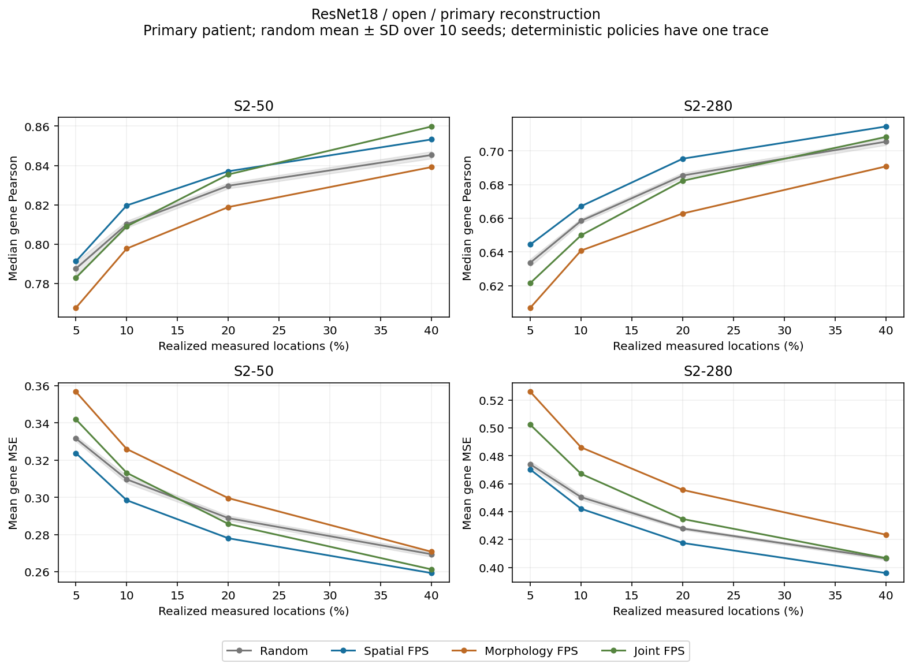
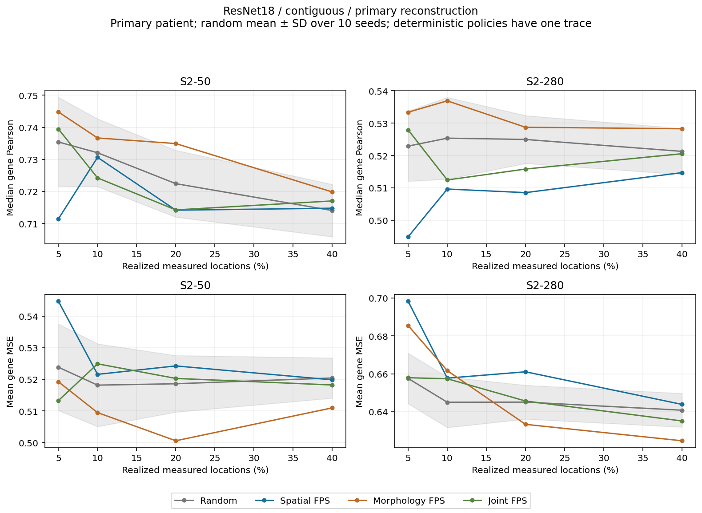
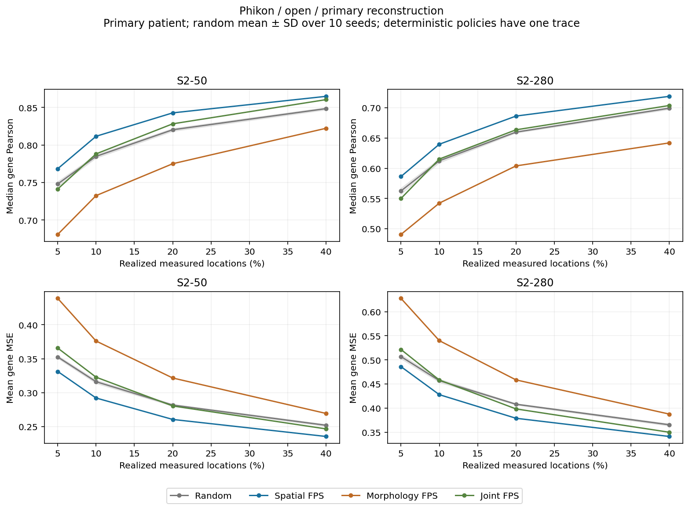
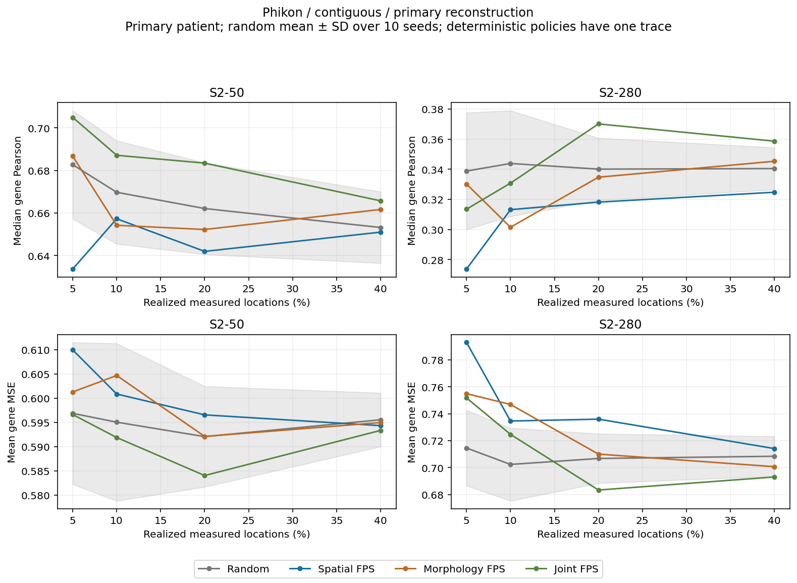

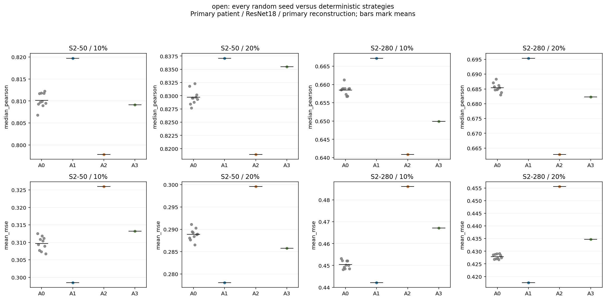

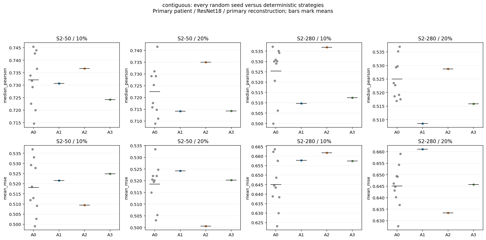

[Budget curves](C6A_BUDGET_CURVES.csv) retain every strategy, encoder, reconstruction role and patient. [AUC-coverage](C6A_AUC_COVERAGE.csv) uses trapezoidal integration divided by the realized budget span, on the same four points; larger Pearson AUC and smaller MSE/MAE AUC are better. It is descriptive and does not replace the raw curves. There is no frozen fidelity threshold, minimum required coverage, or monetary efficiency claim.

Primary reconstruction AUC values below average the ten random seed curves for A0 and use the single frozen curve for each deterministic strategy.

| Encoder | Panel | Regime | Policy | Pearson AUC-coverage | MSE AUC-coverage |
| --- | --- | --- | --- | --- | --- |
| Phikon | S2-280 | contiguous | A0 | 0.341 | 0.707 |
| Phikon | S2-280 | contiguous | A1 | 0.316 | 0.734 |
| Phikon | S2-280 | contiguous | A2 | 0.330 | 0.718 |
| Phikon | S2-280 | contiguous | A3 | 0.354 | 0.700 |
| Phikon | S2-280 | open | A0 | 0.654 | 0.414 |
| Phikon | S2-280 | open | A1 | 0.679 | 0.386 |
| Phikon | S2-280 | open | A2 | 0.594 | 0.468 |
| Phikon | S2-280 | open | A3 | 0.657 | 0.406 |
| Phikon | S2-50 | contiguous | A0 | 0.663 | 0.594 |
| Phikon | S2-50 | contiguous | A1 | 0.647 | 0.598 |
| Phikon | S2-50 | contiguous | A2 | 0.658 | 0.596 |
| Phikon | S2-50 | contiguous | A3 | 0.681 | 0.589 |
| Phikon | S2-50 | open | A0 | 0.816 | 0.286 |
| Phikon | S2-50 | open | A1 | 0.837 | 0.265 |
| Phikon | S2-50 | open | A2 | 0.773 | 0.327 |
| Phikon | S2-50 | open | A3 | 0.823 | 0.286 |
| ResNet18 | S2-280 | contiguous | A0 | 0.524 | 0.645 |
| ResNet18 | S2-280 | contiguous | A1 | 0.510 | 0.658 |
| ResNet18 | S2-280 | contiguous | A2 | 0.531 | 0.641 |
| ResNet18 | S2-280 | contiguous | A3 | 0.517 | 0.646 |
| ResNet18 | S2-280 | open | A0 | 0.682 | 0.430 |
| ResNet18 | S2-280 | open | A1 | 0.691 | 0.420 |
| ResNet18 | S2-280 | open | A2 | 0.662 | 0.458 |
| ResNet18 | S2-280 | open | A3 | 0.678 | 0.439 |
| ResNet18 | S2-50 | contiguous | A0 | 0.723 | 0.519 |
| ResNet18 | S2-50 | contiguous | A1 | 0.718 | 0.524 |
| ResNet18 | S2-50 | contiguous | A2 | 0.732 | 0.507 |
| ResNet18 | S2-50 | contiguous | A3 | 0.719 | 0.520 |
| ResNet18 | S2-50 | open | A0 | 0.827 | 0.291 |
| ResNet18 | S2-50 | open | A1 | 0.835 | 0.280 |
| ResNet18 | S2-50 | open | A2 | 0.817 | 0.301 |
| ResNet18 | S2-50 | open | A3 | 0.833 | 0.289 |

## Does morphology guidance add value beyond spatial coverage?

The following contrasts average across the four conditional patients and four budgets, separately by panel and geometry. Positive values favor morphology-guided policy over A1. This aggregate is descriptive; patient-resolved figures and raw tables expose reversals and heterogeneity.

| Encoder | Panel | Regime | Policy vs A1 | Mean Pearson gain | Mean MSE reduction |
| --- | --- | --- | --- | --- | --- |
| Phikon | S2-280 | contiguous | A2 | -0.005 | -0.036 |
| Phikon | S2-280 | contiguous | A3 | -0.007 | -0.017 |
| Phikon | S2-280 | open | A2 | -0.063 | -0.076 |
| Phikon | S2-280 | open | A3 | -0.020 | -0.023 |
| Phikon | S2-50 | contiguous | A2 | +0.006 | -0.031 |
| Phikon | S2-50 | contiguous | A3 | +0.002 | -0.019 |
| Phikon | S2-50 | open | A2 | -0.036 | -0.065 |
| Phikon | S2-50 | open | A3 | -0.005 | -0.031 |
| ResNet18 | S2-280 | contiguous | A2 | +0.008 | -0.006 |
| ResNet18 | S2-280 | contiguous | A3 | +0.009 | -0.000 |
| ResNet18 | S2-280 | open | A2 | -0.015 | -0.026 |
| ResNet18 | S2-280 | open | A3 | -0.006 | -0.016 |
| ResNet18 | S2-50 | contiguous | A2 | +0.006 | -0.005 |
| ResNet18 | S2-50 | contiguous | A3 | +0.002 | -0.001 |
| ResNet18 | S2-50 | open | A2 | -0.020 | -0.030 |
| ResNet18 | S2-50 | open | A3 | -0.006 | -0.016 |

A2/A3 operate in the **eight frozen training-only C5 image-PCA components**, not a new encoder or an unrestricted high-dimensional morphology search. Spatial coordinates are normalized by within-tissue RMS radial distance; no expression determines scaling or clustering. A3's small alpha grid was selected on validation MSE averaged equally across panels, regimes and budgets. Both encoders selected alpha=0.75; A1 was the strongest nonrandom validation policy for both. The grid was not expanded after testing. A4 was skipped because C5 provides no validated uncertainty acquisition rule.

| Encoder | Policy | Alpha | Validation MSE |
| --- | --- | --- | --- |
| ResNet18 | A1 | — | 0.482725 |
| ResNet18 | A2 | — | 0.503656 |
| ResNet18 | A3 | 0.25 | 0.505152 |
| ResNet18 | A3 | 0.5 | 0.498473 |
| ResNet18 | A3 | 0.75 | 0.496659 |
| Phikon | A1 | — | 0.527475 |
| Phikon | A2 | — | 0.569594 |
| Phikon | A3 | 0.25 | 0.554799 |
| Phikon | A3 | 0.5 | 0.553364 |
| Phikon | A3 | 0.75 | 0.547489 |

## Geometry, distances and contiguous extrapolation

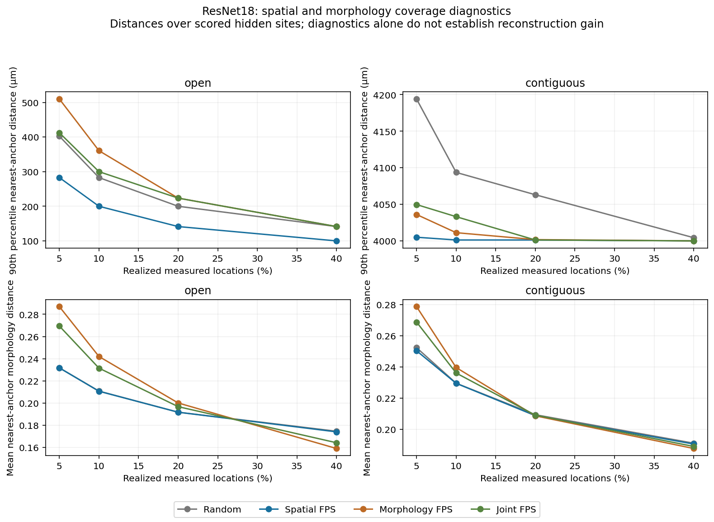

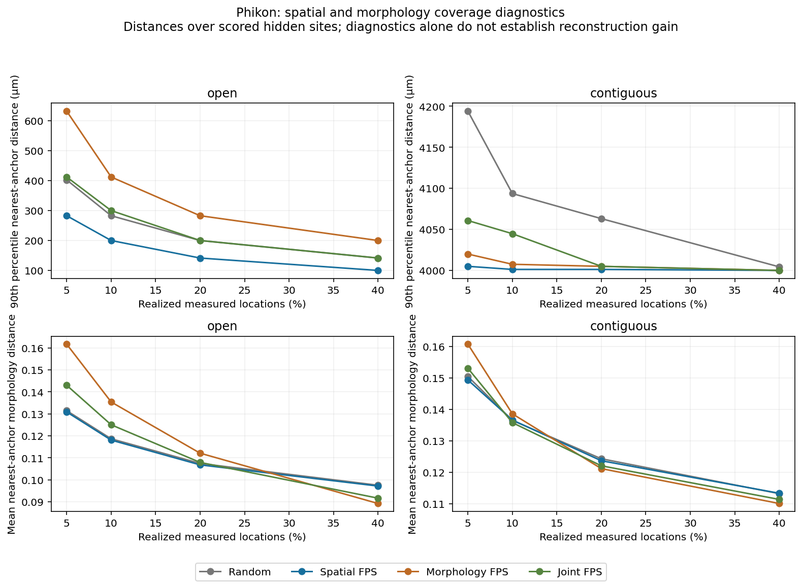

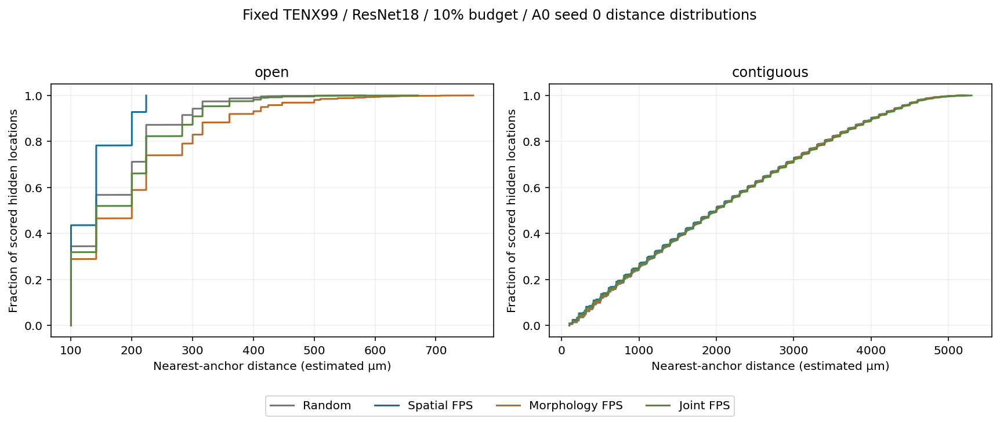

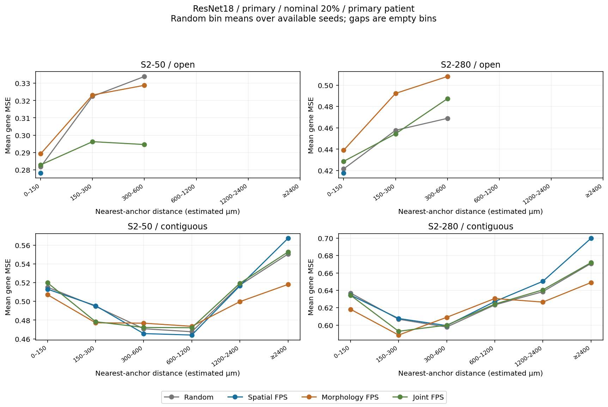

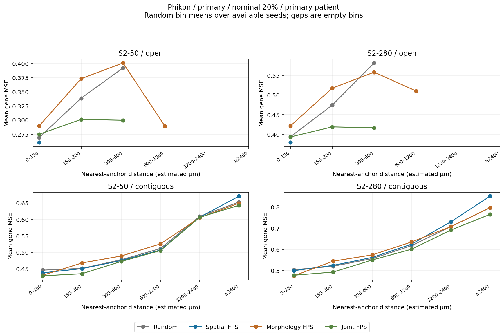

Distance uses inherited estimated micrometers. Frozen bins are [0,150), [150,300), [300,600), [600,1200), [1200,2400), and ≥2400 µm; correlations require at least 20 scoring locations. Empty bins are absent, not zero error. [C6A_DISTANCE_METRICS.csv](C6A_DISTANCE_METRICS.csv) retains MSE, MAE, correlation and count per bin. [Matched-distance contrasts](C6A_MATCHED_DISTANCE.csv) compare strategies only where both have a populated bin and retain the number of random seeds represented. These are coarse-bin descriptive comparisons, not paired-location or causal estimates: anatomy and scoring membership can still differ within bins.

[C6A_GEOMETRY_DIAGNOSTICS.csv](C6A_GEOMETRY_DIAGNOSTICS.csv) contains mean/median/90th-percentile/maximum distance, coverage radius, large unmeasured components and morphology coverage/diversity. Coverage radius equals maximum nearest-anchor distance over the scored targets. Large components mean at least 50 unmeasured nodes connected on the frozen C2 graph, not physical tissue area. Better geometric coverage alone cannot establish lower reconstruction error.

Only one predeclared unavailable region is tested per patient. Random seeds vary anchor selection outside that same region; they are not independent replications of missing-region geometry. Do not generalize a favorable open-sampling result to arbitrary unmeasured tissue.

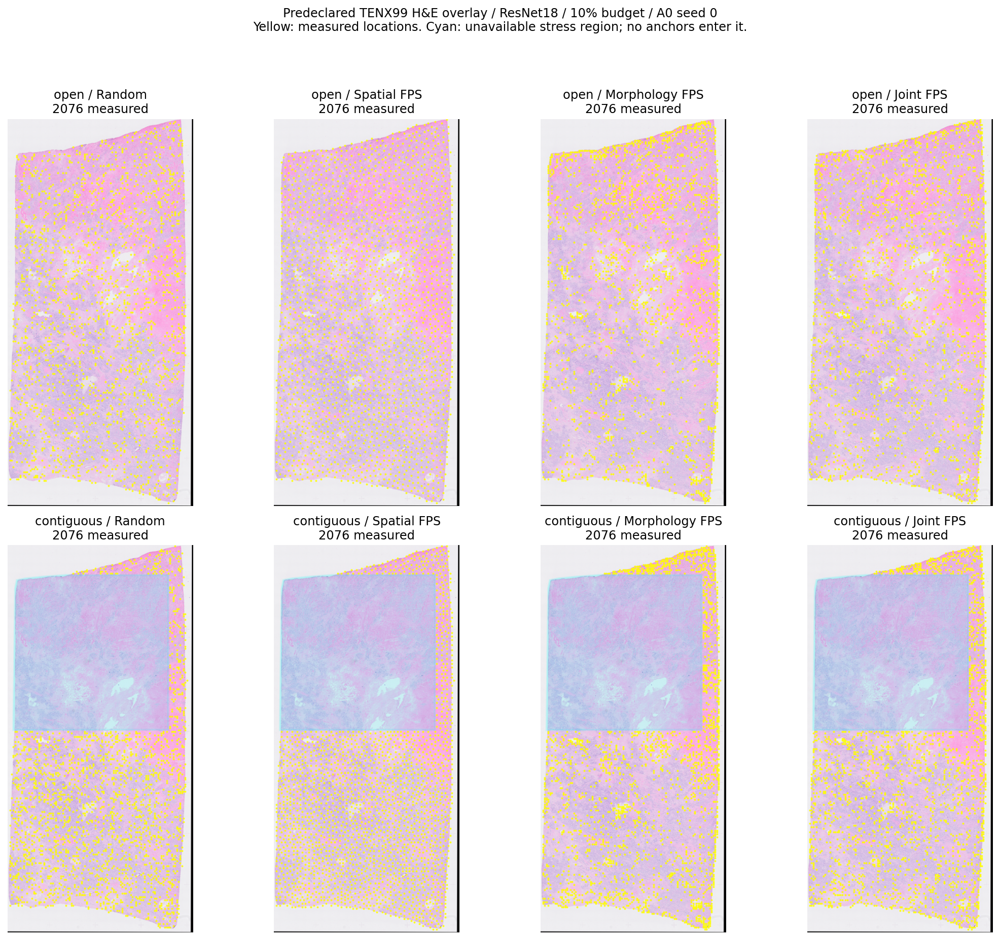

The map uses TENX99, ResNet18, 10% budget, A0 seed 0 and all deterministic strategies, for both regimes. It was chosen before test access. H&E thumbnails and coordinates are barcode aligned; no primary error map chooses the shown region or policy.

## Patient dependence

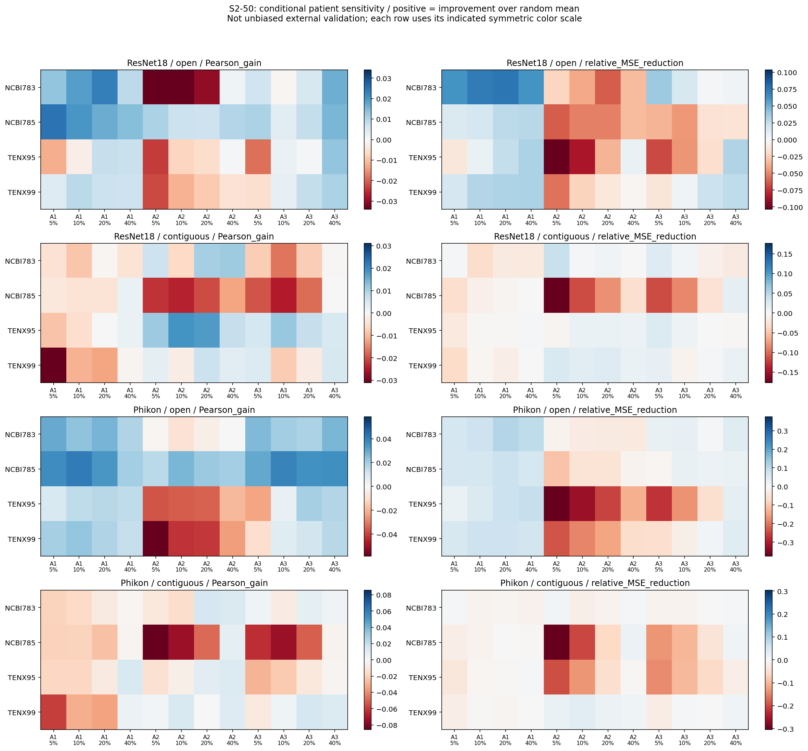

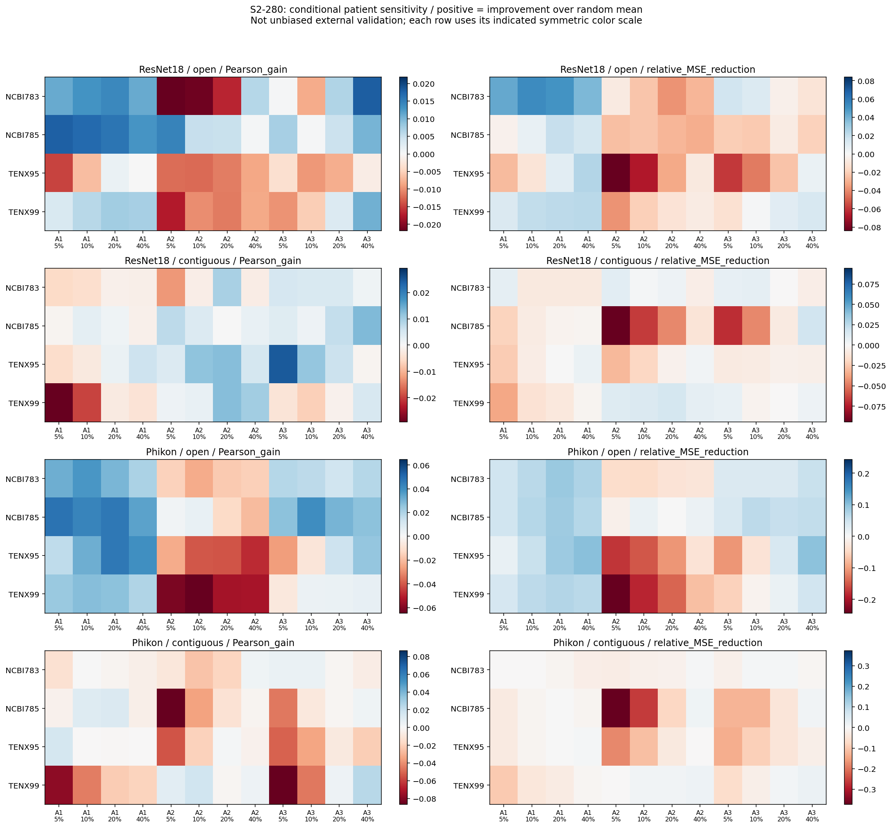

Each conditional patient's reconstruction model and image-PCA scaler are its existing C5 fold artifacts, fitted on the other three patients. Policy alpha and reconstruction choices remain primary-validation-selected. This inherits prior development decisions, gene panels, target normalization, overlapping training folds and known C0–C5 outcomes. TENX95 was the original validation patient; including its conditional results does not make the analysis unbiased cross-validation.

## Negative controls

NC1 is the complete ten-seed random distribution. NC2 permutes morphology among locations before A2/A3 sampling; NC3 permutes coordinates before A1 sampling. Reconstruction uses true images/coordinates, and the unavailable-region restriction remains enforced in true location identity. Below, control-minus-unpermuted differences average three control seeds and the two fixed budgets (10%/20%); positive MSE change is worse. Controls are diagnostics, not hidden-label corruption tests. If a morphology policy was already harmful, permutation need not worsen it further.

| Encoder | Panel | Regime | Policy | Control | Pearson change | MSE change |
| --- | --- | --- | --- | --- | --- | --- |
| Phikon | S2-280 | contiguous | A1 | NC3 | +0.022 | -0.017 |
| Phikon | S2-280 | contiguous | A2 | NC2 | +0.010 | +0.002 |
| Phikon | S2-280 | contiguous | A3 | NC2 | -0.008 | +0.000 |
| Phikon | S2-280 | open | A1 | NC3 | -0.028 | +0.028 |
| Phikon | S2-280 | open | A2 | NC2 | +0.064 | -0.068 |
| Phikon | S2-280 | open | A3 | NC2 | +0.003 | -0.001 |
| Phikon | S2-50 | contiguous | A1 | NC3 | +0.013 | -0.008 |
| Phikon | S2-50 | contiguous | A2 | NC2 | -0.002 | +0.005 |
| Phikon | S2-50 | contiguous | A3 | NC2 | -0.016 | +0.004 |
| Phikon | S2-50 | open | A1 | NC3 | -0.023 | +0.022 |
| Phikon | S2-50 | open | A2 | NC2 | +0.052 | -0.051 |
| Phikon | S2-50 | open | A3 | NC2 | -0.002 | -0.005 |
| ResNet18 | S2-280 | contiguous | A1 | NC3 | +0.016 | -0.004 |
| ResNet18 | S2-280 | contiguous | A2 | NC2 | -0.008 | +0.000 |
| ResNet18 | S2-280 | contiguous | A3 | NC2 | +0.009 | -0.004 |
| ResNet18 | S2-280 | open | A1 | NC3 | -0.008 | +0.009 |
| ResNet18 | S2-280 | open | A2 | NC2 | +0.022 | -0.032 |
| ResNet18 | S2-280 | open | A3 | NC2 | +0.003 | -0.011 |
| ResNet18 | S2-50 | contiguous | A1 | NC3 | +0.006 | -0.002 |
| ResNet18 | S2-50 | contiguous | A2 | NC2 | -0.013 | +0.013 |
| ResNet18 | S2-50 | contiguous | A3 | NC2 | +0.002 | -0.001 |
| ResNet18 | S2-50 | open | A1 | NC3 | -0.011 | +0.011 |
| ResNet18 | S2-50 | open | A2 | NC2 | +0.012 | -0.014 |
| ResNet18 | S2-50 | open | A3 | NC2 | -0.004 | -0.000 |

In open sampling, averaged across the two panels, encoders, 10%/20% budgets and three seeds, coordinate permutation lowers A1 Pearson by 0.017 and increases MSE by 0.018. Permuting morphology improves A2 Pearson by 0.037 and lowers MSE by 0.041, consistent with the original morphology-only diversity heuristic being harmful in these settings. These controls do not establish universal properties of morphology-guided policies.

All control runs, including the interpolation baseline, are in [C6A_NEGATIVE_CONTROLS.csv](C6A_NEGATIVE_CONTROLS.csv).

## Where are strategy differences largest?

The ranges below span both panels and encoders on the primary reconstruction role. Counts indicate qualifying combinations out of four; no favorable budget was selected for the gate after testing.

| Regime | Budget | Policy | Pearson gain range | Relative MSE reduction range | Qualifying / 4 |
| --- | --- | --- | --- | --- | --- |
| contiguous | 5% | A1 | -0.065 to -0.024 | -11.0% to -2.2% | 0 |
| contiguous | 5% | A2 | -0.009 to +0.010 | -5.7% to +0.9% | 0 |
| contiguous | 5% | A3 | -0.025 to +0.022 | -5.2% to +2.0% | 0 |
| contiguous | 10% | A1 | -0.031 to -0.001 | -4.6% to -0.7% | 0 |
| contiguous | 10% | A2 | -0.042 to +0.012 | -6.3% to +1.7% | 0 |
| contiguous | 10% | A3 | -0.013 to +0.017 | -3.2% to +0.5% | 0 |
| contiguous | 20% | A1 | -0.022 to -0.008 | -4.1% to -0.8% | 0 |
| contiguous | 20% | A2 | -0.010 to +0.012 | -0.5% to +3.5% | 1 |
| contiguous | 20% | A3 | -0.009 to +0.030 | -0.3% to +3.3% | 1 |
| contiguous | 40% | A1 | -0.016 to +0.001 | -0.8% to +0.2% | 0 |
| contiguous | 40% | A2 | +0.005 to +0.008 | +0.1% to +2.5% | 0 |
| contiguous | 40% | A3 | -0.001 to +0.018 | +0.4% to +2.2% | 1 |
| open | 5% | A1 | +0.004 to +0.024 | +0.8% to +6.1% | 2 |
| open | 5% | A2 | -0.072 to -0.020 | -24.5% to -7.6% | 0 |
| open | 5% | A3 | -0.012 to -0.005 | -6.0% to -2.9% | 0 |
| open | 10% | A1 | +0.009 to +0.027 | +1.8% to +7.6% | 2 |
| open | 10% | A2 | -0.070 to -0.012 | -19.0% to -5.3% | 0 |
| open | 10% | A3 | -0.009 to +0.003 | -3.7% to -0.3% | 0 |
| open | 20% | A1 | +0.007 to +0.027 | +2.4% to +7.5% | 2 |
| open | 20% | A2 | -0.056 to -0.011 | -14.2% to -3.7% | 0 |
| open | 20% | A3 | -0.003 to +0.008 | -1.6% to +2.4% | 0 |
| open | 40% | A1 | +0.008 to +0.020 | +2.6% to +6.6% | 2 |
| open | 40% | A2 | -0.057 to -0.006 | -6.9% to -0.5% | 0 |
| open | 40% | A3 | +0.003 to +0.014 | -0.1% to +4.2% | 2 |

## Integrity and reproducibility

Technical audit: **PASS**. All 296 test trajectories replayed exactly, including their ordered barcodes and acquisition scores. All 592 test selection corruption comparisons left choices unchanged. All 4448 prediction files passed hashes and identity checks; all 8896 full-unobserved-vector NaN/random comparisons returned identical predictions. Independent replay covers 464 prediction/metric runs: every deterministic policy and random seed 0 at 20%, all patients/panels/encoders/roles/regimes, plus every 20% negative control. Maximum mismatch was zero. Budgets match exactly and no stress-region anchor is present.

All C0–C5 frozen hashes and the prior experiment-registry prefix passed. No C0–C5 training or evaluation stage was rerun. C6 performs new forward inference using frozen C5 models without retraining or retuning. Source commit, policy config, seed, barcode reveal order, checkpoint/scaler/cache hashes, prediction hash, runtime and peak RSS are retained. Runtime includes corruption audits, metrics and artifact serialization, not just deployment inference. The global registry has 4924 C6A events including validation and policy generation. Large prediction arrays and uncompressed gene/selection CSVs remain local with final-manifest hashes; compressed tables, traces, figures, code and reports are committed.

[All figures, including interpolation-only comparisons](figures/), are retained alongside the report.

Stop after the appropriate C6 gate. No new encoder, encoder tuning, multiresolution graph, pathway analysis, explainability, clinical claim or external-validation experiment is part of C6A.
