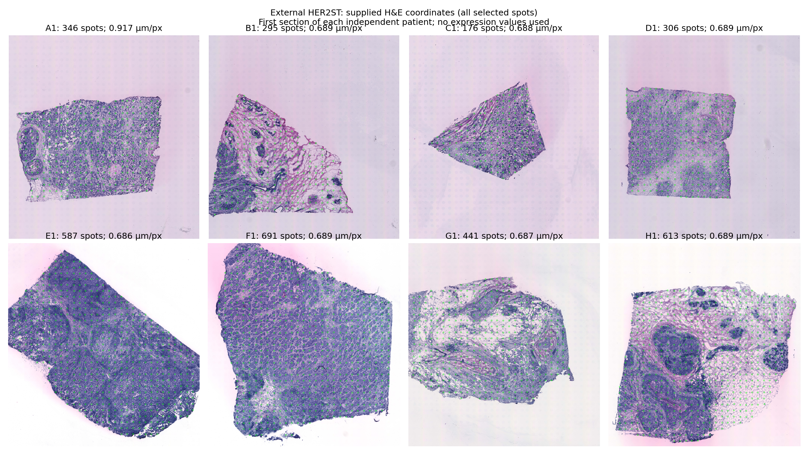

# C7A — External cohort qualification

Status: **PASS_EXTERNAL_DATASET_QUALIFICATION**. Eight independent HER2ST patients, one first-numbered section each (A1–H1), 3,455 selected capture locations. No external expression values or reconstruction outcomes informed qualification.

The [source study](https://doi.org/10.1038/s41467-021-26271-2) and [public source deposit](https://zenodo.org/records/4751624) identify eight breast-cancer patients. Its 2021 Swedish cohort, patient identities and sequencing-ST assets are independent of the four development patients. The published source archive MD5 values are checked alongside local SHA-256 records. Barcode keys link supplied coordinates, count-matrix row identifiers and patch order.

## Cohort and preprocessing

First-numbered section of **each** source patient was selected before expression values were read. Serial sections are not additional patients. Individual S2-50 availability is 45–46 genes, but the same common **40/50** genes (80%) are evaluated for every patient. S2-280 uses the shared **226/280** genes (80.7%). No aliases, replacements or outcome-based selection. S2-250 is optional and omitted. The [exact intersection](C7A_GENE_INTERSECTION.csv) includes every original panel gene and exclusion reason.

H&E uses a 112 µm square, 224 RGB pixels, the frozen C0 ResNet18 weights and official transform. ResNet18 is the predeclared primary encoder; Phikon is not additionally evaluated. E0 averages the three frozen primary C4 D1 heads; E1 and E2 retain C5 validation-selected interpolation and fusion parameters for each original panel/regime; E3 retains exact C5 B4 weights and image PCA, with independent gene heads restricted to retained genes. No model is fit.

The target interface remains log1p(integer counts) standardized using C0 training-only gene means/SDs. This is a **cross-platform** zero-shot test: sequencing capture spots are 100 µm diameter with 200 µm spacing, whereas development pooled Xenium transcripts in 100 µm squares. Capture efficiency, capture area, depth, preparation and image resolution can shift distributions. They are not corrected from external labels. Compatibility here means executable frozen count/image model inputs, not calibrated cross-assay abundance equivalence. Integer-count validation is mandatory after lock.

Published selected spots and gene columns inherit upstream source filtering. The qualification reader parses only gene headers and spot identifiers; numeric count fields are discarded. No external expression matrix has been loaded. Source H&E annotation labels are not used.

## Alternatives and exclusions

Development/related HEST Xenium samples were excluded by patient and source; the complete HEST asset repository returned HTTP 401 and no authorized Hugging Face credential was configured. This does not mean no independent public dataset exists.

The independent [GSE311609](https://www.ncbi.nlm.nih.gov/geo/query/acc.cgi?acc=GSE311609) four-donor pilot B1–B4 had 50/50 and 280/280 overlap but no verified public H&E-to-DAPI transforms. Its source notebook refers to private transform paths. SIFT, tissue-outline and affine intensity methods were examined using images only; high silhouette agreement did not establish reliable local correspondence. These exploratory image-registration diagnostics are not certified target-registration errors, and are not validation results. The cohort was not admitted to C7B. No molecular counts were evaluated.

The [Xenium Prime breast release](https://www.10xgenomics.com/datasets/xenium-prime-ffpe-human-breast-cancer) had only 30/50 primary-gene exact-symbol overlap and was excluded at the fixed 80% threshold. Its low-resolution tutorial derivative was not counted as another cohort or patient. Source run-summary metadata was inspected but no expression matrix or performance was evaluated.

## Frozen evaluation design

S2-50 common 40 genes is primary; S2-280 common 226 is secondary, not whole-transcriptome validation. Budgets 10/20/40%, ten random seeds and deterministic spatial FPS. V1 scores all unobserved tissue. V2 uses three coordinate-defined 40% unavailable regions, fixed across budgets and policies, and samples outside them. Regions are centered at 25/50/75% along the tissue's first spatial principal axis. All unobserved labels are removed before model inputs.

Quantitative patient-level decision rules, distance bins, controls and six display genes are fixed in [protocol.json](../configs/protocol.json). All 352 trajectories must be hashed before external-label access. Qualifying a dataset is not a claim that C5 generalizes. C7C/adaptation are not planned.
