# C7 — Independent external validation

**Overall: MIXED_EXTERNAL_VALIDATION. Recommendation: NEED_METHOD_REVIEW.**

C7 completed 8,448 locked main evaluations and 108 negative controls on eight independent HER2ST breast-cancer patients. Sparse molecular anchors substantially improve the frozen H&E predictor, but the frozen H&E contribution does **not** establish added value over ST-only interpolation when correlation and error are assessed together. All technical audits passed. No C0–C6 artifact, model, scaler, panel or selection rule was modified; no external adaptation was performed. Stop here for review.

## Answers to the ten checkpoint questions

1. **Was an independent cohort used? Yes.** The [HER2ST study](https://doi.org/10.1038/s41467-021-26271-2), [public deposit](https://zenodo.org/records/4751624) and [source repository](https://github.com/almaan/her2st) describe a separate Swedish breast-cancer cohort. One first-numbered section for each of eight patients (A1–H1), 3,455 locations, was selected before numeric expression access. No development patient, related release, serial-section duplicate or repeat assay is counted as external. Source metadata and archive hashes support provenance; this is not a donor-genotyping audit.
2. **Did sparse measured ST improve over H&E alone? Yes.** On primary V1 random sampling, all eight patients satisfy the frozen joint Pearson/MSE improvement threshold at at least two budgets. At 20%, median paired Pearson gain is +0.0603 and median paired relative MSE reduction is 92.58%. The large error improvement partly reflects severe H&E output bias under assay shift, not necessarily preserved morphological prediction quality.
3. **Did H&E add value beyond interpolation? Not convincingly.** At 20% V1, E2 improves Pearson over E1 in 3/8 patients, with median paired gain −0.0107. It worsens MSE and MAE in 8/8. Across all 24 primary patient–budget settings, E2 MSE is more than 2% worse than E1. No patient satisfies the joint meaningful-gain threshold over E1 at any primary budget. Gene-specific correlation gains exist but none of the 40 primary genes has positive median patient MSE improvement over E1.
4. **Did results reproduce across patients? Partly.** E2-over-E0 improvement is broad, and all eight patients improve E2 correlation and MSE from 10% to 40% V1 coverage. Added H&E value over interpolation is heterogeneous in correlation and consistently adverse in error. Patient B has much higher absolute correlation than A/E/F; this is not a uniform eight-patient success.
5. **Did coverage-response reproduce? Yes for V1, with qualifications.** Primary E2 cohort median Pearson rises 0.2426 → 0.2546 → 0.2718 at 10/20/40%; mean-gene MSE medians fall 0.3582 → 0.3481 → 0.3425. V1 scores all remaining unobserved locations, so its target membership changes with budget/policy. V2 keeps the same forbidden target regions across budgets and shows smaller correlation improvement (0.1245 → 0.1316 → 0.1360).
6. **Did distance-to-anchor behavior reproduce? Partly.** In well-supported primary V1 bins, E2 median patient MSE rises modestly from 0.3501 at 150–300 µm to 0.3545 at 300–600 µm and 0.3576 at 600–1200 µm. V2 rises 1.1439 → 1.1735 → 1.1738 → 1.3207 through 1200–2400 µm, then falls to 1.2291 beyond 2400 µm (seven patients). It is not a universal monotone relationship. Sparse extreme V1 bins cannot support a horizon estimate. The same tissue locations recur across masks/budgets; bin counts are evaluation incidences, not independent samples.
7. **How much weaker was contiguous extrapolation?** At 20% random coverage, primary E2 median patient Pearson falls from 0.2546 (V1) to 0.1316 (V2); median MSE rises from 0.3481 to 1.2047, about 3.46×. V2 differs in target geometry **and** uses the frozen C5 block contract (50% H&E weight instead of 25%); this comparison does not isolate a causal geometry effect. Only 4/8 patients meet meaningful E2-over-E0 support at some V2 budget and 0/8 meet E2-over-E1 support.
8. **How large was development-to-external shift?** On the exact same retained 40 genes at 20% random coverage, saved C5 primary-patient E2 Pearson was 0.8409; the external patient median is 0.2546 (−0.5863). E0 changes 0.7241 → 0.1432; E1 0.8035 → 0.1943. E2 MSE changes 0.2735 → 0.3481, but E1 MSE falls 0.2778 → 0.0680 despite much lower correlation. Cross-assay target scale, sparsity and variance make error magnitudes alone unsuitable as transportability evidence. Development has one primary test patient; external has eight, so these are descriptive summaries, not a paired cohort test.
9. **Does this support the core publication story? Only in part.** Sparse measured anchors help reconstruction beyond a poorly transported H&E-only predictor, and coverage matters. The stronger claim that H&E provides externally useful improvement over simple ST interpolation is not established. A positive cohort-median correlation difference must not conceal negative paired effects or systematic MSE harm. This checkpoint does not justify clinical utility, cost savings, biological interpretation or a general cross-platform accuracy claim.
10. **What next? NEED_METHOD_REVIEW.** Review target-scale transportability and the frozen fusion calibration before proposing another checkpoint. Any adaptation or revised method requires a separately declared protocol with calibration/test separation and fresh held-out evaluation. These eight patients now have known outcomes and cannot become an untouched external test for revisions. No such revision or later checkpoint was executed here.

## Locked design and statistical unit

The scientific source/spec lock was committed as `c06e92d`; all 352 observation trajectories were committed as `455b9a939cc08640a12634bca7410efbb7d2a049`. Numeric external-label access began only afterward at `2026-10-01T02:20:51.847013+00:00`. [C7A_SPEC_LOCK.json](C7A/C7A_SPEC_LOCK.json) includes the exact source-file hashes, model/normalization hashes, cohort, common genes, metrics and decision criteria. [MASK_LOCK.json](C7B/MASK_LOCK.json) records every trajectory checksum. The apparent C6 `source_commit` inside the earlier spec is its then-current HEAD; scientific C7 source contents were separately hashed before being committed. No evaluated source changed after the lock.

Primary S2-50 is the common **40/50 genes (80%)**; secondary S2-280 is **226/280 (80.7%)**, not whole-transcriptome validation. Individual patients have 45–46 primary genes, but an identical common set is used in all patients. No gene substitution, alias expansion or performance-based inclusion. Exact included/excluded genes are in [C7A_GENE_INTERSECTION.csv](C7A/C7A_GENE_INTERSECTION.csv).

Each patient has ten random seeds and one deterministic spatial farthest-point trajectory. Budgets are 10/20/40% of all tissue locations, rounded by floor(N×budget+0.5). V1 measures anywhere and scores all unobserved locations. V2 holds out each of three coordinate-defined compact regions comprising 40% of locations, centered at fixed 25/50/75% positions along the first spatial principal axis; no anchor enters a forbidden region. All other unobserved labels are also removed from inputs. V2 results average three geometries and ten random seeds within patient. Nested observations reuse the same trajectory prefix at each budget. No adaptive sampling.

Per-run metrics are gene-wise Pearson, Spearman, MSE and MAE on hidden locations only; panel means/medians and Pearson fractions >0, >0.1, >0.2 and >0.3 are saved. Undefined constant-gene correlations remain missing, are omitted from finite means/medians, and do not count as exceeding thresholds; fractions use the retained panel size as denominator. The files retain `n_defined_pearson` and prediction/target variance. Seeds and geometries are averaged **within patient first**. Main tables then use the median of eight patients, with no spot-level significance test. Plot bands are patient IQRs, not confidence intervals. Paired effects are computed before taking their patient median; a difference between two cohort medians is generally not the median paired effect.

## Frozen model and assay contract

- **E0:** exact frozen primary C4 D1 H&E-only three-seed ensemble, reused by C5 B1, with frozen C0 ResNet18 encoder/transform.
- **E1:** exact C5 validation-selected B2b inverse-distance interpolation (power 2, up to 16 nearest anchors) for V1; B2a mean of 16 nearest anchors for V2, for both retained panels.
- **E2:** frozen C5 B3, 0.25×H&E + 0.75×interpolation in V1; 0.50×H&E + 0.50×interpolation in V2.
- **E3:** secondary exact frozen C5 B4 gene-wise learned propagation, original training PCA and kNN6/cap250 µm graph, restricted to retained independent gene heads. No externally fitted graph or new architecture.

Input H&E is a 112 µm square resized to 224 RGB, using exact C0 encoder weights and official transform; cache/barcode identity is audited. Physical resolution comes from the documented 200 µm array pitch and supplied refined image coordinates. Calibration residuals are <0.006 px and anisotropy <1.01; these are consistency checks of supplied coordinates, not independent cellular registration errors. Only the predeclared ResNet18 branch was evaluated; no new encoder or fine-tuning.

Targets remain log1p(integer capture counts) standardized by C0 training-only gene mean/SD. HER2ST uses 100 µm diameter sequencing-ST capture spots; development aggregated Xenium in 100 µm squares. Count integrality, finite values, gene identity and barcode order pass the executable interface contract. **This does not establish equivalent abundance calibration across assays.** Source filtering, capture efficiency/area, depth, preparation, pixel scale and platform differ; none was corrected using external outcomes. There was no external library normalization, centering, imputation, refit or depth/area correction.

## Primary S2-50 results

The following are medians across eight patient-level summaries. MSE and MAE are means across retained genes before patient aggregation, in frozen C0 standardized log-count units.

| regime   |   nominal_budget | model   |   median_pearson |   mean_mse |   mean_mae |
|:---------|-----------------:|:--------|-----------------:|-----------:|-----------:|
| V1       |           0.1000 | E0      |           0.1393 |     4.3683 |     1.9379 |
| V1       |           0.1000 | E1      |           0.1525 |     0.0724 |     0.1772 |
| V1       |           0.1000 | E2      |           0.2426 |     0.3582 |     0.5216 |
| V1       |           0.1000 | E3      |           0.2356 |     0.5514 |     0.6437 |
| V1       |           0.2000 | E0      |           0.1432 |     4.3665 |     1.9376 |
| V1       |           0.2000 | E1      |           0.1943 |     0.0680 |     0.1730 |
| V1       |           0.2000 | E2      |           0.2546 |     0.3481 |     0.5153 |
| V1       |           0.2000 | E3      |           0.2507 |     0.5643 |     0.6537 |
| V1       |           0.4000 | E0      |           0.1671 |     4.3621 |     1.9393 |
| V1       |           0.4000 | E1      |           0.2414 |     0.0652 |     0.1705 |
| V1       |           0.4000 | E2      |           0.2718 |     0.3425 |     0.5122 |
| V1       |           0.4000 | E3      |           0.2605 |     0.5806 |     0.6651 |
| V2       |           0.1000 | E0      |           0.1111 |     4.4602 |     1.9583 |
| V2       |           0.1000 | E1      |           0.0482 |     0.0767 |     0.1954 |
| V2       |           0.1000 | E2      |           0.1245 |     1.2102 |     1.0086 |
| V2       |           0.1000 | E3      |           0.1288 |     1.3722 |     1.0571 |
| V2       |           0.2000 | E0      |           0.1111 |     4.4602 |     1.9583 |
| V2       |           0.2000 | E1      |           0.0638 |     0.0775 |     0.1962 |
| V2       |           0.2000 | E2      |           0.1316 |     1.2047 |     1.0031 |
| V2       |           0.2000 | E3      |           0.1316 |     1.3704 |     1.0586 |
| V2       |           0.4000 | E0      |           0.1111 |     4.4602 |     1.9583 |
| V2       |           0.4000 | E1      |           0.0915 |     0.0773 |     0.1961 |
| V2       |           0.4000 | E2      |           0.1360 |     1.1982 |     0.9993 |
| V2       |           0.4000 | E3      |           0.1379 |     1.3743 |     1.0626 |

At 20%, the separate E2 and E1 cohort Pearson medians are 0.2546 and 0.1943, yet the median **paired** difference is −0.0107 because patient rankings differ between methods. The patient table below is essential to interpretation.

| patient_id   | regime   |   E0_median_pearson |   E1_median_pearson |   E2_median_pearson |   E1_mean_mse |   E2_mean_mse |   gain_pearson_vs_E0 |   gain_pearson_vs_E1 |
|:-------------|:---------|--------------------:|--------------------:|--------------------:|--------------:|--------------:|---------------------:|---------------------:|
| HER2ST_A     | V1       |              0.0486 |              0.1229 |              0.1075 |        0.0801 |        0.3340 |               0.0590 |              -0.0153 |
| HER2ST_A     | V2       |              0.0488 |              0.0588 |              0.0571 |        0.0848 |        1.0572 |               0.0083 |              -0.0017 |
| HER2ST_B     | V1       |              0.4261 |              0.5825 |              0.5601 |        0.0603 |        0.3365 |               0.1339 |              -0.0224 |
| HER2ST_B     | V2       |              0.2361 |              0.2160 |              0.2723 |        0.1489 |        1.2034 |               0.0362 |               0.0563 |
| HER2ST_C     | V1       |              0.1018 |              0.3680 |              0.3264 |        0.1436 |        0.3715 |               0.2246 |              -0.0416 |
| HER2ST_C     | V2       |              0.0112 |              0.1724 |              0.0623 |        0.2029 |        1.0144 |               0.0512 |              -0.1101 |
| HER2ST_D     | V1       |              0.2370 |              0.2895 |              0.3366 |        0.1153 |        0.3597 |               0.0995 |               0.0470 |
| HER2ST_D     | V2       |              0.2226 |              0.1367 |              0.2548 |        0.1398 |        1.2110 |               0.0322 |               0.1182 |
| HER2ST_E     | V1       |              0.0069 |              0.1155 |              0.0665 |        0.0334 |        0.5073 |               0.0596 |              -0.0490 |
| HER2ST_E     | V2       |              0.0234 |              0.0688 |              0.0351 |        0.0361 |        1.9947 |               0.0116 |              -0.0337 |
| HER2ST_F     | V1       |              0.0472 |              0.1016 |              0.0954 |        0.0735 |        0.4762 |               0.0483 |              -0.0062 |
| HER2ST_F     | V2       |              0.0247 |              0.0354 |              0.0304 |        0.0702 |        1.7799 |               0.0057 |              -0.0049 |
| HER2ST_G     | V1       |              0.2060 |              0.2032 |              0.2671 |        0.0624 |        0.3313 |               0.0611 |               0.0638 |
| HER2ST_G     | V2       |              0.1733 |              0.0534 |              0.2009 |        0.0645 |        1.2059 |               0.0276 |               0.1475 |
| HER2ST_H     | V1       |              0.1846 |              0.1854 |              0.2422 |        0.0409 |        0.2959 |               0.0576 |               0.0568 |
| HER2ST_H     | V2       |              0.2196 |              0.0490 |              0.2274 |        0.0551 |        1.1155 |               0.0078 |               0.1783 |

Direction counts and paired effect medians across all primary random budgets:

| regime   |   nominal_budget |   gain_pearson_vs_E0_median |   gain_pearson_vs_E0_positive_patients |   gain_pearson_vs_E1_median |   gain_pearson_vs_E1_positive_patients |   gain_mse_vs_E1_positive_patients |   meaningful_vs_E1_patients |
|:---------|-----------------:|----------------------------:|---------------------------------------:|----------------------------:|---------------------------------------:|-----------------------------------:|----------------------------:|
| V1       |           0.1000 |                      0.0485 |                                      8 |                     -0.0020 |                                      4 |                                  0 |                           0 |
| V1       |           0.2000 |                      0.0603 |                                      8 |                     -0.0107 |                                      3 |                                  0 |                           0 |
| V1       |           0.4000 |                      0.0716 |                                      8 |                     -0.0295 |                                      3 |                                  0 |                           0 |
| V2       |           0.1000 |                      0.0057 |                                      8 |                      0.0705 |                                      5 |                                  0 |                           0 |
| V2       |           0.2000 |                      0.0196 |                                      8 |                      0.0273 |                                      4 |                                  0 |                           0 |
| V2       |           0.4000 |                      0.0182 |                                      8 |                     -0.0016 |                                      3 |                                  0 |                           0 |

## Frozen gate and decision

Meaningful E2-over-E0 requires Δmedian Pearson ≥0.02 **and** ≥2% MSE reduction; E2-over-E1 requires Δmedian Pearson ≥0.01 **and** ≥1% MSE reduction. Primary V1 random pass required at least 6/8 patients over E0 at ≥2 budgets, at least 4/8 over E1 at ≥1 budget, positive median patient gains in correlation and MSE over both, at most 25% of settings with >2% MSE harm versus E1, and coherent 10→40% behavior in ≥6/8 patients. V2 support required ≥4/8 patients over each comparator at some budget.

Observed: E0 support **8/8**, E1 support **0/8**, coherent coverage **8/8**, harmful-MSE settings **24/24**. V2 support: **4/8** over E0, **0/8** over E1. The predeclared mixed-result fallback is met, so the final status is **MIXED_EXTERNAL_VALIDATION**, not a technical failure and not a limited pass. [Gate details](C7B/logs/GATE_RESULT.json) were generated by the unchanged locked analyzer.

## Secondary panel, propagation and simple regular sampling

At 20% random coverage:

| regime   | model   |   median_pearson |   mean_mse |   mean_mae |
|:---------|:--------|-----------------:|-----------:|-----------:|
| V1       | E0      |           0.0766 |     4.6596 |     1.9880 |
| V1       | E1      |           0.0777 |     0.0690 |     0.1434 |
| V1       | E2      |           0.0964 |     0.3810 |     0.5417 |
| V1       | E3      |           0.1003 |     0.6035 |     0.6752 |
| V2       | E0      |           0.0506 |     4.6918 |     1.9983 |
| V2       | E1      |           0.0379 |     0.0659 |     0.1442 |
| V2       | E2      |           0.0611 |     1.2286 |     1.0130 |
| V2       | E3      |           0.0624 |     1.3913 |     1.0489 |

S2-280 shows weaker absolute correlations. Secondary propagation does not rescue error performance: primary V1 E3 at 20% has median Pearson 0.2507 and MSE 0.5643 versus E2 0.2546 and 0.3481; secondary V1 E3 has Pearson 0.1003 but MSE 0.6035. It remains secondary regardless of occasional correlation advantages.

Spatial FPS was evaluated exactly as frozen. At 20% primary V1, its median paired E2 Pearson change versus random is +0.0078 and MSE change is +0.0013 (worse). In V2 the corresponding changes are −0.0001 and −0.0072. E2 still improves MSE over E1 in 0/8 patients for both policies. V1 scored sets change with policy; V2 scored regions are identical. No policy was selected or optimized from these outcomes.

## Gene-specific gains and sparsity

At 20% random coverage, gene effects are averaged within patient across seeds/geometries, then summarized across patients. These are descriptive results, not additional pass criteria or multiplicity-controlled gene discoveries.

| panel   | regime   | comparator   |   genes |   positive_median_r |   positive_median_MSE_reduction |   both_positive |   median_delta_r_ge_002_and_ge6_positive_patients |
|:--------|:---------|:-------------|--------:|--------------------:|--------------------------------:|----------------:|--------------------------------------------------:|
| S2-280  | V1       | E0           |     226 |                 195 |                             226 |             195 |                                                87 |
| S2-280  | V1       | E1           |     226 |                 154 |                               0 |               0 |                                                49 |
| S2-280  | V2       | E0           |     226 |                 189 |                             226 |             189 |                                                15 |
| S2-280  | V2       | E1           |     226 |                 153 |                               0 |               0 |                                                49 |
| S2-50   | V1       | E0           |      40 |                  39 |                              40 |              39 |                                                29 |
| S2-50   | V1       | E1           |      40 |                  20 |                               0 |               0 |                                                 7 |
| S2-50   | V2       | E0           |      40 |                  38 |                              40 |              38 |                                                10 |
| S2-50   | V2       | E1           |      40 |                  32 |                               0 |               0 |                                                13 |

Thus 39/40 primary V1 genes have positive median correlation gain over E0, but only 20/40 over E1. Seven genes have median Pearson gain ≥0.02 over E1 and positive correlation gain in ≥6 patients; none has positive median MSE reduction. In V2, 32/40 genes have positive median correlation gain over E1 while 0/40 improve median MSE. The same correlation/error disagreement is present on the secondary panel. All gene names and patient effects, including failures and missing correlations, are saved in [C7B_GENE_GAIN_SUMMARY.csv](C7B/C7B_GENE_GAIN_SUMMARY.csv) and [C7B_GENE_GAIN_PATIENT.csv](C7B/C7B_GENE_GAIN_PATIENT.csv). No biological interpretation or gene-panel revision follows from these results.

A post-evaluation descriptive check, which did not change any input, found median patient raw zero fractions of 65.6% (primary) and 82.1% (secondary). Primary mean-gene target variance is only 0.0747 in frozen normalized units. Primary full-tissue E0 MSE is 4.3637; mean squared gene-wise mean bias is 4.0664 (medians of separate patient quantities). This is consistent with a large mean/scale shift dominating error. It does not identify which assay or biological factor caused the shift and does not justify changing normalization inside C7. [Diagnostics](C7B/C7B_DOMAIN_SHIFT_DIAGNOSTICS.csv).

## Distance behavior and contiguous extrapolation

The distance curve uses bins [0,150), [150,300), [300,600), [600,1200), [1200,2400), [2400,∞) µm. Correlations require ≥20 hidden locations within a run/bin; errors use every nonempty bin. For displayed MSE, repeated evaluation locations are weighted within each patient/bin across frozen budgets/masks, then eight patients contribute equally to the median. This is descriptive: occupancy, target tissue, coverage and geometry confound distance comparisons. Per-budget/per-run bins are retained for inspection.

| regime   |   lower_um |   median_patient_mse |   patients |   sampled_locations |
|:---------|-----------:|---------------------:|-----------:|--------------------:|
| V1       |          0 |               0.3553 |          1 |                  18 |
| V1       |        150 |               0.3501 |          8 |               58122 |
| V1       |        300 |               0.3545 |          8 |               18091 |
| V1       |        600 |               0.3576 |          8 |                3221 |
| V1       |       1200 |               0.3212 |          5 |                  28 |
| V2       |        150 |               1.1439 |          8 |               15497 |
| V2       |        300 |               1.1735 |          8 |               25857 |
| V2       |        600 |               1.1738 |          8 |               49237 |
| V2       |       1200 |               1.3207 |          8 |               32498 |
| V2       |       2400 |               1.2291 |          7 |                1111 |

The 0–150 µm V1 bin has one contributing patient and 18 repeated evaluation incidences; the 1200–2400 µm V1 bin has five patients and only 28 incidences. Their apparent downturn must not be presented as robust long-range accuracy. V2 supports a broad distance penalty but no single validated extrapolation horizon. Its larger MSE also reflects the unchanged regime-specific H&E weight. V1/V2 remain separate throughout.

## Negative controls

A1, 20% random coverage, seed 0, V1 geometry 0 and V2 geometry 1, both panels, three control seeds, E1/E2/E3: 108 runs. NC1 permutes observed expression, NC2 misassigns anchor positions, NC3 permutes H&E location information. For frozen pointwise image heads, permuting cached image predictions and image PCA features is algebraically equivalent to applying those frozen heads to the permuted embedding rows. NC1/NC2 can express closely related anchor-assignment disruptions; they are not independent biological evidence.

Primary-panel mean changes over three control seeds (control minus clean; negative Pearson and positive errors indicate degradation):

| panel   | regime   | model   | control   |   pearson_change_control_minus_clean |   mse_change_control_minus_clean |   mae_change_control_minus_clean |
|:--------|:---------|:--------|:----------|-------------------------------------:|---------------------------------:|---------------------------------:|
| S2-50   | V1       | E1      | NC1       |                              -0.1113 |                           0.0157 |                           0.0159 |
| S2-50   | V1       | E1      | NC2       |                              -0.0977 |                           0.0150 |                           0.0159 |
| S2-50   | V1       | E1      | NC3       |                               0.0000 |                           0.0000 |                           0.0000 |
| S2-50   | V1       | E2      | NC1       |                              -0.0597 |                           0.0151 |                           0.0080 |
| S2-50   | V1       | E2      | NC2       |                              -0.0484 |                           0.0147 |                           0.0087 |
| S2-50   | V1       | E2      | NC3       |                              -0.0136 |                           0.0056 |                           0.0043 |
| S2-50   | V1       | E3      | NC1       |                              -0.0511 |                           0.0122 |                           0.0041 |
| S2-50   | V1       | E3      | NC2       |                              -0.0416 |                           0.0119 |                           0.0047 |
| S2-50   | V1       | E3      | NC3       |                              -0.0537 |                           0.0105 |                           0.0054 |
| S2-50   | V2       | E1      | NC1       |                              -0.0617 |                           0.0025 |                           0.0044 |
| S2-50   | V2       | E1      | NC2       |                              -0.0376 |                          -0.0004 |                           0.0011 |
| S2-50   | V2       | E1      | NC3       |                               0.0000 |                           0.0000 |                           0.0000 |
| S2-50   | V2       | E2      | NC1       |                              -0.0031 |                           0.0143 |                           0.0062 |
| S2-50   | V2       | E2      | NC2       |                              -0.0086 |                           0.0174 |                           0.0087 |
| S2-50   | V2       | E2      | NC3       |                              -0.0687 |                           0.0760 |                           0.0314 |
| S2-50   | V2       | E3      | NC1       |                               0.0067 |                           0.0159 |                           0.0056 |
| S2-50   | V2       | E3      | NC2       |                               0.0048 |                           0.0191 |                           0.0081 |
| S2-50   | V2       | E3      | NC3       |                              -0.0646 |                           0.1159 |                           0.0453 |

E2 degrades under all three controls in both regimes on both panels. E1 is exactly unchanged by NC3, as required for an ST-only comparator. Controls are not uniformly monotone for every method: primary V2 E3 Pearson increases slightly under NC1/NC2 despite higher MSE, and primary V2 E1 NC2 MSE decreases slightly. Reported controls characterize one predeclared patient; they do not establish cohort-wide specificity or overcome the failed E2-over-E1 result.

## Development versus external

Saved C5 predictions were re-summarized on exactly the 40/226 common genes, without running or modifying a parent model. The comparison includes all frozen budgets and methods in [C7_DEVELOPMENT_EXTERNAL_COMPARISON.csv](C7_DEVELOPMENT_EXTERNAL_COMPARISON.csv). C5 contiguous masks were coverage-dependent, whereas C7 uses fixed forbidden regions; their V2 numbers are not a matched geometry experiment. Only one C5 primary test patient is shown; the original four development patients are never counted as external.

## Integrity, artifacts and limitations

All 8,556 prediction files passed checksums, observed/hidden barcode identity, disjointness, budget and gene checks. Every run recorded two hidden-label corruption checks (17,112 comparisons). Independent audit replayed 620 predictions and all their metrics exactly, with 1,240 additional corruption checks and zero replay error. All 352 sampling trajectories replayed with 704 label-corruption comparisons; 16 observed-only normalization checks confirmed hidden counts cannot affect anchor normalization. Distances and bin occupancies were independently reconstructed for every prediction file. Source archive MD5 and model/input SHA-256 checks passed, as did the full frozen C0–C6 manifest chain and unchanged registry prefix. C7 adds 8,908 registry rows (352 masks + 8,556 evaluations).

The eight-patient sample is one external study and one section per patient, with an 80% primary overlap, inherited source filtering, sparse counts and substantial platform shift. H&E registration relies on supplied coordinates and image QA. Generalization to IDC specifically, all breast-cancer subtypes, other platforms or whole transcriptomes is not established. Correlation can look favorable while absolute error worsens. There is no clinical utility or monetary-savings claim.

Source, configs, masks, compressed gene tables, per-run metadata, registry, figures and reports are committed. Large raw images, external embeddings, target caches and 8,556 prediction NPZs remain local under C7 and are hashed in the final manifest; they are not uploaded as Git blobs. The required uncompressed gene CSV is also present locally, with a byte-equivalent gzip version in Git. Optional C7C, V3, S2-250, adaptation and later checkpoints were not run.

## Figure index

All six map genes (FOXA1, SCD, KRT7, ERBB2, POSTN, SERHL2), patient A1, budget 20%, and seed 0 were declared before external outcomes. No outcome-based display selection or value clipping was used. Ground truth and prediction use the same per-gene scale; errors use symmetric scales.

### H&E and open-tissue anchors

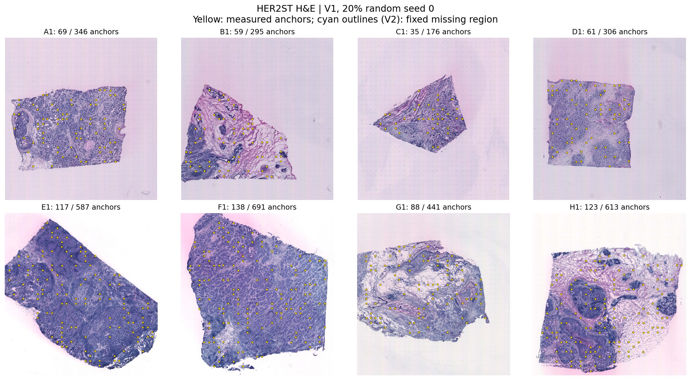

### H&E and contiguous unavailable regions

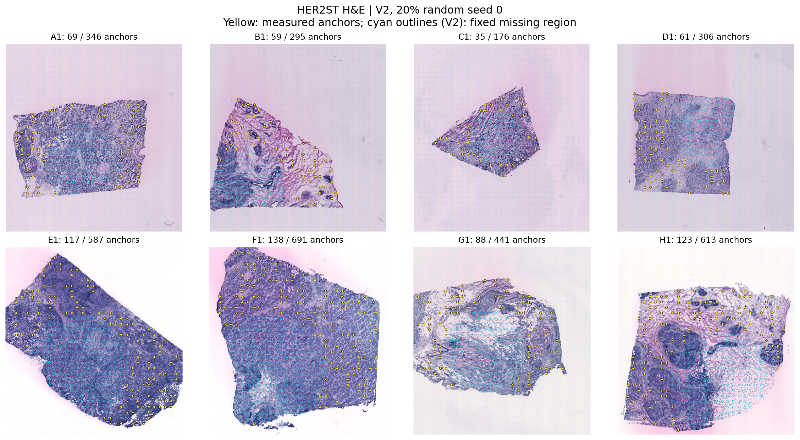

### Predeclared genes: V1 truth, prediction and error

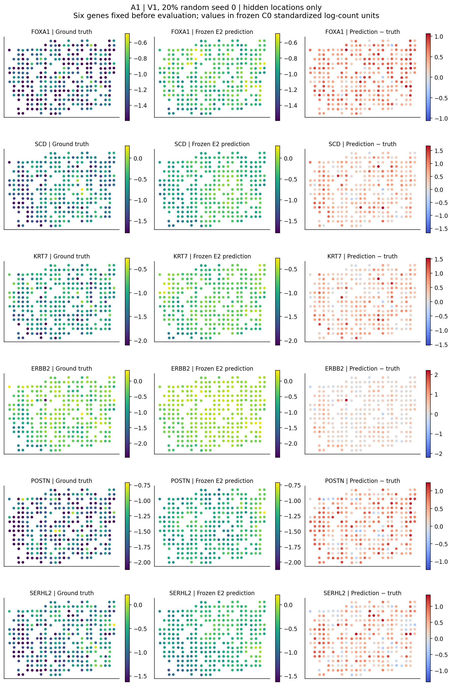

### Predeclared genes: V2 truth, prediction and error

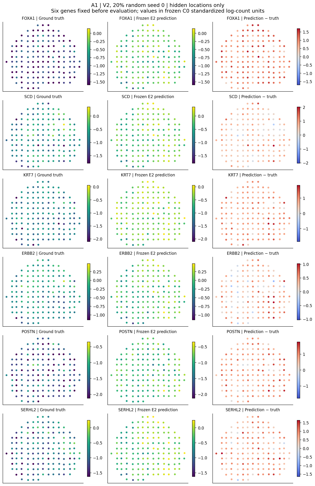

### Random coverage and Pearson

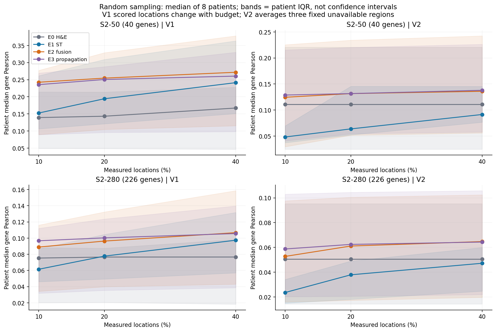

### Random coverage and MSE

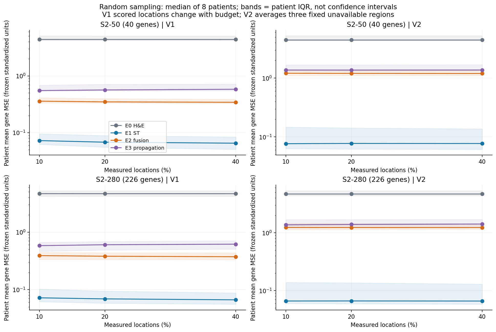

### Regular coverage and Pearson

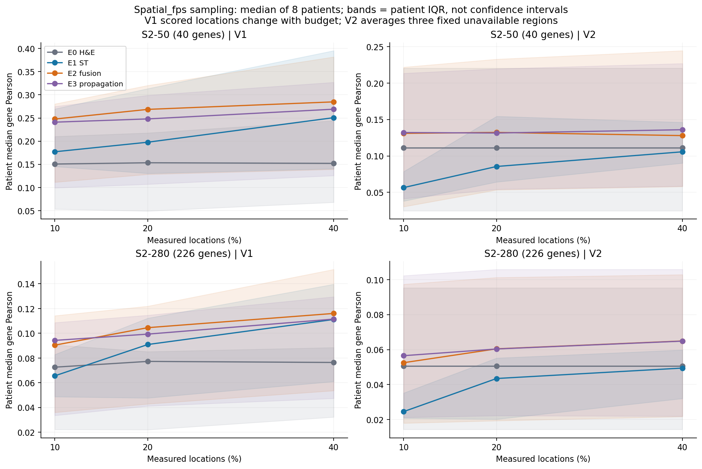

### Regular coverage and MSE

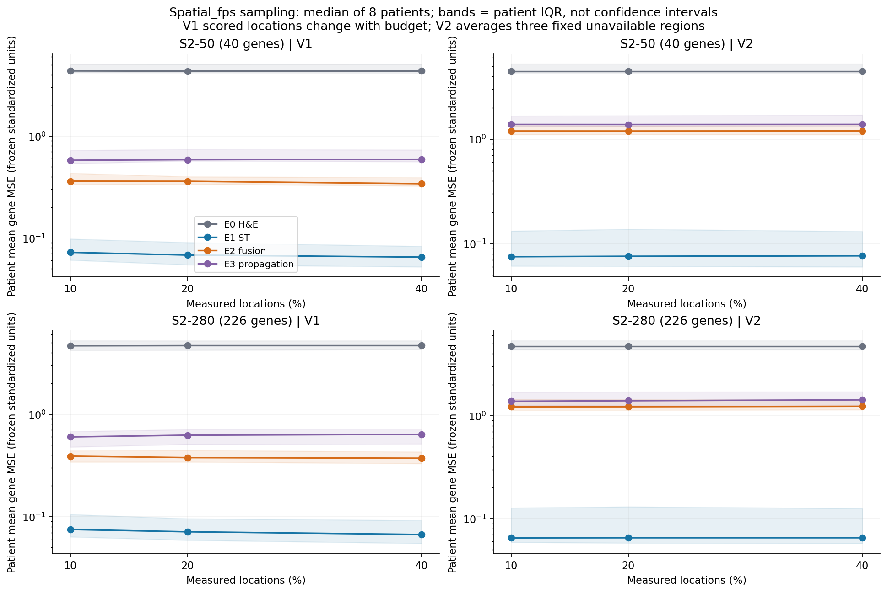

### E0–E3 comparison and V1 versus V2

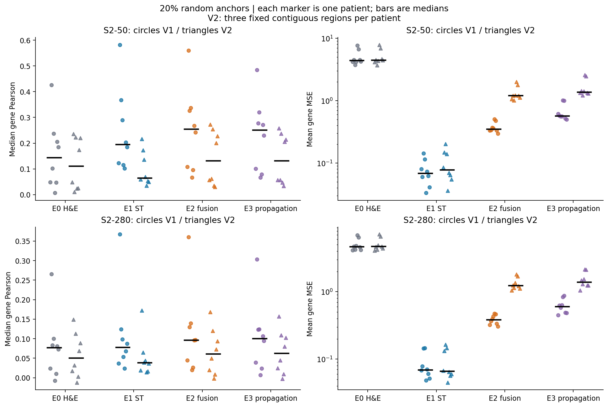

### Distance to anchors

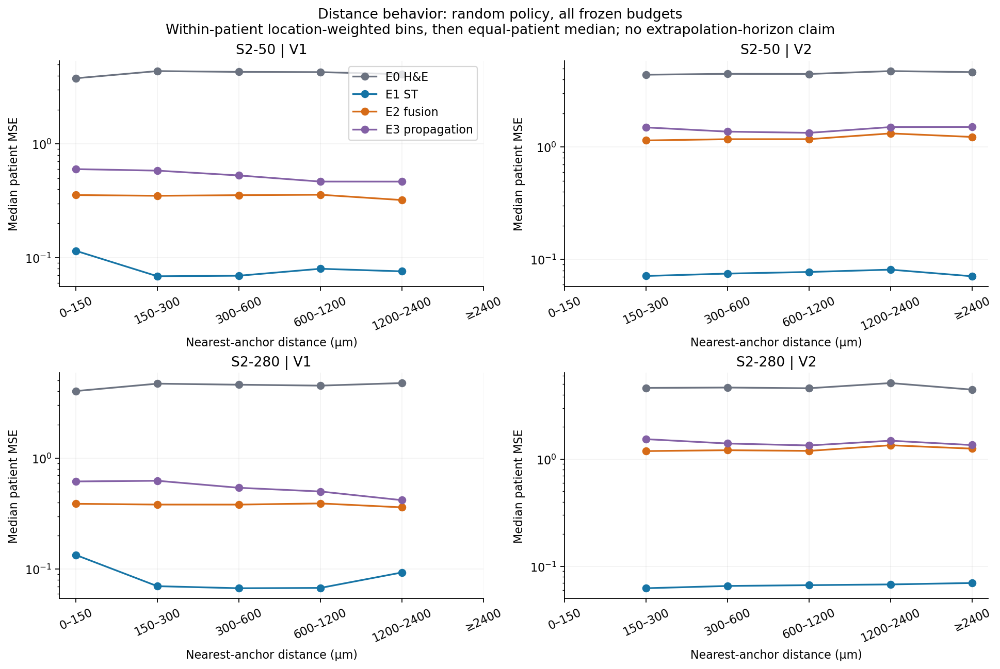

### Primary paired patient effects

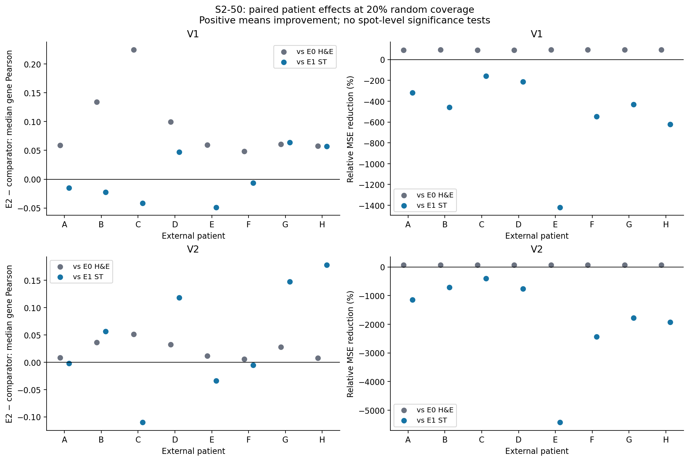

### Secondary paired patient effects

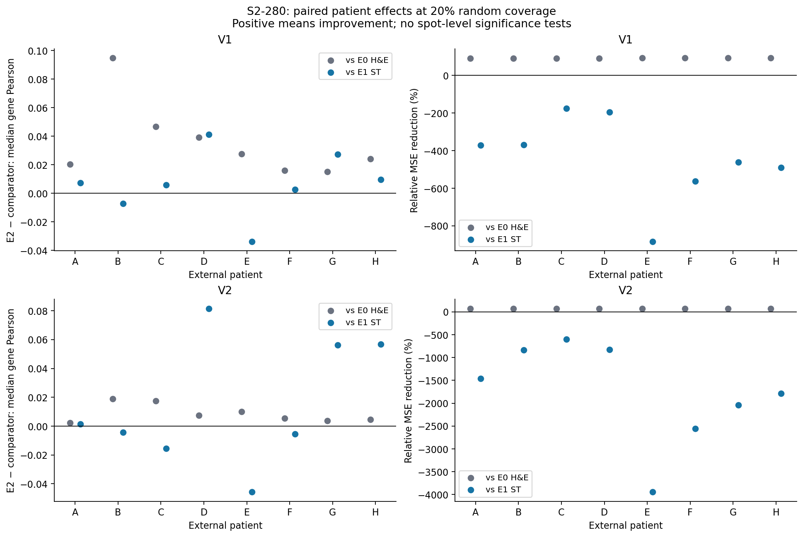

### Development versus external on identical genes

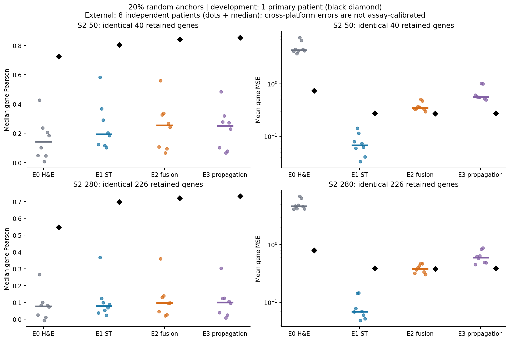
