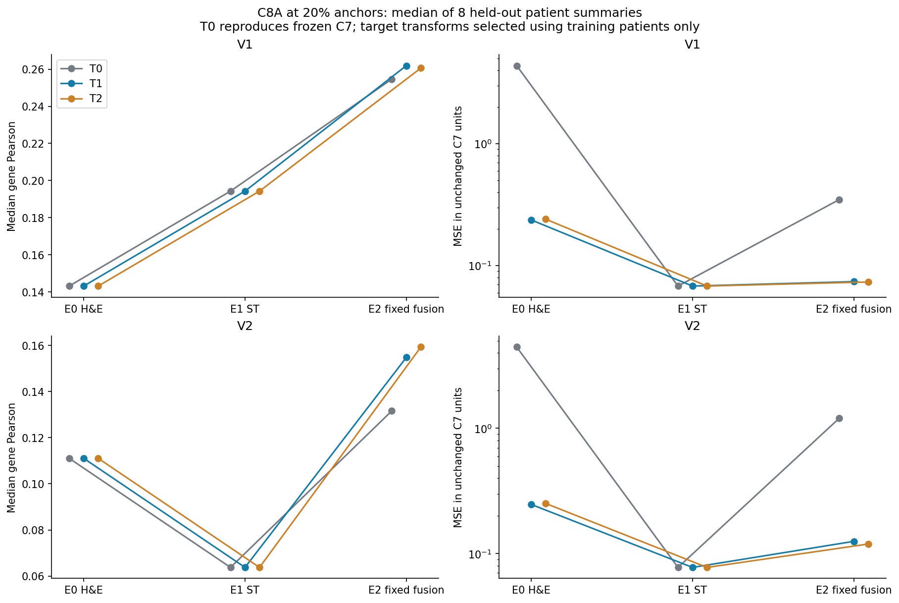
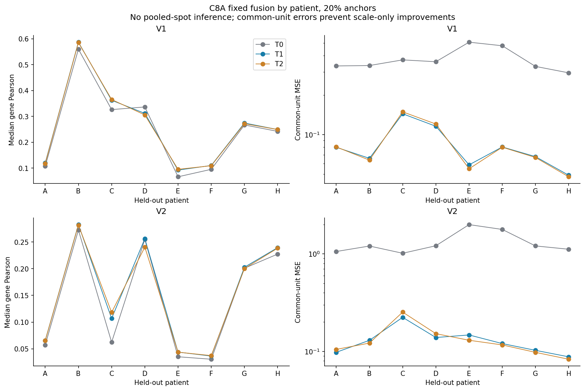
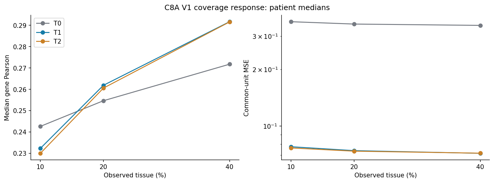
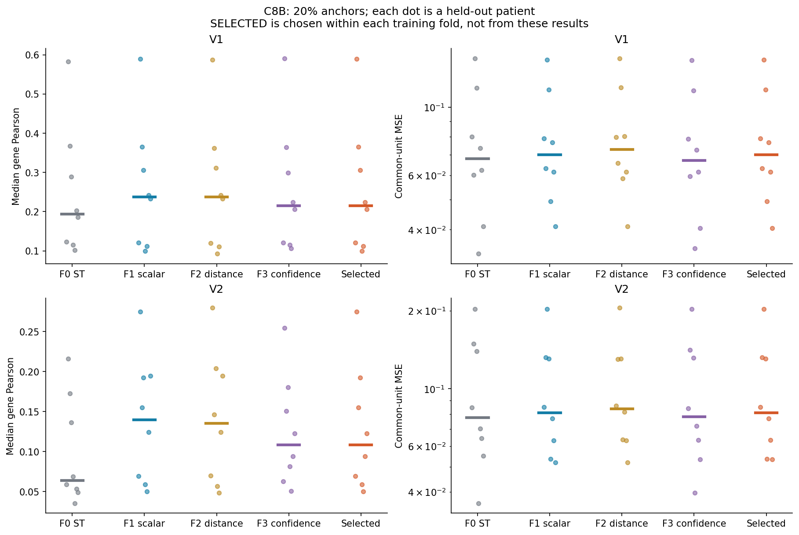
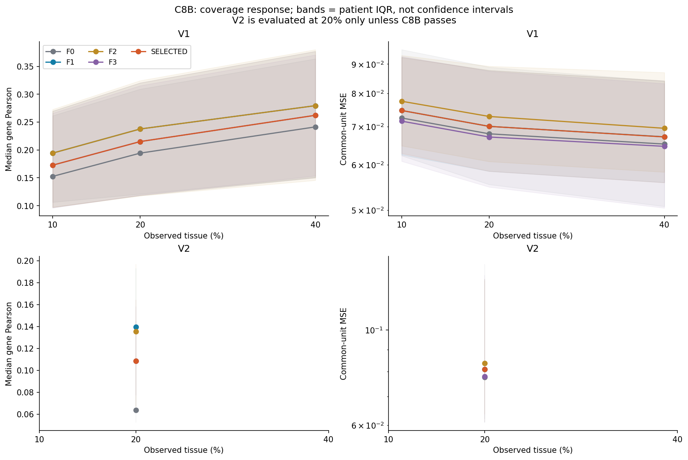
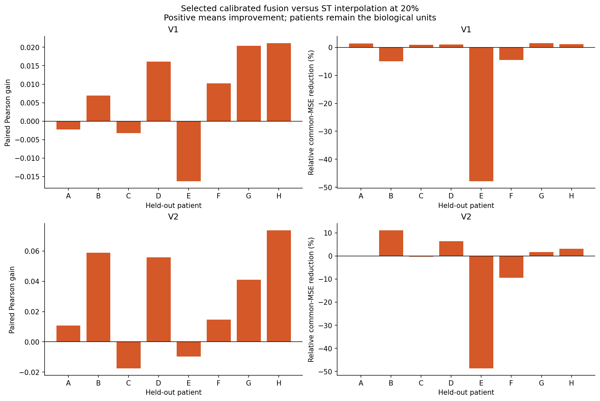
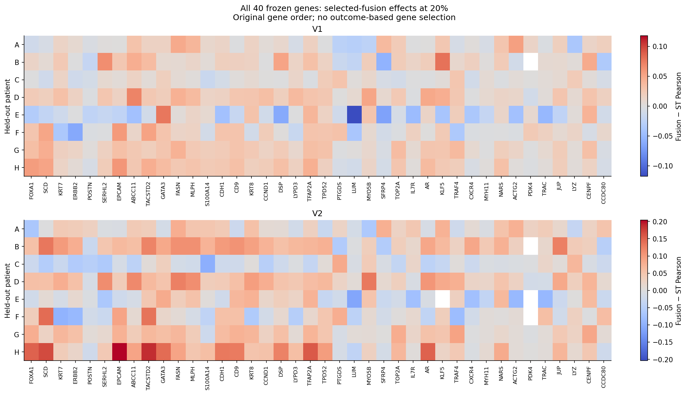
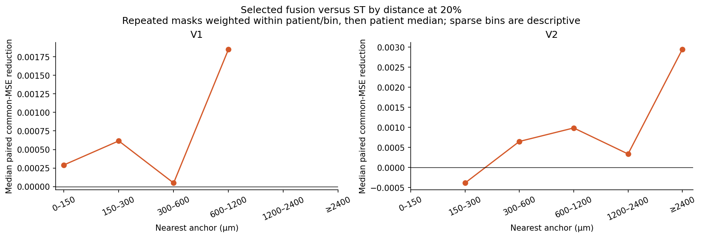
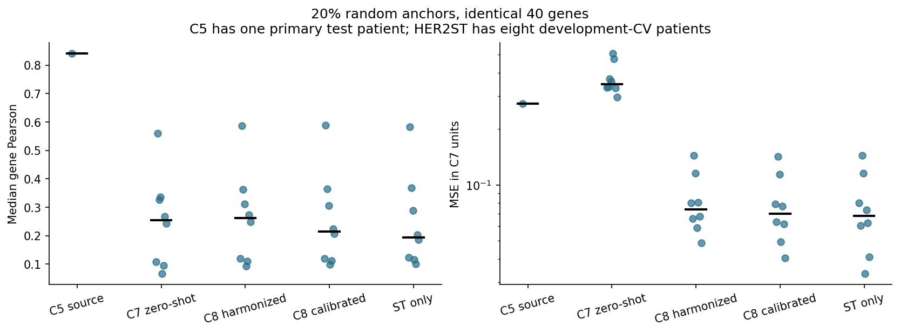

# C8 — Cross-platform target harmonization and fusion calibration

**Overall: MIXED_CROSS_PLATFORM_CALIBRATION. Recommendation: NEED_METHOD_REVIEW.** C8A passed target harmonization; C8B produced mixed fusion calibration and did not meet its frozen pass criteria. **C8C was not run**, as required by the stage gate. C0–C7 remain unchanged, including the exact C7 zero-shot predictions. No later checkpoint or fresh external validation was started.

The central result is a substantial repair of cross-platform scale error, with only modest and heterogeneous evidence that H&E adds value beyond molecular interpolation. At 20% V1 coverage, training-selected calibrated fusion has median patient Pearson **0.21505**, common-unit MSE **0.07004**, and MAE **0.18709**, compared with ST interpolation **0.19431 / 0.06797 / 0.17298**. The median paired Pearson gain is **+0.00856**, and the median paired relative MSE reduction is **0.995%**, but only **3/8** patients jointly improve Pearson with at most 1% MSE harm. **MAE worsens in all eight patients.** These paired effects, not differences of independently computed cohort medians, determine the scientific conclusion.

## Dataset roles, folds and unchanged inputs

HER2ST is now **method-development transportability data**, not a pristine final external cohort. Its outcomes were examined in C7, and the C8 plan explicitly permits calibration development on it. C8's patient-disjoint outer cross-validation evaluates the predefined calibration procedure within this cohort; it cannot erase the earlier development knowledge or substitute for new external validation.

The eight patients and one section each (A1–H1, 3,455 locations) come from the [HER2ST study](https://doi.org/10.1038/s41467-021-26271-2) and [source deposit](https://zenodo.org/records/4751624). Source acquisition/provenance remains frozen under C7. The primary panel is exactly C7's common **40/50 genes**; the optional 226-gene panel was not run so this checkpoint could focus on the calibration question. No missing gene was replaced and no gene was selected using C8 performance.

Four outer folds were fixed by patient IDs before C8 fitting: A/B, C/D, E/F and G/H. Each has six training patients and two held-out patients. Within each six-patient training set, leave-one-patient-out records use scalers fit on the other five patients. The original C0 training patients **NCBI783 and NCBI785** supply source target moments; source validation/test patients TENX95/TENX99 do not fit a C8 transform. Only saved source-test predictions are re-summarized later for descriptive comparison.

Image embeddings, encoder weights, image heads, original C7 panel, interpolation rules and observation masks are read-only. There is no encoder fine-tuning, head refit, learned graph, multiresolution model or sampling search. Sampling is the predeclared **random C7 trajectories only**: ten outer seeds at 10/20/40% V1, three fixed V2 missing-region geometries at 20%. Inner fitting uses seeds 0/1/2 only. V2 excludes all anchors inside each fixed 40% region; every other unobserved label is also withheld from model inputs. V1 target membership changes with coverage; V2 targets remain identical across models for each geometry.

## What harmonization means here

Let `y` and frozen image output `p` be expressed in C7's original C0-standardized log-count units. For each gene, fit source center/scale `(a_s,b_s)` on the original source-training patients and destination center/scale `(a_t,b_t)` on the allowed HER2ST training patients. Then:

```text
image_native  = (p - a_s) / b_s
anchor_native = (y_observed - a_t) / b_t
prediction_common_C7 = a_t + b_t * prediction_native
```

This applies **separate assay-specific scales**, so it genuinely changes the image prediction after inversion. Applying one identical affine transform to targets and predictions would only relabel errors and could not fix the C7 mismatch. All transform/fusion selection and error gates therefore use **inverse-mapped errors in the original C7 units**, alongside Pearson. Native transform MSE/MAE are saved separately but must not be compared numerically across transforms.

- **T0:** exact C7 representation and predictions; identity source/destination maps.
- **T1:** per-gene mean/SD estimated with equal total weight per training patient in each domain. Scales below 1e-8 use 1. Source moments are recomputed from the original two source-training patients under this declared patient-weighting rule; no C0 file is edited.
- **T2:** patient-weighted pooled median/IQR in each domain, using a stable-sort left inverse empirical CDF. IQR below 1e-8 falls back to that domain's training SD, then 1 if needed. Destination fallback occurred for 15, 20, 12 and 13 of 40 genes in folds 0–3; source fallback was zero. The fallback is predefined, never selected from held-out performance.

These positive per-gene affine maps preserve within-sample gene ordering and correlation under simple coordinate conversion. They do not establish assay-equivalent absolute RNA abundance or eliminate between-patient variation. T3 within-sample ranks were omitted because computing full held-out ranks would use hidden expression; T4 was omitted to keep the candidate set small. No held-out patient estimates its own scaler, even from its observed anchors. Anchors are used only for the allowed reconstruction inputs.

## Selection and lock chronology

[C8A_SPEC_LOCK.json](C8A/C8A_SPEC_LOCK.json), SHA-256 `3d087940666ec8c0662fbd241d0d66f234f0a4401ba22c2364dcb501c477fcc0`, seals the complete source implementation, folds, transforms, fusion grids/forms, mask choices, selection rule, gates, original inputs and parent manifest. It was committed as `b75b764` before C8 fitting. All A fold scaler objects and training-only selections were sealed in [FIT_LOCK.json](C8A/FIT_LOCK.json), committed as `5a97385`, before outer A evaluation. After A passed, B calibration objects were sealed in [C8B_SPEC_LOCK.json](C8B/C8B_SPEC_LOCK.json), committed as `d29ed78`, before outer B evaluation. No locked scientific source was altered after external C8 predictions were evaluated.

For selection, average mask seeds/geometries within each inner patient/regime/budget, then the four conditions (V1 at three budgets; V2 at 20%) equally, then the six training patients equally. Maximize mean patient median-gene Pearson; among candidates within **0.005** of the best, choose the lowest **common-unit MSE**, with deterministic ties. A chooses a transform using fixed E2 fusion. B chooses parameters within each fusion family and then a family, including F0, using the same inner-record rule. The selected-per-fold procedure is the primary algorithm; no family was promoted because it looked better on outer patients.

## C8A: target harmonization passed

All four inner selections chose **T1**. With fixed C7 fusion weights (25% image in V1; 50% in V2), primary V1 at 20% improves median paired Pearson by **+0.01372** over T0 and reduces common-unit MSE by **79.99%** (median patient-relative reduction). Seven of eight patients meet the joint harmonization support criterion. Patient common-MSE IQR falls **0.06440 → 0.02519**. All three V1 budgets have nonnegative median Pearson gain and lower MSE. V2's median Pearson gain is **+0.00861**, and all eight patients pass its error safety bound.

20% coverage, medians across eight held-out patient summaries:

| transform   | model   | regime   |   median_pearson |   mean_mse |   common_mse |   common_mae |
|:------------|:--------|:---------|-----------------:|-----------:|-------------:|-------------:|
| T0          | E0      | V1       |          0.14319 |    4.36650 |      4.36650 |      1.93756 |
| T0          | E0      | V2       |          0.11105 |    4.46020 |      4.46020 |      1.95830 |
| T0          | E1      | V1       |          0.19431 |    0.06797 |      0.06797 |      0.17298 |
| T0          | E1      | V2       |          0.06379 |    0.07751 |      0.07751 |      0.19623 |
| T0          | E2      | V1       |          0.25463 |    0.34809 |      0.34809 |      0.51525 |
| T0          | E2      | V2       |          0.13160 |    1.20468 |      1.20468 |      1.00309 |
| T1          | E0      | V1       |          0.14319 |    1.62996 |      0.23699 |      0.35568 |
| T1          | E0      | V2       |          0.11105 |    1.69841 |      0.24668 |      0.36082 |
| T1          | E1      | V1       |          0.19431 |    0.61722 |      0.06797 |      0.17298 |
| T1          | E1      | V2       |          0.06379 |    0.66610 |      0.07751 |      0.19623 |
| T1          | E2      | V1       |          0.26187 |    0.63949 |      0.07388 |      0.19683 |
| T1          | E2      | V2       |          0.15476 |    0.85746 |      0.12519 |      0.26408 |
| T2          | E0      | V1       |          0.14319 |    0.82677 |      0.24038 |      0.33988 |
| T2          | E0      | V2       |          0.11105 |    0.85458 |      0.25130 |      0.33858 |
| T2          | E1      | V1       |          0.19431 |    0.46510 |      0.06797 |      0.17298 |
| T2          | E1      | V2       |          0.06379 |    0.47571 |      0.07751 |      0.19623 |
| T2          | E2      | V1       |          0.26056 |    0.45176 |      0.07341 |      0.18668 |
| T2          | E2      | V2       |          0.15927 |    0.55824 |      0.11923 |      0.24273 |

Native `mean_mse` uses each transform's units; `common_mse` and `common_mae` use unchanged C7 units. T1 reduces H&E-only common MSE substantially without changing its gene-wise correlation, because scale calibration cannot create new spatial information in a frozen image predictor. Molecular interpolation remains effectively identical in common units under these affine transformations, apart from numerical precision.

The held-out target variance is not made uniform: at 20% V1, mean-gene native variance has median/range **0.07438 / 0.03672–0.17203** for T0, **0.63652 / 0.19308–2.59243** for T1, and **0.45019 / 0.12149–2.20531** for T2. T1 held-out mean levels range −0.5074 to +0.9851 in its native units. Training moment alignment therefore leaves substantial patient-specific distribution shift. Exact values are in [C8A_TARGET_SCALE_CONSISTENCY.csv](C8A/C8A_TARGET_SCALE_CONSISTENCY.csv).

The A gate required a non-T0 choice in ≥3 folds, preserved/improved Pearson with ≥10% median MSE reduction at 20%, joint support in ≥6/8 patients, non-increased error IQR, support at ≥2 V1 budgets, and non-catastrophic V2 behavior. All requirements passed. This gate concerns harmonization versus T0, not superiority over ST interpolation.

## C8B: fusion calibration is mixed

F0 is ST interpolation. F1 uses one global scalar image weight per fold, shared across regimes/budgets, from 0.0–1.0 in 0.1 steps. F2 uses nondecreasing image weights in nearest-anchor bins <300, 300–600 and ≥600 µm, with 35 ordered triples from {0,0.1,0.25,0.5,1}. F3 is a five-parameter sigmoid linear gate using log nearest/mean-kNN anchor distances, anchor count within 600 µm and mean gene anchor-disagreement variance. Feature scaling and gate fitting use only the inner out-of-fold training records. Its frozen optimizer minimizes equal-patient/equal-condition common-unit error normalized by the corresponding interpolation error, with fixed regularization. All four optimizers converged and were independently refit exactly.

Selected fold objects:

| fold   | held_out   | target   |   F1_lambda | F2_weights         | selected_family   |
|:-------|:-----------|:---------|------------:|:-------------------|:------------------|
| fold0  | A1,B1      | T1       |     0.20000 | [0.25, 0.25, 0.25] | F1                |
| fold1  | C1,D1      | T1       |     0.20000 | [0.25, 0.25, 0.25] | F1                |
| fold2  | E1,F1      | T1       |     0.20000 | [0.25, 0.25, 0.25] | F1                |
| fold3  | G1,H1      | T1       |     0.10000 | [0.1, 0.1, 0.1]    | F3                |

F2 selected **constant** weights in every fold, so no distance dependence was retained by that candidate family. The primary procedure selects F1 with λ=0.2 for A/B, C/D and E/F, and F3 for G/H. The complete F3 coefficients and feature normalizers are in the hashed calibration JSONs. F4/F5 were not run.

All candidate-family outer summaries are shown for transparency, but only `SELECTED` determines the gate:

| regime   |   budget | model    |   median_pearson |   common_mse |   common_mae |
|:---------|---------:|:---------|-----------------:|-------------:|-------------:|
| V1       |  0.10000 | F0       |          0.15255 |      0.07245 |      0.17718 |
| V1       |  0.20000 | F0       |          0.19431 |      0.06797 |      0.17298 |
| V1       |  0.40000 | F0       |          0.24135 |      0.06523 |      0.17052 |
| V2       |  0.20000 | F0       |          0.06379 |      0.07751 |      0.19623 |
| V1       |  0.10000 | F1       |          0.19430 |      0.07467 |      0.19331 |
| V1       |  0.20000 | F1       |          0.23764 |      0.07004 |      0.18709 |
| V1       |  0.40000 | F1       |          0.27947 |      0.06715 |      0.18243 |
| V2       |  0.20000 | F1       |          0.13967 |      0.08086 |      0.21031 |
| V1       |  0.10000 | F2       |          0.19430 |      0.07749 |      0.19828 |
| V1       |  0.20000 | F2       |          0.23764 |      0.07289 |      0.19607 |
| V1       |  0.40000 | F2       |          0.27947 |      0.06950 |      0.19356 |
| V2       |  0.20000 | F2       |          0.13550 |      0.08364 |      0.21551 |
| V1       |  0.10000 | F3       |          0.17268 |      0.07153 |      0.18317 |
| V1       |  0.20000 | F3       |          0.21506 |      0.06710 |      0.17807 |
| V1       |  0.40000 | F3       |          0.26219 |      0.06464 |      0.17455 |
| V2       |  0.20000 | F3       |          0.10855 |      0.07790 |      0.20229 |
| V1       |  0.10000 | SELECTED |          0.17268 |      0.07467 |      0.19331 |
| V1       |  0.20000 | SELECTED |          0.21506 |      0.07004 |      0.18709 |
| V1       |  0.40000 | SELECTED |          0.26219 |      0.06712 |      0.18243 |
| V2       |  0.20000 | SELECTED |          0.10855 |      0.08086 |      0.21031 |

At 20% V1, selected fusion improves Pearson in **5/8** patients and MSE in **5/8**, but the improving sets differ: only D/G/H improve both. Patient E has **47.90% worse MSE**, and MAE worsens in **8/8**. The median paired relative MSE reduction (+0.995%) coexists with a larger separate cohort-median MSE (0.07004 versus 0.06797); these are distinct summaries, neither should replace the other.

Paired patient effects at 20%:

| sample_id   | regime   |   SELECTED_median_pearson |   F0_median_pearson |   SELECTED_common_mse |   F0_common_mse |   gain_pearson |   relative_mse_reduction |   mae_reduction |
|:------------|:---------|--------------------------:|--------------------:|----------------------:|----------------:|---------------:|-------------------------:|----------------:|
| A1          | V1       |                   0.12058 |             0.12287 |               0.07900 |         0.08011 |       -0.00229 |                  0.01378 |        -0.00825 |
| A1          | V2       |                   0.06950 |             0.05880 |               0.08485 |         0.08478 |        0.01071 |                 -0.00083 |        -0.00830 |
| B1          | V1       |                   0.58936 |             0.58247 |               0.06326 |         0.06027 |        0.00689 |                 -0.04955 |        -0.02345 |
| B1          | V2       |                   0.27491 |             0.21602 |               0.13237 |         0.14891 |        0.05889 |                  0.11109 |        -0.00385 |
| C1          | V1       |                   0.36481 |             0.36803 |               0.14235 |         0.14364 |       -0.00322 |                  0.00899 |        -0.00197 |
| C1          | V2       |                   0.15484 |             0.17244 |               0.20342 |         0.20289 |       -0.01760 |                 -0.00261 |        -0.00136 |
| D1          | V1       |                   0.30568 |             0.28955 |               0.11402 |         0.11528 |        0.01614 |                  0.01092 |        -0.00501 |
| D1          | V2       |                   0.19253 |             0.13667 |               0.13083 |         0.13980 |        0.05586 |                  0.06415 |         0.00379 |
| E1          | V1       |                   0.09921 |             0.11551 |               0.04936 |         0.03337 |       -0.01630 |                 -0.47904 |        -0.06679 |
| E1          | V2       |                   0.05908 |             0.06878 |               0.05370 |         0.03611 |       -0.00970 |                 -0.48719 |        -0.07001 |
| F1          | V1       |                   0.11183 |             0.10159 |               0.07682 |         0.07350 |        0.01024 |                 -0.04525 |        -0.01773 |
| F1          | V2       |                   0.05009 |             0.03535 |               0.07687 |         0.07025 |        0.01474 |                 -0.09433 |        -0.01985 |
| G1          | V1       |                   0.22363 |             0.20323 |               0.06152 |         0.06245 |        0.02040 |                  0.01481 |        -0.00446 |
| G1          | V2       |                   0.09436 |             0.05336 |               0.06333 |         0.06445 |        0.04100 |                  0.01748 |        -0.00574 |
| H1          | V1       |                   0.20648 |             0.18540 |               0.04043 |         0.04092 |        0.02108 |                  0.01199 |        -0.00467 |
| H1          | V2       |                   0.12274 |             0.04905 |               0.05336 |         0.05506 |        0.07370 |                  0.03080 |        -0.00506 |

Frozen V1 budget gates:

|   budget |   median_Pearson_gain |   median_relative_common_MSE_reduction |   joint_improved_patients | supported   |
|---------:|----------------------:|---------------------------------------:|--------------------------:|:------------|
|  0.10000 |               0.00779 |                                0.01884 |                         3 | False       |
|  0.20000 |               0.00856 |                                0.00995 |                         3 | False       |
|  0.40000 |               0.00569 |                               -0.00793 |                         5 | False       |

PASS required median ΔPearson ≥0.01, nonnegative median relative MSE reduction and joint patient support ≥5/8 at at least two budgets; at most 25% of V1 patient–budget settings could have >2% MSE harm. **No budget meets all conditions**, and **9/24 settings (37.5%)** exceed the error-harm limit. At 40%, seven patients improve correlation but only three improve MSE; the median relative MSE change is adverse. The mixed fallback is satisfied because multiple patients have genuine paired correlation/error gains. The exact locked analyzer therefore returns **MIXED_FUSION_CALIBRATION**.

F3 considered across all folds has lower aggregate MSE than the selected procedure in some settings, but selecting it now would use held-out outcomes. It remains a secondary candidate comparison; no post-hoc replacement, grid expansion or tolerance change was made.

## Contiguous extrapolation and distance

At 20% V2, selected fusion has median Pearson **0.10855**, common MSE **0.08086**, MAE **0.21031**, versus interpolation **0.06379 / 0.07751 / 0.19623**. Median paired ΔPearson is **+0.02787** and median relative MSE reduction **0.833%**. Six patients improve correlation, four improve MSE, and only one improves MAE. This is weaker absolute correlation than V1 despite scale calibration. Patient E again has substantial harm (48.72% MSE increase).

By fixed missing-region geometry:

|   geometry |   median_Pearson_gain |   median_relative_MSE_reduction | supported   |
|-----------:|----------------------:|--------------------------------:|:------------|
|          0 |               0.01007 |                        -0.00963 | False       |
|          1 |               0.03311 |                         0.00667 | True        |
|          2 |               0.02473 |                        -0.00862 | False       |

Only **1/3** geometries has both nonnegative median correlation and error improvement, below the required 2/3. C8C's additional V2 10/40% stress runs are therefore **not executed**. This is an intentional stage-gated stop, not missing execution of an authorized unconditional stage.

Distance summaries retain the predeclared C7 bins and equal-patient aggregation after weighting repeated mask incidences within each patient/bin. At 20% V1, median paired MSE reductions are approximately 0.000616 at 150–300 µm, 0.000049 at 300–600 µm and 0.001851 at 600–1200 µm. V2 is adverse at 150–300 µm (−0.000387), positive but small farther away. The V1 <150 µm bin has one patient and six repeated incidences; the farthest V2 bin has six patients. These descriptive, occupancy-confounded results do not validate a distance horizon or establish reliability gating as the source of gains.

## Gene-level evidence

At 20%, average matched-mask gene effects within patient first, then summarize across patients. All 40 genes are retained, with their original order and no outcome-based selection:

| regime   |   positive_median_Pearson_genes |   positive_median_MSE_genes |   both_positive_genes |
|:---------|--------------------------------:|----------------------------:|----------------------:|
| V1       |                              34 |                          29 |                    27 |
| V2       |                              34 |                          31 |                    29 |

Thus 27/40 V1 genes and 29/40 V2 genes have positive median paired correlation **and** common-MSE gains. These are descriptive, not multiplicity-controlled discoveries, and do not override adverse patient-level errors or the frozen gate. Undefined constant-gene correlations remain missing; panel fractions use all 40 genes in the denominator. White heatmap cells indicate undefined correlations, not zero gains. No pathway enrichment, cell-type inference or biological interpretation was performed.

## Negative controls

All eight held-out patients, 20% coverage, seed 0, V1 geometry 0 and V2 geometry 1; F1/F2/F3/selected methods; NC1/NC2/NC3; three control seeds: **576 runs**. NC1 randomly permutes the fitted location-weight vector, preserving its empirical distribution; NC2 permutes distance-derived features across locations; NC3 permutes image predictions while retaining ST and gate inputs.

NC1 is a matched empirical random-weight control. For a constant scalar it is necessarily an identity operation, and cannot test whether that scalar value is optimal. F1 and all selected F2 lookup tables are constant; their NC1/NC2 invariance is expected. Consequently these controls provide limited evidence about global scalar calibration. They must not be reported as a successful degradation test for a quantity that is unchanged.

Median patient changes (each patient first averaged across three control seeds; control minus clean):

| model    | regime   | control   |   Pearson_change |   common_MSE_change |
|:---------|:---------|:----------|-----------------:|--------------------:|
| F1       | V1       | NC1       |          0.00000 |             0.00000 |
| F1       | V1       | NC2       |          0.00000 |             0.00000 |
| F1       | V1       | NC3       |         -0.02126 |             0.00098 |
| F1       | V2       | NC1       |          0.00000 |             0.00000 |
| F1       | V2       | NC2       |          0.00000 |             0.00000 |
| F1       | V2       | NC3       |         -0.05375 |             0.00240 |
| F2       | V1       | NC1       |          0.00000 |             0.00000 |
| F2       | V1       | NC2       |          0.00000 |             0.00000 |
| F2       | V1       | NC3       |         -0.02664 |             0.00119 |
| F2       | V2       | NC1       |          0.00000 |             0.00000 |
| F2       | V2       | NC2       |          0.00000 |             0.00000 |
| F2       | V2       | NC3       |         -0.06130 |             0.00275 |
| F3       | V1       | NC1       |         -0.00165 |             0.00007 |
| F3       | V1       | NC2       |          0.00028 |             0.00000 |
| F3       | V1       | NC3       |         -0.01494 |             0.00036 |
| F3       | V2       | NC1       |         -0.00153 |            -0.00008 |
| F3       | V2       | NC2       |          0.00513 |            -0.00005 |
| F3       | V2       | NC3       |         -0.04070 |             0.00168 |
| SELECTED | V1       | NC1       |          0.00000 |             0.00000 |
| SELECTED | V1       | NC2       |          0.00000 |             0.00000 |
| SELECTED | V1       | NC3       |         -0.01925 |             0.00090 |
| SELECTED | V2       | NC1       |          0.00000 |             0.00000 |
| SELECTED | V2       | NC2       |          0.00000 |             0.00000 |
| SELECTED | V2       | NC3       |         -0.04229 |             0.00168 |

Image permutation reduces selected-method Pearson by **0.01925 in V1** and **0.04229 in V2**, with higher MSE, supporting a location-specific H&E signal. Confidence-gate controls are mixed: F3 distance permutation can improve correlation and slightly improve V2 MSE. The reliability features therefore do not have uniform negative-control support. These controls do not rescue the failed main gate.

## Domain-shift recovery and remaining limitations

For identical 40 genes and 20% V1, the saved C5 source-test fusion Pearson was **0.84091**; C7 zero-shot fusion was **0.25463** (eight-patient median), C8A harmonized fixed fusion **0.26187**, and C8B selected calibrated fusion **0.21505**. Corresponding common-unit MSE values are **0.27352, 0.34809, 0.07388, 0.07004**. Calibration repairs much of the count-scale error but does not recover source-level spatial correlation. Its more conservative image contribution reduces absolute median correlation relative to fixed C7/C8A fusion while producing much lower error. This is not a uniformly better predictor on every metric.

[Development transportability table](C8_DEVELOPMENT_TRANSPORTABILITY.csv) includes patient, transform, method, coverage, regime, Pearson/MSE/MAE and gains over ST/H&E. Source-development rows reuse saved C5 predictions; no parent model rerun. C5 has one primary test patient, whereas HER2ST has eight; C5 contiguous geometry differs from C7/C8 fixed regions. The contrast is descriptive, not a matched cohort experiment. Assay capture area/depth and gene sparsity still differ, so common mathematical units do not establish common measurement calibration.

This remains one small, already examined cohort with overlapping CV training sets and 40 retained genes. A and B selection reuse inner records but outer-patient labels are excluded throughout; reported inner optima are not unbiased test estimates. Neither additional folds nor thousands of spots create additional independent biological patients. No confidence interval treats spots as independent. The known HER2ST cohort cannot later serve as pristine final validation for a revised method. There are no clinical utility, cost savings or whole-transcriptome claims.

## Integrity and reproducibility

The independent audit passed **7,296 prediction-file checks**, including every barcode/mask/scaler/model hash and distance identity; **1,440 T0 predictions exactly match frozen C7**. It rebuilt all **84** outer/inner scaler objects while explicitly forbidding outer-held-out label access, replayed all eight transform/family selections, and independently refit all four F3 gates exactly. **1,248** stratified predictions and gene metrics replayed exactly; **2,496** extra hidden-label corruption comparisons passed, in addition to **14,592** checks recorded across all outer runs. Both stage-fit locks preceded their outer-evaluation access records. There are **11,388** appended registry events, with the prior prefix unchanged.

Counts: 3,888 inner A evaluations; 12 outer scaler-fit events; 4,320 outer A evaluations; 192 fusion candidate-fit events; 2,400 outer B evaluations (including the selected algorithm); 576 negative controls. No C8C outputs are created. Scaler/gating objects, locks, tables, per-run provenance, figures and compressed gene metrics are committed. Large predictions and inner-cache arrays remain local under C8 and are covered by the final manifest. The required plain gene CSV is present locally and has an identical decompressed gzip counterpart in Git. Read-only final verification checks the complete C0–C7 parent chain and C8 artifact hashes.

## Recommendation and stop

**NEED_METHOD_REVIEW.** The next decision should address the residual patient-specific error/MAE harm and whether H&E's modest contribution is reliable enough to justify another method revision. Any revision needs a separately declared training/calibration protocol and subsequent evaluation on a fresh cohort unused in C0–C8. This checkpoint does **not** authorize that next work. C8 is complete at a mixed result and stops for review.

## Figures

### Frozen C7 versus target transforms



### Target transforms for every patient



### Target harmonization coverage response



### Fusion candidates and interpolation versus contiguous regions



### Fusion coverage response; V2 only at permitted 20%



### Paired patient effects



### All 40 genes; white cells have undefined correlation



### Paired fusion gain by distance



### Source-to-HER2ST residual domain shift


