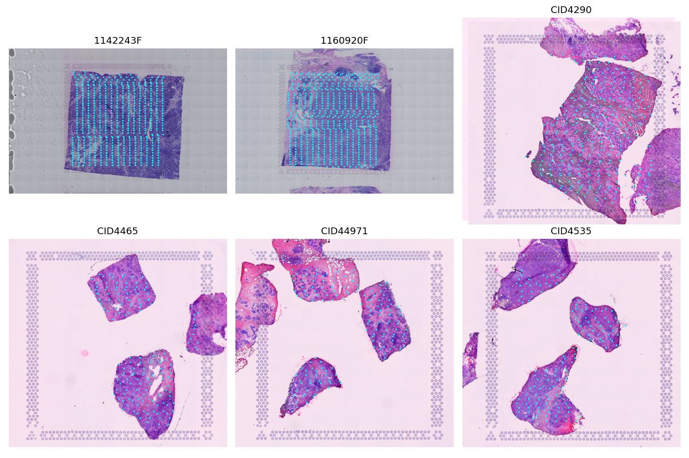

# C9A: fresh external cohort qualification

**LIMITED_FRESH_EXTERNAL_DATASET.** Six distinct patients from the local Visium cohort of [Wu et al. (2021)](https://pmc.ncbi.nlm.nih.gov/articles/PMC9044823/), obtained from the [authors' public deposit](https://zenodo.org/records/4739739). These are not the HER2ST samples separately reanalyzed in the same publication. All 50 original primary genes are present in all six assays; the optional S2-280 intersection is 278 genes and is documented but not evaluated.

| Role | Patients | In-tissue locations |
|---|---|---:|
| Calibration | 1142243F, CID4465, CID4535 | 7,120 |
| Held-out evaluation | 1160920F, CID4290, CID44971 | 8,481 |

The fixed split places one ER-positive local patient, one local TNBC patient and one independently processed TNBC patient in each role. No reconstruction performance or gene-expression matrix values informed this split. Only the published filtered matrix's barcodes and supplied in-tissue flag determine inclusion. Ten source-filtered locations marked off tissue were excluded: six CID4290, two CID4535, two CID44971. No pathology annotations or expression-derived deconvolution outputs are predictors or sampling inputs.

No study or selected-patient identifiers were found in prior tracked project artifacts. Study/patient identities differ from development Xenium, HER2ST, the GSE311609 registration pilot and the 10x Prime diagnostic sample. Available raw-asset SHA-256 values do not match C8-manifest assets. Source MD5 checksums independently verify the downloads. This is provenance-based identity verification, not an assertion of impossible patient reidentification across unrelated anonymized studies. The qualified samples, required fields and source hashes are in `C9A_EXTERNAL_DATASET_MANIFEST.csv`, `logs/DOWNLOADS.json`, `logs/FRESHNESS_AUDIT.json`, and the specification lock.

## Image and coordinate limitation

The public common image set contains 2,000-pixel Space Ranger H&E previews, not native whole-slide images. A 112 micrometer patch has only **15 or 25 native pixels**, resized to the unchanged 224-pixel encoder input. This is a severe image-resolution domain shift and limits the strength of H&E-only/fusion conclusions. The image PDF was downloaded, checksum verified, inventoried and visually inspected. Four patients have similarly sized whole-image views; two have larger tissue crops without a common full-resolution transform. Annotations and PDF crops are not model inputs. No superresolution, new encoder, fine-tuning or outcome-based image choice was used.

The source coordinates were joined to matrix barcodes and visually overlaid on all six H&E images. Physical scale comes from an affine least-squares fit to the documented Visium hexagonal lattice, with 100 micrometer center-to-center pitch ([manufacturer description](https://www.10xgenomics.com/blog/answering-your-questions-about-the-visium-spatial-gene-expression-solution)). Supplied spot-diameter scale estimates differ from lattice estimates, so both are recorded and the lattice calibration is used consistently. Maximum lattice residuals are 0.26-0.65 micrometers; these measure source-coordinate consistency, not independent cellular registration accuracy.

All primary panel gene identifiers are unique exact symbols, with no replacement or alias-based expansion. Published feature/barcode/matrix files misleadingly have `.gz` suffixes but contain plain text. The reader handles the actual format. The frozen target interface remains log1p integer counts and C0 training-only gene means/scales; no external library-size or capture-area correction is introduced. Sequencing Visium capture spots differ materially from development's Xenium bins.

## Prospective validation contract

`C9A_SPEC_LOCK.json` freezes the patient split, all 50 genes in original order, M0-M3, image inputs and parent weights, source calibration identities, random seeds, 10/20/40% coverage, random and label-free spatial FPS sampling, V1 plus three compact V2 geometries, distance bins, metrics and decision criteria. Image features and three-seed frozen MLP predictions were produced without expression-matrix access. The mask and calibration locks must exist before evaluation-patient target access.

The source target transform is C8 T1, fit with equal patient weighting on NCBI783/NCBI785. Destination moments use only the three C9 calibration patients. The single image fusion weight is 0.2. C8 has fold-specific selections, not one final all-patient fitted rule; the plan's recommended fixed scalar is therefore used without C9 selection.

A crucial limitation was declared before outcomes: per-gene affine harmonization commutes with normalized linear ST interpolation. Thus M2 and M1 are identical after mapping back to common units. M2-M1 cannot identify the C8 image-calibration benefit, and numerical roundoff/native-unit error changes cannot count as positive harmonization evidence. The full-PASS harmonization clause is not waived. Sparse-ST support and image-fusion support are assessed separately.
